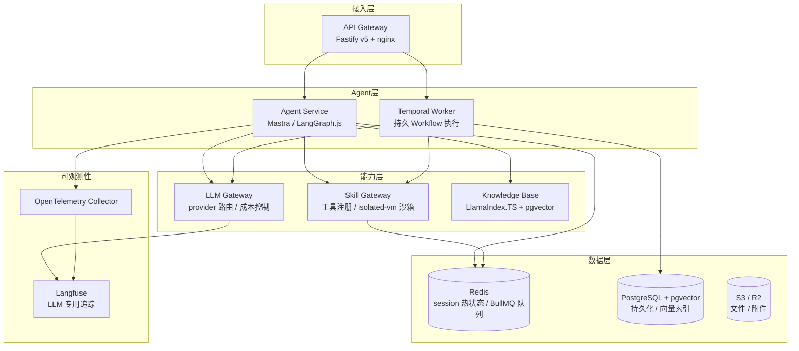
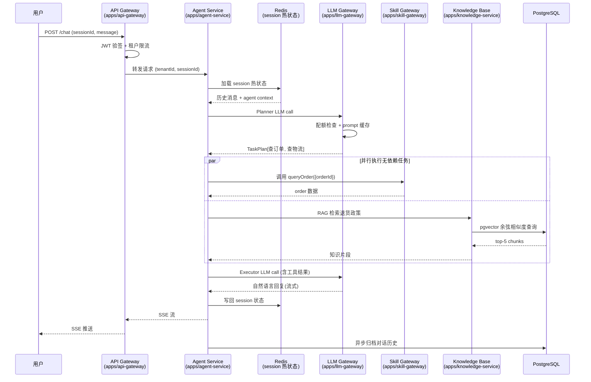

2024 年 3 月，某国内 SaaS 公司把 AI 客服上线。头两周风平浪静，日均 session 不到 5000。第三周，运营推了一波活动，session 峰值跳到 8 万。系统在峰值 20 分钟后开始大面积报 503——不是因为 API 挂了，是因为 agent 的状态全存在单台服务器的内存里，水平扩容加了 3 个 Pod，但 session 状态没法同步，新 Pod 上的 agent 全部无法续上之前的对话。

这个故障的根本原因不是代码写错了，是架构假设从一开始就是错的。那台服务器上的代码在本地测试时完全正常——因为本地测试只有一个进程，session 状态当然在内存里。

本章从这里出发，讨论 AgentFlow 的整体架构设计：规模目标是什么、哪些本地开发的假设在生产环境失效、系统分几层以及每层的职责边界是什么，以及我们为什么选择这套 TypeScript 技术栈。

## 1.1 规模校准：数字背后的真实含义

架构设计的第一步是把目标数字搞清楚。"1M 并发 session"和"50K QPS"这两个数字经常出现在系统设计讨论里，但如果不把它们拆开来看，会得出错误的架构结论。

### Session、QPS 和 LLM Call 的区别

**Session（会话）**指的是一个用户和 agent 之间的对话上下文——从用户打开客服窗口到关闭，期间所有轮次的消息都属于同一个 session。1M session 意味着系统同时维护着 100 万个活跃对话状态，但绝大多数 session 在任意时刻都处于等待状态（用户在想怎么描述问题，或者 agent 在等 LLM 响应）。

**QPS（每秒请求数）**指的是每秒到达 API Gateway 的 HTTP 请求数。50K QPS 是用户侧的请求量——包括发送消息、查询状态、轮询进度。这是流量指标，决定了 API 层需要多少吞吐。

**LLM Call**指的是发向 LLM provider（OpenAI、Anthropic 等）的实际 API 调用。一次用户消息可能触发 5 到 20 个 LLM call：意图识别一次、工具选择一次、工具执行结果解析一到多次、最终回复生成一次，如果中间有 ReAct 循环，每一轮都是一个 LLM call。每个 LLM call 的响应时间在 1 到 5 秒之间（取决于模型和输出长度）。

这三个数字的量级差异很大，需要分开处理。下表把这些关系展示清楚：

| 维度 | 数值 | 说明 |
|------|------|------|
| 总 Session 数 | 1,000,000 | 系统维护的并发对话状态数量 |
| Session 活跃率 | ~1% | 任意时刻，真正在处理请求的 session 比例 |
| 真实并发 Session | ~10,000 | 正在等待 LLM 响应或工具调用的 session |
| 用户侧 QPS | 50,000 | HTTP 请求数，大量是轮询/状态查询 |
| 触发 LLM 的 QPS | ~5,000 | 实际触发 agent 推理的请求（约 10%） |
| 每次推理的 LLM Call | 5–20 次 | 取决于 agent 复杂度和工具调用链长度 |
| LLM 层峰值 RPS | 25,000–100,000 | 发向 LLM provider 的实际请求速率 |
| 单 LLM Call 延迟 | 1–5 秒 | 首 token 时间到流式完成时间 |
| LLM 真实并发连接 | 5,000–10,000 | 同时处于等待 LLM 响应状态的连接数 |

### 关键结论

1M session 听起来吓人，但只有 1% 在任意时刻真正活跃，意味着**状态存储**是主要挑战，而不是计算资源。系统需要高效地存储和检索 100 万份 session 状态，每次活跃 session 的请求都要在毫秒级完成状态加载。

50K QPS 的用户请求中，大部分是轻量操作（查状态、轮询、心跳）。真正触发 agent 推理的约 5K QPS（10% 左右），但每次推理的成本远高于普通 HTTP 请求。

LLM 层的真实并发约 5K-10K 连接——这个数字决定了 LLM Gateway 需要维护多少个持久连接，也是成本控制的核心变量。

**本书的架构目标**：设计一个支持 1M session + 50K 用户侧 QPS 的系统，在 LLM 层保持 5K-10K 真实并发，控制端到端 P99 延迟在 30 秒以内（包含 LLM 响应时间）。

附录 D 给出了基于这套规模假设的真实压测数据（单 API Pod 极限、pgvector p99、各模型 LLM 延迟、端到端 baseline/spike/fault-inject 三类场景），可用作容量规划的对照参考。

## 1.2 本地 Agent vs 生产 Agent：三个失效假设

绝大多数 agent 教程和原型代码有三个隐含假设，在本地运行时从来不会暴露，到了生产环境才会爆炸。

### 假设一：状态在内存里

```typescript
// 本地原型里常见的写法
const sessions = new Map<string, SessionState>();

app.post('/chat', async (req, res) => {
  const { sessionId, message } = req.body;
  // 从内存 Map 里取 session 状态
  const session = sessions.get(sessionId) ?? createNewSession();
  const response = await agent.run(message, session);
  sessions.set(sessionId, response.updatedSession);
  res.json({ reply: response.message });
});
```

本地跑一个进程，`sessions` 这个 Map 一直在内存里，完全正常。

生产环境里，这段代码会在以下任何一种情况下丢失所有 session 状态：Kubernetes 调度器因资源压力重启 Pod、部署新版本时滚动更新、健康检查失败触发重启、进程崩溃（内存溢出、未捕获异常）。

更隐蔽的问题是：即使单个 Pod 没有重启，当流量增加需要水平扩容时，新 Pod 上没有旧 Pod 的 session 数据。负载均衡器把同一个用户的下一条消息路由到了新 Pod，新 Pod 上的 agent 不知道对话上下文，只能从头开始。

| | 本地开发 | 生产环境 |
|---|---|---|
| **状态存储** | 进程内 `Map` | Redis（热数据）+ PostgreSQL（持久化） |
| **重启行为** | 状态丢失无所谓，本地重新测试 | Pod 重启必须恢复完整状态 |
| **水平扩容** | 单进程，不存在多副本 | 多 Pod 共享同一个外部状态存储 |
| **状态大小** | 随便，反正是测试 | 每个 session 状态需要序列化存储，超大状态会影响 Redis 内存 |

生产解法：session 状态必须外置。热数据（当前轮次的上下文、工具调用队列）存 Redis，持久化数据（历史消息、用户偏好、会话元数据）存 PostgreSQL。每次请求进来，先从 Redis 加载 session 状态，处理完成后写回。第 7 章详细讨论状态管理的实现。

### 假设二：失败了重启就好

```bash
# 本地出问题了
Ctrl+C
npm run dev  # 重新开始，从头测
```

本地开发时，agent 执行失败代价是零——Ctrl+C 一下，重新跑，状态清零，重新来过。

生产环境里，这个假设的代价是 LLM API 费用。假设一个 agent 执行一个复杂的工单处理 workflow：用全书主力模型 Claude Sonnet 4.5（input $3 / 1M tokens、output $15 / 1M tokens）跑 4 次调用，每次约 input 2K + output 500 token，单次成本 $0.0135（input $0.006 + output $0.0075），4 次共约 $0.054。执行到第 3 步（第 3 个 LLM call 完成之后）进程崩溃，如果没有 checkpoint 机制，重启只能从头来，前 3 步的 $0.04 直接打水漂。

在 50K QPS 的场景下，假设每天有 0.1% 的 agent workflow 因各种原因中断需要重试，1 天就是 4320 次中断，如果每次重试平均浪费 $0.04，一天就是 $173 的无效 API 支出，一个月 $5K——这部分钱完全是 checkpoint 机制就能省下的。

更大的问题是用户体验：金融租户的一个合规审批 workflow，执行到第 10 步（已经走完了 3 个人工审批节点）时崩溃，如果从头来，需要重新走所有人工审批，不可接受。

| | 本地开发 | 生产环境 |
|---|---|---|
| **失败代价** | 零 | LLM API 费用 + 用户体验损失 |
| **恢复策略** | 重启从头开始 | 从最后一个完成的 checkpoint 恢复 |
| **长运行 workflow** | 不存在 | 可能运行数小时，中间有人工审批节点 |
| **调试方式** | 日志+断点 | 需要分布式追踪 + workflow 可视化 |

生产解法：对需要精确恢复的 workflow（金融租户、多步骤有状态流程），使用 Temporal 的事件溯源机制。Temporal 把每个 Activity 的完成状态持久化，崩溃后从最后一个完成的 Activity 点恢复，不从头。第 3 章讨论 agent 引擎，第 12 章讨论 Temporal 部署。

### 假设三：顺序执行就行

```typescript
// 本地原型：顺序处理，简单直观
while (true) {
  const message = await getNextMessage();
  const response = await agent.process(message); // 等待完成
  await sendResponse(response);
}
```

本地测试，用户一个一个来，顺序处理，逻辑清晰。

生产环境里，50K QPS 意味着每秒有 5K+ 个 agent workflow 同时运行。每个 workflow 的每一步 LLM call 都在等待响应，等待期间占着内存、文件描述符、连接池资源。如果所有 workflow 都同步阻塞等待，Node.js 事件循环会被打满，新请求进不来。

还有一个更底层的问题。KV cache（键值缓存）是 LLM 推理服务器用来加速重复前缀计算的机制。同一个 session 的多次 LLM call 通常有大量重叠的 context（系统提示、历史消息），如果这些 context 已经在 GPU 显存里缓存了，后续调用可以直接复用，首 token 时间从 2 秒缩短到 200ms。

但 KV cache 受 GPU 显存限制，容量有限。当大量并发 session 同时访问时，早先计入 cache 的 session 上下文会被驱逐。一旦被驱逐，下次 LLM call 需要重新生成，时间回到原点。

针对 agent workload 的实测分析表明：**在高并发 agent 场景下，大量 LLM 推理时间消耗在重新生成已被驱逐的 KV cache 上**，在多租户 LLM 服务上这一比例可达 30% 以上。KV cache 感知调度属于推理服务器（vLLM、SGLang 等）层面的工作，本书不自建推理服务，只在 LLM Gateway 层做请求合并和 prompt prefix 复用来缓解这个开销。

| | 本地开发 | 生产环境 |
|---|---|---|
| **并发模型** | 单用户顺序执行 | 50K QPS 并发，每个 workflow 多步异步 |
| **KV cache** | 单用户独占，命中率接近 100% | 多用户竞争，频繁驱逐，命中率可能 <50% |
| **KV cache 失效代价** | 无感知 | 在多租户场景可占推理时间 30%+ |
| **阻塞模型** | 同步阻塞，简单可靠 | 必须异步非阻塞，否则事件循环被打死 |

生产解法：全链路异步非阻塞（Fastify + async handler，BullMQ Worker 处理后台任务，SSE 流式推送结果）。LLM Gateway 层做请求合并和响应缓存（第 4 章）。

## 1.3 整体分层架构

理解了规模目标和失效假设，可以开始讨论整体架构。AgentFlow 分为四层，每层有明确的职责边界：



**接入层（API Gateway）**：Fastify v5 处理所有入站 HTTP/SSE 请求。职责包括：租户认证（JWT 验证、API key 校验）、请求限流（按租户粒度）、路由到对应的 Agent Service 实例。这一层是无状态的，可以水平扩展。第 2 章搭建本地开发环境时引入，第 8 章讨论多租户认证细节，第 10 章讨论限流策略。

**Agent 层**：Agent Service 运行 Mastra 和 LangGraph.js，是业务逻辑的主体。每个入站请求在这里被解析成 agent task，分配给对应的 agent workflow 执行。Temporal Worker 独立运行，负责需要精确 checkpoint 的长运行 workflow（主要是金融租户的合规流程）。Agent 层本身是有状态的（需要加载 session 状态），但状态通过外部存储管理，Pod 重启不影响服务。第 3 章详细展开。

**能力层**：三个独立服务。LLM Gateway 负责把 Agent 层的 LLM 调用路由到正确的 provider，做成本限额检查、请求合并、响应缓存；Skill Gateway 管理工具注册和执行，用 isolated-vm 隔离用户自定义代码；Knowledge Base 提供 RAG 能力，LlamaIndex.TS 处理文档分块和检索，pgvector 做向量存储。第 4、5、6 章分别展开。

**数据层**：Redis 存 session 热状态（当前对话上下文、正在执行的工具调用队列）和 BullMQ 任务队列；PostgreSQL 持久化历史消息、用户数据、租户配置、向量索引；S3/R2 存文件附件和知识库文档。第 7 章详细讨论数据层设计。

**关于消息总线（Kafka/RedPanda）**：在更大规模或需要严格事件溯源、跨地域审计回放的场景，通常会在能力层和外部审计/分析系统之间插一条 Kafka topic，把 LLM 调用、skill 调用、状态变更都作为事件发出去。本书 12 章的 AgentFlow 不引入独立的消息总线——审计日志通过 BullMQ + PostgreSQL 异步落库已经能满足三类租户的需求，引入 Kafka 会显著增加运维复杂度。读到第 11、12 章如果需要扩展到更严苛的合规或多区域部署，可以把 BullMQ 的事件队列替换成 Kafka，这部分留给读者按需扩展。

### 一次请求的完整流转

四层架构的静态视图说明了"谁负责什么"，更直观的是看一次真实请求经过这些层时发生了什么。下图（图 1-2）是用户发一条"查我的订单 #12345"的消息后，请求在各层之间的流转过程：



几个值得留意的点：Planner 和 Executor 是两次独立的 LLM call，中间夹着 Skill / RAG 的并行执行；Redis 在请求开始和结束时被读写两次，但 PG 的写入是异步的——session 在 Redis 里是权威数据，PG 只是归档；KB 检索和 Skill 调用是并行的，依赖 Planner 输出的 `TaskPlan` 标注哪些任务无依赖（详见第 3 章的 P-E-R 实现）。这套流转模型贯穿后续所有章节，建议读到具体组件时回到这张图对照。

## 1.4 TypeScript 技术栈选型

选型的逻辑是：先明确要解决的问题，再选解决这个问题最合适的工具，同时说清楚这个工具带来的约束。以下每个选择都遵循这个逻辑。

### Agent 编排层

#### Mastra

**问题**：TypeScript 生态长期没有生产级 agent 框架。Python 有 LangChain、LangGraph、AutoGen，有完整的 Memory 管理、RAG 集成、工具调用生态。TypeScript 侧只有薄薄的 wrapper 库，要构建完整的 agent 系统，工程师需要自己把十几个零散的 npm 包拼在一起，每个包的接口风格不同，类型定义参差不齐，维护成本很高。

**解决**：Mastra 是第一个真正 TypeScript-native 的生产级 agent 框架。它内置了：
- Memory 管理（基于向量存储的长期记忆，基于滑动窗口的短期上下文）
- RAG pipeline（文档摄入、分块、检索、重排序）
- MCP（Model Context Protocol）支持，可以直接接入 MCP server 上的工具
- OpenTelemetry 集成，agent 执行链路自动上报 trace

这意味着大多数 agent 场景不需要额外集成就能跑起来，减少了"集成地狱"的问题。

**约束**：Mastra 的 Memory 系统在后台会触发 LLM 调用——每次 session 结束时，Mastra 会用 LLM 提炼对话摘要，写入长期记忆。这些调用不会出现在你主动发起的 LLM call 里，如果不监控，会出现"为什么 token 消耗比预期高 20%"的困惑。在成本敏感场景，需要明确关闭或限制这个行为：

```typescript
import { Mastra } from '@mastra/core';

const mastra = new Mastra({
  memory: {
    // 关闭自动摘要，手动控制长期记忆写入
    autoSummarize: false,
    // 或者设置摘要触发的最小对话轮次
    summarizeAfterTurns: 20,
  },
});
```

**适用**：大多数 agent 编排场景，特别是需要快速开发、不需要精确 checkpoint 的业务 agent（电商和 SaaS 租户的客服场景）。

#### LangGraph.js

**问题**：Mastra 的 workflow 是高层抽象，对于需要精确控制状态转换的复杂 pipeline 来说不够强。具体场景：金融租户的合规审批流，有明确的状态机——草稿、等待初级审批、等待终审、执行中、已完成——每个状态转换都需要在特定条件下触发，任意一步失败需要从该步骤恢复，不允许从头重来。

**解决**：LangGraph.js 的 `StateGraph` 模型要求显式声明所有状态节点和转换条件。这个强制约束带来了两个好处：状态机的行为完全可预测，不会出现"agent 自己跑偏了"的情况；内置 checkpoint 支持，在任意节点保存状态快照，崩溃后从最近的 checkpoint 恢复。

```typescript
import { StateGraph, Annotation } from '@langchain/langgraph';

// 显式声明 workflow 状态结构
const WorkflowState = Annotation.Root({
  // 工单 ID
  ticketId: Annotation<string>(),
  // 当前审批阶段
  approvalStage: Annotation<'draft' | 'primary_review' | 'final_review' | 'executing' | 'completed'>(),
  // 审批人列表
  approvers: Annotation<string[]>({
    reducer: (current, update) => [...current, ...update],
  }),
  // 是否通过
  approved: Annotation<boolean | null>({
    default: () => null,
  }),
});

const workflow = new StateGraph(WorkflowState)
  .addNode('submitForReview', submitForReviewNode)
  .addNode('primaryReview', primaryReviewNode)
  .addNode('finalReview', finalReviewNode)
  .addNode('execute', executeNode)
  .addEdge('__start__', 'submitForReview')
  .addConditionalEdges('primaryReview', (state) => {
    if (state.approved === false) return 'rejected';
    return 'finalReview';
  })
  .compile({
    // 配置 checkpoint，每个节点完成后保存状态
    checkpointer: postgresCheckpointer,
  });
```

**约束**：TypeScript 版本（`@langchain/langgraph`）比 Python 版本晚 1-2 个特性周期。2024 年中 Python 版发布的 Subgraph 和 Send API，TypeScript 版到 2024 年底才补齐。如果你的 workflow 依赖最新特性，需要关注 changelog。学习曲线比 Mastra 陡——`StateGraph` 的 `Annotation`、`reducer`、`conditional edge` 这套概念需要一定时间建立心智模型。

**适用**：需要精确 checkpoint 的长运行 workflow，有人工审批节点的合规流程，需要"时间旅行"调试（回放到某个历史状态）的复杂场景。

**决策矩阵**：

| 场景 | 推荐选型 | 理由 |
|------|---------|------|
| 普通问答 + 工具调用 | Mastra | 开发快，内置 Memory/RAG |
| 多步任务，不需要精确恢复 | Mastra | 够用，避免引入 LangGraph 的复杂性 |
| 多步任务，需要从崩溃点恢复 | LangGraph.js | checkpoint 是核心需求 |
| 人工审批节点 | LangGraph.js | `interrupt()` 原语支持 |
| 合规审计，状态机需要可审计 | LangGraph.js | 状态转换可追溯 |

两者可以在同一个服务里共存：Mastra 处理电商和 SaaS 租户的普通 agent，LangGraph.js 处理金融租户的合规 workflow。

### 流式传输

#### Vercel AI SDK

**问题**：LLM 的流式响应（SSE）实现细节繁琐，且不同 provider 的流格式不同。OpenAI 的流是 `data: {...}\n\n` 格式，Anthropic 的是另一套事件类型，AWS Bedrock 又不一样。每次切换或者新增 provider，都要重写流处理逻辑。前端消费流也需要手动处理 EventSource 连接、重连、错误，代码量不少。

**解决**：Vercel AI SDK 提供统一的 `streamText()` API，屏蔽了 provider 差异。后端切换 provider 只需要换 `model` 参数，流格式保持一致。前端用 `useChat()` hook 直接消费，内置重连、加载状态、错误处理。

```typescript
import { streamText } from 'ai';
import { openai } from '@ai-sdk/openai';

// 后端：统一的流式接口
const result = await streamText({
  model: openai('gpt-4o'),
  messages: conversation.messages,
  // 切换到 Anthropic 只需要改这一行
  // model: anthropic('claude-sonnet-4-5'),
});

// 返回标准流式响应
return result.toDataStreamResponse();
```

**约束**：Vercel AI SDK 在 Vercel 平台外使用会损失部分开发体验优化（比如 Vercel 自动处理的 streaming timeout），需要手动配置 Fastify 的 keep-alive 和 SSE timeout。更重要的是：它只是传输层，不替代 agent 编排——`streamText()` 是单次 LLM call，不是 agent loop。AgentFlow 里，Mastra/LangGraph 做编排，AI SDK 做最终结果的流式传输。

### 持久执行

#### Temporal TypeScript SDK

**问题**：agent 执行到第 10 步时进程崩溃，所有状态丢失，之前的 LLM API 费用打了水漂。更严重的是，金融租户的合规 workflow 可能持续数小时（等待人工审批），期间进程必须保持健康，任何崩溃都不能从头来。普通的 try/catch + 重试无法解决这个问题——重试是从头开始，不是从崩溃点继续。

**解决**：Temporal 把 workflow 实现为事件溯源（event sourcing）的。每个 Activity（工作单元，比如调用一次 LLM、发一封邮件）完成后，其结果会被持久化到 Temporal 的 event history。进程崩溃重启后，Temporal Worker 重放 event history，跳过已完成的 Activity，从最后一个未完成的 Activity 继续——这叫"确定性重放"。

```typescript
import { proxyActivities, sleep } from '@temporalio/workflow';
import type * as activities from './activities';

// Workflow 代码：声明式，描述步骤顺序
// Temporal 保证每一步完成后持久化
export async function complianceWorkflow(ticketId: string): Promise<void> {
  const { callLLM, sendApprovalRequest, waitForApproval, executeAction } =
    proxyActivities<typeof activities>({
      startToCloseTimeout: '10 minutes',
      retry: { maximumAttempts: 3 },
    });

  // 第一步：LLM 分析，结果持久化
  const analysis = await callLLM(ticketId);

  // 第二步：发送审批请求
  await sendApprovalRequest(ticketId, analysis);

  // 第三步：等待人工审批（可能等几小时）
  const approved = await waitForApproval(ticketId);

  if (approved) {
    // 第四步：执行操作，前面三步不会因为这里崩溃而重跑
    await executeAction(ticketId, analysis);
  }
}
```

**约束**：Workflow 代码必须是确定性的。不能直接使用 `Math.random()`、`Date.now()`、`setTimeout()`、外部 API 调用——这些必须封装成 Activity，或者使用 Temporal 提供的等价 API（`workflow.sleep()`、`workflow.now()`）。违反确定性会导致重放时行为不一致，产生难以排查的 bug。另外，Temporal 需要运行独立的 server（可以用官方的 Temporal Cloud 托管版，也可以自建），增加了基础设施复杂度。

第 12 章会详细讨论 Temporal server 的部署方案和运维要点。

### 任务队列

#### BullMQ

**问题**：Skill 执行可能耗时很长——爬取网页可能需要 10 秒，调用第三方 API 可能需要 30 秒，生成文档摘要可能需要 1 分钟。如果在 HTTP 请求的生命周期内同步等待这些操作，客户端会超时，服务端连接资源被占满。

**解决**：BullMQ 提供 Redis-backed 的持久任务队列。Skill 执行请求丢进队列，HTTP 立即返回任务 ID，客户端通过 SSE 或轮询获取结果。Worker 独立消费队列，可以水平扩展。支持优先级（金融租户的任务优先级高于其他租户）、延迟任务、定时任务。

```typescript
import { Queue, Worker } from 'bullmq';

const skillQueue = new Queue('skill-execution', {
  connection: { host: 'redis', port: 6379 },
});

// 提交任务，立即返回
const job = await skillQueue.add(
  'execute-skill',
  { skillId, params, tenantId },
  {
    // 金融租户优先级最高
    priority: tenant.tier === 'financial' ? 1 : 10,
    attempts: 3,
    backoff: { type: 'exponential', delay: 1000 },
  }
);

// Worker 独立消费
const worker = new Worker(
  'skill-execution',
  async (job) => {
    // 真正的 skill 执行逻辑
    return await executeSkill(job.data);
  },
  { connection: { host: 'redis', port: 6379 }, concurrency: 20 }
);
```

**约束**：BullMQ 是 at-least-once 语义——任务可能被执行多次（Worker 崩溃后，BullMQ 会在锁过期后自动重新投递该任务）。Skill 实现必须是幂等的，或者通过任务 ID 做去重。这个责任在 Skill 开发者身上，框架层无法强制保证。第 5 章讨论 Skill 系统时会详细说明幂等性约束。

### Skill 沙箱

#### isolated-vm

**问题**：AgentFlow 允许租户上传自定义 Skill 代码（JavaScript/TypeScript）。如果这些代码直接在 Agent Service 进程里运行，有三类风险：一是数据安全，恶意代码可以读取进程内存里其他租户的数据；二是资源滥用，无限循环或大量分配内存会拖垮整个服务；三是服务稳定性，`process.exit()` 或抛出未捕获异常会把整个 Pod 干掉。

**解决**：`isolated-vm` 基于 V8 Isolate 实现沙箱。每个 Skill 运行在独立的 V8 Isolate 里，有独立的堆内存，不共享 prototype chain，无法访问宿主进程的全局对象。冷启动时间 <5ms，足够在请求链路内同步创建。内存限制在创建 Isolate 时配置，超限时 Isolate 被销毁，不影响主进程。

```typescript
import ivm from 'isolated-vm';

// 为每次 skill 执行创建独立 Isolate
const isolate = new ivm.Isolate({
  memoryLimit: 64, // 单位 MB，超限自动销毁
});

const context = await isolate.createContext();
const jail = context.global;

// 只暴露允许的 API，不暴露 process、fs、require 等
await jail.set('fetch', new ivm.Reference(safeFetch));
await jail.set('console', new ivm.Reference(safeConsole));

// 执行 skill 代码，超时后强制终止
const result = await isolate.compileScript(skillCode).run(context, {
  timeout: 5000, // 5 秒超时
});

// 执行完成后销毁 Isolate，释放内存
isolate.dispose();
```

**约束**：`isolated-vm` 的维护者是单人（laverdet），虽然项目活跃但存在单点风险。在企业生产环境，建议在 V8 Isolate 隔离的基础上加一层容器边界防御——把 Skill Worker 放在独立的容器里运行，即使 Isolate 逃逸（理论上可能但极难实现），攻击者也只拿到了一个最小权限容器。`isolated-vm` 不防护侧信道攻击（Spectre 类漏洞），高安全场景需要额外的硬件级隔离。第 9 章安全设计章节会详细讨论纵深防御策略。

### 向量检索

#### pgvector + Drizzle ORM

**问题**：RAG 需要向量检索，但对于刚起步的租户，引入 Qdrant、Weaviate 等专用向量数据库会增加基础设施复杂度——多一个需要部署、监控、备份的组件。

**解决**：pgvector 是 PostgreSQL 的向量扩展，在现有 PostgreSQL 实例上 `CREATE EXTENSION vector` 即可使用。HNSW 索引在 100 万文档级别可以做到 <10ms 的 P99 查询延迟。Drizzle ORM 提供了类型安全的 PostgreSQL 操作，包括向量字段的定义和查询：

```typescript
import { pgTable, text, vector, index } from 'drizzle-orm/pg-core';

// 定义向量表
export const documents = pgTable(
  'documents',
  {
    id: text('id').primaryKey(),
    tenantId: text('tenant_id').notNull(),
    content: text('content').notNull(),
    // 1024 维，对应 voyage-3（全书默认 embedding 模型）
    // 切换到 OpenAI text-embedding-3-small 时改为 1536
    embedding: vector('embedding', { dimensions: 1024 }),
  },
  (table) => ({
    // HNSW 索引，余弦相似度
    embeddingIndex: index('embedding_idx').using(
      'hnsw',
      table.embedding.op('vector_cosine_ops')
    ),
  })
);
```

**约束**：pgvector 在高写入吞吐时会有瓶颈——当向量文档超过 1000 万条，同时有大量并发写入时，PostgreSQL 的 WAL 写入会成为瓶颈，查询 P99 可能超出 50ms。向量维度在建表时固定，后期修改需要重建整张表（包括重新生成所有 embedding），代价很高，因此选择 embedding 模型时需要提前考虑维度稳定性。

#### Qdrant（规模化迁移选项）

当 pgvector 的查询 P99 超过 50ms 时，Qdrant 是推荐的迁移目标。Rust 实现，内存映射存储，高并发向量写入时性能比 pgvector 好一个数量级。迁移时机的判断标准：pgvector 查询 P99 > 50ms，持续超过 72 小时，且已排除索引维护问题。迁移不需要改变 LlamaIndex.TS 的上层代码，只需要替换 vector store 适配器。第 6 章的知识库系统会给出迁移的具体步骤。

### HTTP 框架

#### Fastify v5

**问题**：50K QPS 下，HTTP 框架本身的吞吐会成为瓶颈。Express 在 Node.js 20 上基准测试约 25K-30K RPS（无业务逻辑），有效吞吐只有目标 QPS 的一半左右。另一个问题是 Express 没有内置请求验证，需要手动集成 joi 或 zod，且验证错误格式不统一。

**解决**：Fastify 基于 JSON Schema 的请求验证在编译期生成优化代码，运行时开销极低。内置的 pino logger 比 console.log 快 5-10 倍（异步写入，结构化 JSON）。基准测试在 Node.js 20 上约 47K RPS（无业务逻辑），留有充足余量。类型安全的 schema 定义（配合 TypeBox 或 Zod）让请求/响应结构在编译期就能发现问题。

```typescript
import Fastify from 'fastify';
import { TypeBoxTypeProvider } from '@fastify/type-provider-typebox';
import { Type } from '@sinclair/typebox';

const app = Fastify({ logger: true }).withTypeProvider<TypeBoxTypeProvider>();

// schema 定义同时用于运行时验证和 TypeScript 类型推导
app.post(
  '/chat',
  {
    schema: {
      body: Type.Object({
        sessionId: Type.String(),
        message: Type.String({ minLength: 1, maxLength: 4096 }),
        tenantId: Type.String(),
      }),
      response: {
        200: Type.Object({
          jobId: Type.String(),
          status: Type.Literal('queued'),
        }),
      },
    },
  },
  async (request, reply) => {
    // request.body 完全类型安全，无需手动类型断言
    const { sessionId, message, tenantId } = request.body;
    // ...
  }
);
```

**约束**：Fastify 的插件生态比 Express 小，某些第三方中间件没有原生 Fastify 版本，需要通过 `fastify-plugin` 适配或手动集成。对于 API 服务层，这通常不是问题；如果需要大量第三方 middleware，需要提前评估兼容性。

### 可观测性

#### OpenTelemetry + Langfuse

可观测性层需要解决两类不同的问题，因此用两个工具：

**OpenTelemetry（OTel）**：解决基础设施层的可观测性——HTTP 请求延迟、错误率、数据库查询时间、跨服务链路追踪。OTel 是 vendor-neutral 的标准，数据可以发到任何支持 OTLP 的后端（Jaeger、Grafana Tempo、Datadog）。Mastra 和 LangGraph.js 都内置了 OTel 集成，agent 执行链路自动上报 trace，不需要手动埋点。

**Langfuse**：解决 LLM 层的可观测性——token 消耗、每租户 API 成本、prompt 版本管理、agent 响应质量评分。这些指标在通用 APM 工具里没有，Langfuse 专门为 LLM workload 设计。关键特性：Langfuse 接受 OTLP 格式，可以从同一条 OTel trace 里获取 LLM 专用的指标，不需要额外的 SDK 调用。

```typescript
import { Langfuse } from 'langfuse';
import { trace } from '@opentelemetry/api';

// OTel trace 和 Langfuse trace 共享同一个 trace ID
// 在 Langfuse 里可以看到 LLM 调用，在 Jaeger 里可以看到整个链路
const tracer = trace.getTracer('agent-service');

const span = tracer.startSpan('agent.run', {
  attributes: {
    'tenant.id': tenantId,
    'session.id': sessionId,
  },
});

// Langfuse 自动从 OTel context 读取 trace/span ID
const langfuse = new Langfuse();
const lfTrace = langfuse.trace({
  name: 'agent-run',
  // 与 OTel trace 关联，共享同一个 trace ID
  traceId: span.spanContext().traceId,
  metadata: { tenantId, sessionId },
});
```

第 11 章完整讨论可观测性系统的搭建，包括 alert 规则、成本仪表板、agent 质量评估流水线。

## 1.5 代码仓库结构

AgentFlow 采用 monorepo 结构，用 Turborepo 管理构建和依赖。

```
agentflow/
├── apps/
│   ├── api-gateway/          # Fastify API 网关（第 2、8、10 章）
│   ├── agent-service/        # Mastra + LangGraph agent（第 3 章）
│   ├── llm-gateway/          # LLM 路由和成本控制（第 4 章）
│   ├── skill-gateway/        # 工具注册和沙箱（第 5 章）
│   ├── knowledge-service/    # RAG 和向量检索（第 6 章）
│   └── temporal-worker/      # Temporal workflow worker（第 3、8 章）
├── packages/
│   ├── shared/               # 共享类型定义和工具函数（本章）
│   ├── db/                   # Drizzle schema 和迁移（第 7 章）
│   ├── redis/                # Redis 客户端封装（第 7 章）
│   ├── observability/        # OTel + Langfuse 初始化（第 11 章）
│   ├── auth/                 # JWT 验证和租户鉴权（第 9 章）
│   └── config/               # 环境变量 schema 和加载（第 2 章）
├── infra/
│   ├── docker/               # 本地开发 docker-compose（第 2 章）
│   ├── k8s/                  # Kubernetes 部署配置（第 12 章）
│   └── terraform/            # 云资源配置（第 12 章）
├── turbo.json                # Turborepo 构建图配置
├── package.json              # workspace 根配置
└── tsconfig.base.json        # TypeScript 基础配置
```

**packages 之间的依赖关系**：

```
apps/* 
  → packages/shared（类型定义）
  → packages/observability（OTel 初始化）
  → packages/config（环境变量）

apps/agent-service
  → packages/db
  → packages/redis
  → packages/auth

apps/api-gateway
  → packages/auth
  → packages/redis（限流用）

apps/llm-gateway
  → packages/db（审计日志）
  → packages/observability

apps/skill-gateway
  → packages/db（Skill 注册表）
  → packages/redis（任务队列）
```

每个 `apps/*` 是一个独立部署的服务，可以单独构建和扩缩容。`packages/*` 是内部共享库，不对外部发布，通过 workspace 协议引用：`"@agentflow/shared": "workspace:*"`。

**构建顺序**：Turborepo 根据包依赖图自动确定构建顺序，并行构建没有依赖关系的包。修改 `packages/shared` 会自动触发所有依赖它的 apps 重新构建。

## 对三个租户意味着什么

这章定下来的五层架构和规模假设，对三个租户落到的着力点并不一样。

**租户 A（电商）**：50K QPS 峰值就是这章里 1M session 换算的上界，所有架构决策都要先扛住这条线——单进程内存 session 直接出局，Redis Cluster 必上，Temporal 用来兜底重试。这意味着第 1.4 节里的几乎所有选型对租户 A 都不是"可选项"，是"必选项"。

**租户 B（SaaS 软件）**：QPS 不高，但产品文档每天更新，知识库读写比例和租户 A 完全不同。架构上预留独立的 knowledge-base 服务（而不是嵌进 agent-engine），就是为这类租户的索引重建留出独立扩缩容路径。

**租户 C（金融机构）**：合规要求决定了 LLM Gateway 和 audit 服务必须自托管（不能直接走第三方 SaaS）；私有化部署场景下，整套 monorepo 要能拆出一个最小子集独立交付。这章选 Fastify、Temporal self-hosted、pgvector 而不是托管向量库，本质上都是为给租户 C 留出口子。

## 本章小结

1M session 不等于 1M QPS：状态存储才是主要挑战，真实的 LLM 并发连接只有 5K-10K。本地开发的三个隐含假设——进程内状态、无代价重启、顺序执行——在生产环境分别对应三类故障：水平扩容失效、API 费用浪费、事件循环被打死。AgentFlow 的五层架构针对这三个失效点各自给出了解法：外置状态到 Redis/PostgreSQL、用 Temporal 持久化 workflow 执行、全链路异步非阻塞。技术选型的决策逻辑是：先明确问题，再选工具，同时说清楚约束——后面各章的选型讨论都沿用这个框架。

下一章开始搭建本地开发环境，把这个 monorepo 结构跑起来，并配置好开发阶段所需的所有基础设施（Redis、PostgreSQL、Temporal server）。

---

> 本章来自《百万级 AI Agent 平台架构》开源版 · 作者「递归客」  
> 在线阅读完整书系：[inferloop.dev](https://inferloop.dev)  
> 源码仓库：[github.com/diguike/book-enterprise-agent](https://github.com/diguike/book-enterprise-agent)
