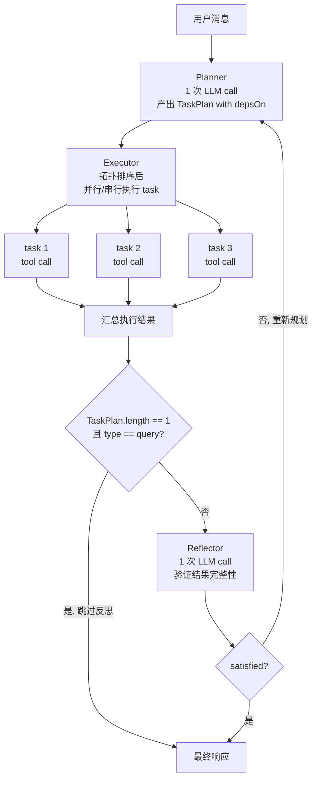
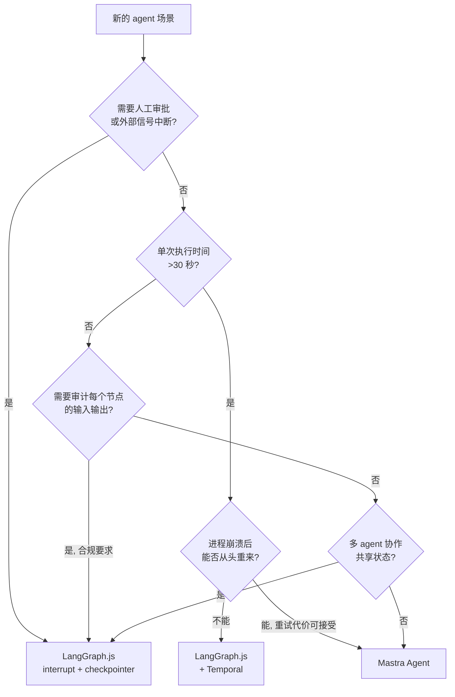

用户发来一条消息："我的订单 #12345 在哪里？"

从这条消息落地到系统，到最终回复"您的包裹已发出，预计明天到达"，中间经过了多少环节？

首先，HTTP 请求到达 Fastify 路由，携带 `sessionId`、`tenantId` 和消息文本。路由层把消息转发给 agent 引擎。agent 引擎先做意图识别——这条消息要查订单，不是要退款也不是要投诉。识别出意图后，agent 决定调用 `queryOrder` 工具，传入订单号 `12345`。工具执行完毕，返回 `{ status: 'shipped', carrier: 'SF Express', trackingNumber: 'SF7890123' }`。agent 再把这个结果传给 `queryShipping` 工具，获取物流详情。最后，把两个工具的返回值组合起来，通过 LLM 生成一段自然语言回复，以 SSE 流式输出给前端。

整个过程涉及：agent 状态管理、工具注册与调用、多步骤编排、流式响应。本章把这些逐一实现。

---

## 3.1 Mastra 核心概念上手

AgentFlow 第一版用过裸 AI SDK——直接调 `streamText`，把工具手动注册进去，系统 prompt 写在一个大字符串里。这个方案在单个 agent 时勉强可用，但一旦需要多租户隔离（每个租户有不同的 system prompt 和工具集）、多 agent 协作、对话历史管理，代码就变成一坨 `if-else`。

Mastra 解决的核心问题是：把"一个可配置的 agent"封装成可复用的类，提供标准化的工具注册、内存管理和运行时接口。它不是对 AI SDK 的替代，而是在 AI SDK 之上加了一层结构化封装。

### Agent：基础单元

```typescript
import { Mastra, Agent } from '@mastra/core';
import { anthropic } from '@ai-sdk/anthropic';
import { queryOrderTool, initiateRefundTool, queryShippingTool } from './tools';

// 电商租户的客服 agent
const ecommerceAgent = new Agent({
  name: 'ecommerce-customer-service',
  // system prompt 会在每次对话开始时注入
  instructions: `你是电商平台的智能客服助手。你的职责是帮助用户查询订单状态、处理退款申请和跟踪物流信息。

处理原则：
- 查询订单时，必须先确认订单号格式（纯数字，6-12位）
- 退款申请超过1000元时，告知用户需要人工审核，预计24小时内处理
- 物流查询结果中，如果显示"已签收"，询问用户是否收到商品
- 用户表达不满时，先表达理解，再给出解决方案

禁止的行为：
- 不能承诺具体的退款时间（退款时间由财务系统决定）
- 不能透露其他用户的订单信息`,
  model: anthropic('claude-sonnet-4-5'),
  tools: {
    queryOrder: queryOrderTool,
    initiateRefund: initiateRefundTool,
    queryShipping: queryShippingTool,
  },
});
```

`instructions` 字段对应 LLM 的 system message。Mastra 在每次 `generate` 或 `stream` 调用时，会把 `instructions` 作为 messages 数组的第一条。工具通过 `tools` 对象注册，key 是工具在这个 agent 内的别名，value 是工具实例。

`Agent` 实例创建之后，通过 `generate` 或 `stream` 方法触发一次对话轮次：

```typescript
// 非流式调用，适合后台批处理
const response = await ecommerceAgent.generate([
  { role: 'user', content: '我的订单 #12345 在哪里？' },
]);
console.log(response.text);

// 流式调用，适合实时对话界面
const stream = await ecommerceAgent.stream([
  { role: 'user', content: '我的订单 #12345 在哪里？' },
]);
for await (const chunk of stream.textStream) {
  process.stdout.write(chunk);
}
```

### Tool：工具调用的最小单元

Mastra 的工具用 `createTool` 创建，核心是三个字段：`id`（工具唯一标识）、`inputSchema`（Zod schema，用于参数校验和 LLM function calling 的 JSON Schema 生成）、`execute`（实际执行逻辑）。

```typescript
import { createTool } from '@mastra/core/tools';
import { z } from 'zod';

export const queryOrderTool = createTool({
  id: 'query-order',
  description: '根据订单ID查询订单状态和基本信息。输入订单ID，返回状态、金额、收货地址。',
  inputSchema: z.object({
    orderId: z.string().describe('订单ID，纯数字格式，例如：12345'),
  }),
  execute: async ({ context }) => {
    const { orderId } = context;
    // 实际项目中这里调用内部订单系统 API
    // 本示例用 mock 数据模拟
    const mockOrders: Record<string, object> = {
      '12345': {
        orderId: '12345',
        status: 'shipped',           // 已发货
        amount: 299.00,
        createdAt: '2024-03-10',
        carrier: 'SF Express',
        trackingNumber: 'SF7890123456',
        address: '北京市朝阳区某某街道',
      },
      '67890': {
        orderId: '67890',
        status: 'processing',        // 处理中
        amount: 1299.00,
        createdAt: '2024-03-12',
        carrier: null,
        trackingNumber: null,
        address: '上海市浦东新区某某路',
      },
    };

    const order = mockOrders[orderId];
    if (!order) {
      return { error: `订单 #${orderId} 不存在` };
    }
    return order;
  },
});
```

`description` 字段会原文传给 LLM，用于 function calling 时的工具选择决策。写得越精确，LLM 选错工具的概率越低。`inputSchema` 会被 Mastra 自动转换为 JSON Schema，作为 function 定义传给 LLM。

`execute` 函数接收 `{ context, mastra, threadId }` 三个参数。`context` 是经过 Zod 校验后的输入对象，类型安全。`mastra` 是 Mastra 实例，工具内部可以通过它访问其他 agent 或服务。`threadId` 是当前会话 ID，可以用于日志追踪。

### Memory：对话记忆

Mastra 内置了 `Memory` 模块，处理对话历史的存储和检索。默认配置下，它把每轮对话的 messages 存入数据库，下次对话时自动拉取历史记录注入 context。

> Memory 的 PostgreSQL 后端依赖独立的包：`npm install @mastra/memory @mastra/pg`。

```typescript
import { Memory } from '@mastra/memory';
import { PgVector, PostgresStore } from '@mastra/pg';

// 使用 PostgreSQL 持久化记忆（生产必须）
const memory = new Memory({
  // 存储后端：对话历史存 PostgreSQL
  storage: new PostgresStore({
    connectionString: process.env.DATABASE_URL!,
  }),
  // 向量后端：语义检索用 pgvector
  vector: new PgVector(process.env.DATABASE_URL!),
  options: {
    // 保留最近 20 条消息（超出的部分通过语义检索补充）
    lastMessages: 20,
    // 语义检索：召回最相关的 5 条历史消息
    semanticRecall: {
      topK: 5,
      messageRange: { before: 2, after: 1 },
    },
  },
});
```

`Memory` 有一个不容易注意到的行为：`semanticRecall` 开启后，每次对话会在后台触发一次额外的 embedding 模型调用（把当前消息向量化），用于从历史中检索相关记录。这个调用不计入主对话的 token 用量，但有实际的 API 调用成本和延迟（通常 100-300ms）。如果对话场景的历史关联性不强（比如每次都是独立的查询），可以只开 `lastMessages`，关掉 `semanticRecall`。

多租户场景下，Memory 必须按 `tenantId` 和 `userId` 隔离。Mastra 通过 `threadId` 区分不同会话。约定 `threadId` 的格式为 `{tenantId}:{userId}:{sessionId}`，确保不同租户的记忆数据在同一个数据库表里也不会混淆：

```typescript
// 生成隔离的 threadId
function buildThreadId(tenantId: string, userId: string, sessionId: string): string {
  return `${tenantId}:${userId}:${sessionId}`;
}

// 调用时传入 threadId
const response = await ecommerceAgent.generate(
  [{ role: 'user', content: userMessage }],
  {
    resourceId: userId,           // Mastra 用于标识用户
    threadId: buildThreadId(tenantId, userId, sessionId),
  }
);
```

> **生产注意**：Mastra 的 `Memory` 默认使用 LibSQL（SQLite 兼容）作为存储后端。开发环境可以用，生产环境必须换成 `PostgresStore`。LibSQL 不支持多进程并发写入，多 Pod 部署时会出现写入冲突。

### Memory 的隔离问题

在多租户 SaaS 平台上，最容易踩的坑是跨租户的数据泄露。这不只是安全问题，也是功能正确性问题：如果租户A的用户历史对话出现在租户B的 agent 上下文里，agent 会给出完全错误的回答。

Mastra 的 `threadId` 是隔离的核心机制。同一个 `threadId` 下的所有对话共享记忆；不同 `threadId` 的对话完全隔离。所以 `threadId` 的命名必须包含租户信息：

```typescript
// 错误：只用 sessionId，不同租户可能碰撞
const threadId = sessionId;

// 正确：包含 tenantId，彻底隔离
const threadId = `${tenantId}:${userId}:${sessionId}`;
```

除了 `threadId`，还需要注意数据库层的隔离。Mastra Memory 默认把所有租户的数据存在同一张表里，只通过 `threadId` 区分。如果数据库遭到 SQL 注入或权限配置失误，一个租户可以查到另一个租户的对话历史。

更严格的隔离方案是每个租户使用独立的数据库 schema 或 database，但实现成本更高。AgentFlow 采用的方案是：单库多表隔离 + 应用层严格的 `tenantId` 过滤 + 数据库 Row Level Security（RLS）。第8章（多租户架构）会详细说明。

### Workflow：线性编排

Mastra 内置的 `Workflow` 适合描述固定步骤的线性流程——每个步骤是一个函数，步骤之间可以传递数据，支持分支和循环，但不支持持久化 checkpoint（执行中断后无法恢复）。

```typescript
import { createWorkflow, createStep } from '@mastra/core';
import { z } from 'zod';

// 步骤1：意图分类
const classifyIntentStep = createStep({
  id: 'classify-intent',
  inputSchema: z.object({ message: z.string() }),
  outputSchema: z.object({
    intent: z.enum(['query_order', 'refund', 'shipping', 'other']),
    orderId: z.string().optional(),
  }),
  execute: async ({ inputData }) => {
    // 实际项目中调用 LLM 做意图分类
    // 这里用简单规则模拟
    const message = inputData.message;
    const orderMatch = message.match(/#(\d+)/);
    const orderId = orderMatch ? orderMatch[1] : undefined;

    if (message.includes('在哪') || message.includes('物流') || message.includes('快递')) {
      return { intent: 'shipping', orderId };
    }
    if (message.includes('退款') || message.includes('退货')) {
      return { intent: 'refund', orderId };
    }
    if (orderId) {
      return { intent: 'query_order', orderId };
    }
    return { intent: 'other' };
  },
});

// 步骤2：执行订单查询
const executeOrderQueryStep = createStep({
  id: 'execute-order-query',
  inputSchema: z.object({
    intent: z.string(),
    orderId: z.string().optional(),
  }),
  outputSchema: z.object({ result: z.any() }),
  execute: async ({ inputData }) => {
    if (!inputData.orderId) {
      return { result: { error: '未识别到订单号' } };
    }
    // 调用订单查询逻辑
    return { result: { orderId: inputData.orderId, status: 'shipped' } };
  },
});

// 组合成 workflow
const orderQueryWorkflow = createWorkflow({
  id: 'order-query',
  inputSchema: z.object({ message: z.string() }),
  outputSchema: z.object({ result: z.any() }),
})
  .then(classifyIntentStep)
  .then(executeOrderQueryStep)
  .commit();
```

Mastra Workflow 适合步骤固定、执行时间短（< 30 秒）、不需要人工介入的场景。退款审批、合规报告生成等需要持久化和人工节点的场景，需要 LangGraph.js，在 3.3 节详细说明。

---

## 3.2 Planner-Executor-Reflector 三层模型

单层 agent 的问题在执行复杂任务时会暴露：收到用户消息后，agent 直接进入 ReAct 循环，每次调用工具后决定"下一步做什么"，是典型的贪心决策。

这在简单查询上没问题。但如果用户说"帮我退款，顺便查一下我还有哪些待发货的订单"，agent 在执行退款中途可能忘记还有查询任务，或者退款失败后不知道是否应该继续查询，还是先告知退款失败。

Planner-Executor-Reflector（P-E-R）模型把这个问题拆成三个职责：

- **Planner**：接收用户意图，输出有序的子任务列表（`TaskPlan[]`），在执行开始前把全局规划确定下来
- **Executor**：逐个执行子任务，每个子任务对应一次 tool 调用或 agent 调用，独立子任务可以并行
- **Reflector**：拿到所有执行结果后，判断结果是否满足用户的原始意图，决定是返回、重试还是重新规划

数据流如下（图 3-1，Planner-Executor-Reflector 三层数据流）：



跳过 Reflector 的逻辑（`shouldSkipReflector`）在 `examples/src/planner-executor.ts` 的主函数里——单 task 且为只读操作时直接返回 Executor 结果，省一次 LLM 调用。重新规划路径在生产中要设上限（通常 2 次），防止 Reflector 与 Planner 互相不满意时陷入死循环。

Reflector 是额外一次 LLM call，有成本。对于简单查询（意图明确、步骤单一），可以跳过 Reflector，直接返回 Executor 的结果。判断标准：Planner 产出的 `TaskPlan[]` 长度为 1，且 task 类型为 `query`（只读操作），跳过 Reflector。

### 实现

```typescript
import { Agent } from '@mastra/core';
import { generateObject } from 'ai';
import { anthropic } from '@ai-sdk/anthropic';
import { z } from 'zod';

// 子任务的数据结构
interface TaskPlan {
  id: string;
  description: string;    // 对 Executor 的自然语言说明
  tool?: string;          // 对应的 tool id（可选，有些 task 不需要 tool）
  params?: Record<string, unknown>;  // tool 的入参（Planner 预填，Executor 可覆盖）
  dependsOn?: string[];   // 依赖的其他 task id（有依赖的 task 不能并行）
  type: 'query' | 'mutation';        // 只读 or 写操作
}

interface TaskResult {
  taskId: string;
  success: boolean;
  data?: unknown;
  error?: string;
}

interface SessionContext {
  tenantId: string;
  userId: string;
  sessionId: string;
}

interface AgentResponse {
  text: string;
  tasks: TaskResult[];
  plannerTokens: number;
  reflectorTokens: number;
}

// Planner：把用户消息分解为子任务列表
async function runPlanner(
  userMessage: string,
  availableTools: string[],
): Promise<{ plans: TaskPlan[]; usage: { inputTokens: number; outputTokens: number } }> {
  const result = await generateObject({
    model: anthropic('claude-sonnet-4-5'),
    system: `你是任务规划器。根据用户消息，把任务分解为有序的子任务列表。
可用工具：${availableTools.join(', ')}

规则：
- 每个子任务对应一个具体操作
- 如果子任务 B 依赖子任务 A 的结果，在 dependsOn 中声明
- 只读操作标记 type: query，写操作标记 type: mutation
- 任务越细粒度越好，但不要过度拆分（不超过5个子任务）`,
    prompt: userMessage,
    schema: z.object({
      plans: z.array(
        z.object({
          id: z.string(),
          description: z.string(),
          tool: z.string().optional(),
          params: z.record(z.unknown()).optional(),
          dependsOn: z.array(z.string()).optional(),
          type: z.enum(['query', 'mutation']),
        })
      ),
    }),
  });

  return {
    plans: result.object.plans,
    usage: {
      inputTokens: result.usage.promptTokens,
      outputTokens: result.usage.completionTokens,
    },
  };
}

// Executor：执行单个 task
async function executeTask(
  task: TaskPlan,
  agent: Agent,
  previousResults: Map<string, TaskResult>,
): Promise<TaskResult> {
  try {
    // 把依赖 task 的结果注入到当前 task 的 prompt 中
    const dependencyContext = task.dependsOn
      ?.map((depId) => {
        const dep = previousResults.get(depId);
        return dep ? `${depId} 的结果：${JSON.stringify(dep.data)}` : '';
      })
      .filter(Boolean)
      .join('\n');

    const prompt = dependencyContext
      ? `${task.description}\n\n相关上下文：\n${dependencyContext}`
      : task.description;

    const response = await agent.generate([{ role: 'user', content: prompt }]);

    return {
      taskId: task.id,
      success: true,
      data: response.text,
    };
  } catch (err) {
    return {
      taskId: task.id,
      success: false,
      error: err instanceof Error ? err.message : String(err),
    };
  }
}

// Reflector：验证执行结果是否满足用户意图
async function runReflector(
  userMessage: string,
  plans: TaskPlan[],
  results: TaskResult[],
): Promise<{ satisfied: boolean; feedback: string; usage: { inputTokens: number; outputTokens: number } }> {
  const resultSummary = results
    .map((r) => `- ${r.taskId}: ${r.success ? '成功' : '失败'} | ${JSON.stringify(r.data || r.error)}`)
    .join('\n');

  const reflectResult = await generateObject({
    model: anthropic('claude-sonnet-4-5'),
    system: '你是结果验证器。判断任务执行结果是否完整满足用户的原始意图。',
    prompt: `用户原始消息：${userMessage}

执行计划：${plans.map((p) => p.description).join('; ')}

执行结果：
${resultSummary}

请判断结果是否满足用户意图，并给出简短说明。`,
    schema: z.object({
      satisfied: z.boolean().describe('结果是否完整满足用户意图'),
      feedback: z.string().describe('说明原因，如果不满足请指出缺少什么'),
    }),
  });

  return {
    satisfied: reflectResult.object.satisfied,
    feedback: reflectResult.object.feedback,
    usage: {
      inputTokens: reflectResult.usage.promptTokens,
      outputTokens: reflectResult.usage.completionTokens,
    },
  };
}

// 主函数：串联三层
export async function runPlannerExecutorReflector(
  agent: Agent,
  userMessage: string,
  _context: SessionContext,
  availableTools: string[],
): Promise<AgentResponse> {
  // 第一层：Planner 分解任务
  const { plans, usage: plannerUsage } = await runPlanner(userMessage, availableTools);

  // 判断是否跳过 Reflector（简单查询任务）
  const shouldSkipReflector =
    plans.length === 1 && plans[0].type === 'query';

  // 第二层：Executor 并行执行无依赖的任务，串行执行有依赖的任务
  const results: TaskResult[] = [];
  const resultMap = new Map<string, TaskResult>();

  // 拓扑排序：按依赖关系分层
  const executed = new Set<string>();
  let iterations = 0;
  const maxIterations = plans.length + 1;

  while (executed.size < plans.length && iterations < maxIterations) {
    iterations++;
    // 找出所有依赖已满足、尚未执行的 task
    const readyTasks = plans.filter((task) => {
      if (executed.has(task.id)) return false;
      if (!task.dependsOn || task.dependsOn.length === 0) return true;
      return task.dependsOn.every((dep) => executed.has(dep));
    });

    if (readyTasks.length === 0) break; // 防止循环依赖死锁

    // 并行执行这一批 ready 的 tasks
    const batchResults = await Promise.all(
      readyTasks.map((task) => executeTask(task, agent, resultMap))
    );

    for (const result of batchResults) {
      results.push(result);
      resultMap.set(result.taskId, result);
      executed.add(result.taskId);
    }
  }

  // 第三层：Reflector 验证结果（简单查询跳过）
  let reflectorUsage = { inputTokens: 0, outputTokens: 0 };
  if (!shouldSkipReflector) {
    const reflection = await runReflector(userMessage, plans, results);
    reflectorUsage = reflection.usage;

    if (!reflection.satisfied) {
      // 结果不满足时，这里可以触发重新规划
      // 生产中需要设置最大重试次数（通常 2 次），防止无限循环
      console.warn(`Reflector 判定结果不满足：${reflection.feedback}`);
    }
  }

  // 汇总所有 task 结果，生成最终回复
  const successResults = results.filter((r) => r.success).map((r) => r.data);
  const finalText = successResults.join('\n');

  return {
    text: finalText,
    tasks: results,
    plannerTokens: plannerUsage.inputTokens + plannerUsage.outputTokens,
    reflectorTokens: reflectorUsage.inputTokens + reflectorUsage.outputTokens,
  };
}
```

P-E-R 模型增加了 2 次固定的 LLM call（Planner + Reflector），每次约 500-1000 tokens。对于每秒处理 100 条消息的系统，额外成本是可测量的。在实际部署中，可以按任务复杂度动态决定是否启用：简单意图（单工具调用）走普通 agent，复杂意图（多步骤、跨系统）才走 P-E-R。

### Executor 的并行策略

Executor 的拓扑排序实现值得多说几句。传统的 DAG 执行引擎通常做完整的 Kahn 算法（入度计数 + 队列），但在 agent 场景下，任务数量很少（通常 3-5 个），完整的拓扑排序反而引入不必要的复杂度。上面代码用的方案更直接：每轮扫描找出所有依赖已满足的任务，并行执行这一批，重复直到所有任务完成。

这个方案的时间复杂度是 O(n²)，但 n 很小（≤ 5），不是性能瓶颈。真正的性能考量是 LLM call 的并发数：把没有依赖关系的任务并行发出，可以把总执行时间从串行的 `n * T_llm` 降到 `depth * T_llm`（depth 是依赖链最长的那条路径上的层数）。

比如用户说"退款订单 #12345，并查询 #67890 的状态"，这两个任务互相独立，并行执行只需要 1 个 LLM round-trip，而串行需要 2 个。在 LLM 响应时间 2-3 秒的情况下，节省的时间对用户是可感知的。

> **生产注意**：并行发出多个 LLM call 时，需要注意 API 的并发限制。Anthropic API 的默认并发上限是每个 API key 每分钟 60 次请求。在高负载下，P-E-R 的并行 Executor 可能触发限速。第4章（LLM Gateway）会处理这个问题，在 agent 和 provider 之间加一层令牌桶限流。

---

## 3.3 Mastra vs LangGraph.js：决策树

两个框架在适用场景上有明确的边界，混用会产生不必要的复杂度。

Mastra 的核心是 `Agent` 类和 tool 注册机制——它把"一个会用工具的 LLM"封装得很干净，适合对话式交互。但它没有解决两个问题：第一，执行过程不能持久化（进程重启后，正在执行的任务从头开始）；第二，无法在执行过程中暂停等待外部输入（比如等人工审批）。

LangGraph.js 的 `StateGraph` 解决了这两个问题：

**Checkpoint 机制**：每个节点执行完毕后，`StateGraph` 自动把当前状态序列化写入 checkpointer（支持 PostgreSQL、Redis）。进程崩溃重启后，从最后一个完成的节点继续执行，而不是从头开始。这对执行时间超过 30 秒的任务非常关键——AgentFlow 的合规报告生成任务平均执行 3-5 分钟，没有 checkpoint 的话每次 Pod 重启都会丢失进度。

**Human-in-the-loop（interrupt）**：`StateGraph` 支持在任意节点设置 `interrupt`，执行到该节点时暂停，把当前状态存入 checkpoint，返回一个等待确认的信号。人工完成审批后，传入确认结果，workflow 从 interrupt 节点继续执行。退款金额超过 1000 元时，AgentFlow 需要人工审批，这个场景只有 LangGraph.js 能干净实现。

**时间旅行调试**：可以拿到任意历史执行的 checkpoint，从中间某个节点重新执行。这在排查 agent 逻辑错误时很有用——不需要复现完整的用户输入，直接从出问题的节点开始调试。

### 决策矩阵

| 场景 | Mastra | LangGraph.js |
|------|--------|--------------|
| 普通问答、意图识别 | ✓ | — |
| 多工具串联，步骤 ≤ 5 步 | ✓ | — |
| 执行时间 < 30s，无中断需求 | ✓ | — |
| 需要持久化 checkpoint | — | ✓ |
| 需要人工审批节点（interrupt） | — | ✓ |
| 执行时间 > 30s | — | ✓（配合 Temporal） |
| 金融/合规场景，需完整执行审计 | — | ✓ |
| 多 agent 协作，状态需跨 agent 共享 | — | ✓ |

判断规则很直接：如果这个任务中断后从头来一遍的代价可以接受，用 Mastra。如果不能接受中断重来，或者需要人工介入，用 LangGraph.js。下面这棵决策树（图 3-2）把这套判断展开成可以照着走的流程：



实际操作时，问题的回答顺序就是从上到下逐个过——大多数客服类对话都会停在最后的 Mastra 节点，少数合规、长任务、跨 agent 编排的会走到 LangGraph.js。

### AgentFlow 的实际分工

```
租户A（电商）普通客服对话
  → Mastra Agent
  → 查订单 / 查物流 / 发起退款（金额 ≤ 1000元）

租户A 退款审批流程（金额 > 1000元）
  → LangGraph.js StateGraph
  → 节点1：提取退款信息
  → 节点2：调用退款预审 API
  → 节点3：interrupt，等待人工审批（通过飞书机器人推送审批消息）
  → 节点4：执行退款，更新订单状态

租户B（SaaS）普通客服对话
  → Mastra Agent
  → 查账单 / 创建工单 / 文档问答

租户C（金融机构）合规报告生成
  → LangGraph.js StateGraph + Temporal
  → 可能涉及 50+ 次 LLM call，执行时间 3-5 分钟
  → 每个节点的输入/输出写入审计日志
```

一个判断该用哪个框架的快速问题：如果你现在把进程 kill 掉，这个任务下次重启后能继续吗？如果答案必须是"能"，用 LangGraph.js。

### LangGraph.js 退款审批流程示例

以下是一个简化的大额退款审批 workflow，展示 `interrupt` 节点的用法。依赖：`npm install @langchain/langgraph @langchain/langgraph-checkpoint-postgres`。

```typescript
import { StateGraph, Annotation, interrupt, Command } from '@langchain/langgraph';
import { PostgresSaver } from '@langchain/langgraph-checkpoint-postgres';

// 定义 workflow 的共享状态
const RefundState = Annotation.Root({
  orderId: Annotation<string>(),
  amount: Annotation<number>(),
  reason: Annotation<string>(),
  approvalStatus: Annotation<'pending' | 'approved' | 'rejected'>({
    default: () => 'pending',
    reducer: (_, next) => next,
  }),
  refundId: Annotation<string | null>({
    default: () => null,
    reducer: (_, next) => next,
  }),
});

// 节点1：验证退款信息
async function validateRefund(state: typeof RefundState.State) {
  // 调用内部 API 验证订单和退款金额
  console.log(`验证退款：订单 ${state.orderId}，金额 ${state.amount} 元`);
  return state; // 验证通过，状态不变
}

// 节点2：等待人工审批（interrupt 节点）
async function waitForApproval(state: typeof RefundState.State) {
  // interrupt 会暂停 workflow，把当前状态存入 checkpoint
  // 外部系统（飞书审批机器人）收到通知后，调用 graph.invoke 传入审批结果继续执行
  const decision = interrupt({
    message: `请审批退款申请`,
    orderId: state.orderId,
    amount: state.amount,
    reason: state.reason,
  });

  // decision 是审批结果：{ approved: true } 或 { approved: false, reason: '...' }
  return {
    approvalStatus: (decision as { approved: boolean }).approved ? 'approved' : 'rejected',
  };
}

// 节点3：执行退款
async function executeRefund(state: typeof RefundState.State) {
  if (state.approvalStatus !== 'approved') {
    console.log('退款被拒绝，流程结束');
    return state;
  }

  const refundId = `RF${Date.now()}`;
  // 调用退款 API
  console.log(`执行退款：${refundId}`);
  return { refundId };
}

// 构建 workflow
const builder = new StateGraph(RefundState)
  .addNode('validate', validateRefund)
  .addNode('waitForApproval', waitForApproval)
  .addNode('executeRefund', executeRefund)
  .addEdge('__start__', 'validate')
  .addEdge('validate', 'waitForApproval')
  .addEdge('waitForApproval', 'executeRefund')
  .addEdge('executeRefund', '__end__');

// checkpointer：把每个节点的执行状态持久化到 PostgreSQL
// 进程重启后从最后一个完成的节点继续，而不是从头开始
const checkpointer = PostgresSaver.fromConnString(process.env.DATABASE_URL!);
await checkpointer.setup();

const refundWorkflow = builder.compile({ checkpointer });

// 第一次调用：执行到 interrupt 节点时暂停
const threadConfig = { configurable: { thread_id: 'refund-12345-001' } };
const result1 = await refundWorkflow.invoke(
  { orderId: '67890', amount: 1299, reason: '商品质量问题' },
  threadConfig
);
// result1.__interrupt__ 非空，说明 workflow 在等待审批

// 人工审批完成后，传入结果继续执行
const result2 = await refundWorkflow.invoke(
  new Command({ resume: { approved: true } }),
  threadConfig // 相同的 thread_id，从上次暂停的地方继续
);
```

退款审批 workflow 的代码量比 Mastra agent 多一倍，但换来了：崩溃后自动恢复、完整的执行审计日志（每个节点的输入输出都在 checkpoint 里）、人工介入能力。这个复杂度是必要的，不是过度设计。

---

## 3.4 用 Mastra 实现电商客服 Agent

本节实现租户A（电商）的完整客服 agent。代码按工具定义、agent 配置、运行时调用三部分组织。

### 工具定义

三个工具覆盖电商客服的主要场景：查订单、查物流、发起退款。

```typescript
import { createTool } from '@mastra/core/tools';
import { z } from 'zod';

// ---- 订单查询工具 ----
export const queryOrderTool = createTool({
  id: 'query-order',
  description: '根据订单ID查询订单状态、金额、商品列表和收货地址。用户询问订单情况时调用此工具。',
  inputSchema: z.object({
    orderId: z.string().describe('订单ID，6-12位纯数字'),
  }),
  execute: async ({ context }) => {
    const { orderId } = context;

    // Mock 数据：模拟真实订单系统的返回格式
    const orders: Record<string, object> = {
      '12345': {
        orderId: '12345',
        status: 'shipped',
        statusLabel: '已发货',
        amount: 299.00,
        items: [{ name: '无线耳机', qty: 1, price: 299.00 }],
        createdAt: '2024-03-10T14:30:00Z',
        paidAt: '2024-03-10T14:31:00Z',
        carrier: 'SF Express',
        trackingNumber: 'SF7890123456',
        shippingAddress: {
          name: '张三',
          phone: '138****8888',
          address: '北京市朝阳区某某街道 18 号',
        },
      },
      '67890': {
        orderId: '67890',
        status: 'processing',
        statusLabel: '备货中',
        amount: 1299.00,
        items: [{ name: '机械键盘', qty: 1, price: 1299.00 }],
        createdAt: '2024-03-12T09:00:00Z',
        paidAt: '2024-03-12T09:01:00Z',
        carrier: null,
        trackingNumber: null,
        shippingAddress: {
          name: '李四',
          phone: '139****9999',
          address: '上海市浦东新区某某路 88 号',
        },
      },
    };

    const order = orders[orderId];
    if (!order) {
      return { found: false, error: `订单 #${orderId} 不存在，请确认订单号是否正确` };
    }
    return { found: true, order };
  },
});

// ---- 物流查询工具 ----
export const queryShippingTool = createTool({
  id: 'query-shipping',
  description: '根据快递单号查询物流轨迹和预计送达时间。需要先调用 query-order 获取 trackingNumber。',
  inputSchema: z.object({
    trackingNumber: z.string().describe('快递单号，例如：SF7890123456'),
    carrier: z.string().describe('快递公司名称，例如：SF Express'),
  }),
  execute: async ({ context }) => {
    const { trackingNumber } = context;

    // Mock 数据：模拟物流系统的返回格式
    const shippingData: Record<string, object> = {
      'SF7890123456': {
        trackingNumber: 'SF7890123456',
        status: 'in_transit',
        statusLabel: '运输中',
        estimatedDelivery: '2024-03-13',
        currentLocation: '北京转运中心',
        timeline: [
          { time: '2024-03-12 08:30', location: '深圳发货仓库', event: '包裹已揽收' },
          { time: '2024-03-12 15:00', location: '深圳机场', event: '已发出，飞机运输中' },
          { time: '2024-03-12 22:00', location: '北京首都机场', event: '已到达目的地转运中心' },
          { time: '2024-03-13 06:00', location: '北京转运中心', event: '分拣中' },
        ],
      },
    };

    const shipping = shippingData[trackingNumber];
    if (!shipping) {
      return { found: false, error: `快递单号 ${trackingNumber} 暂无轨迹信息，可能尚未揽收` };
    }
    return { found: true, shipping };
  },
});

// ---- 退款发起工具 ----
export const initiateRefundTool = createTool({
  id: 'initiate-refund',
  description: '为指定订单发起退款申请。超过1000元的退款需要人工审批，此工具只负责提交申请。',
  inputSchema: z.object({
    orderId: z.string().describe('订单ID'),
    reason: z.string().describe('退款原因，例如：商品质量问题、不想要了、发错货'),
    amount: z.number().describe('退款金额，单位：元。不能超过订单金额'),
  }),
  execute: async ({ context }) => {
    const { orderId, reason, amount } = context;

    // 超过1000元需要人工审批
    const requiresApproval = amount > 1000;

    // Mock 退款申请逻辑
    const refundId = `RF${Date.now()}`;

    return {
      refundId,
      orderId,
      amount,
      reason,
      status: requiresApproval ? 'pending_approval' : 'processing',
      statusLabel: requiresApproval ? '待人工审批' : '处理中',
      message: requiresApproval
        ? `退款申请 ${refundId} 已提交。由于金额超过1000元，需要人工审核，预计24小时内完成审核并通知您。`
        : `退款申请 ${refundId} 已提交，预计3-5个工作日到账。`,
      estimatedTime: requiresApproval ? '24小时内审核' : '3-5个工作日',
    };
  },
});
```

### Agent 配置

```typescript
import { Mastra, Agent } from '@mastra/core';
import { anthropic } from '@ai-sdk/anthropic';
import { Memory } from '@mastra/memory';
import { queryOrderTool, initiateRefundTool, queryShippingTool } from './tools';

// 构建电商客服 agent
// tenantId 用于隔离不同租户的配置和数据
export function createEcommerceAgent(tenantId: string): Agent {
  return new Agent({
    name: `ecommerce-customer-service-${tenantId}`,
    instructions: `你是一个电商平台的智能客服助手，服务于平台的所有用户。

你的能力范围：
- 查询订单状态和详情（工具：query-order）
- 查询物流轨迹（工具：query-shipping，需要先有快递单号）
- 发起退款申请（工具：initiate-refund）

处理订单查询的标准流程：
1. 从用户消息中提取订单号（#后面的数字，或直接提到的数字串）
2. 调用 query-order 获取订单信息
3. 如果订单状态是 shipped，主动调用 query-shipping 获取物流详情
4. 整合两个工具的结果，给出完整回复

处理退款的标准流程：
1. 确认订单号和退款原因
2. 调用 query-order 获取订单金额（确保退款金额不超过实际支付金额）
3. 调用 initiate-refund 提交申请
4. 根据金额告知用户是否需要人工审批

重要约束：
- 退款金额超过1000元时，明确告知需要人工审批，不要给出确定的退款时间
- 不要向用户透露系统内部错误信息，统一回复"系统繁忙，请稍后重试"
- 涉及隐私的订单信息（完整手机号、完整地址）不要完整输出，保持脱敏格式

回复风格：
- 简洁直接，不要过多寒暄
- 数字用中文表达习惯（3-5个工作日，而不是"3~5 business days"）
- 如果需要多步操作，在回复末尾说明已经完成了什么、还需要等待什么`,

    model: anthropic('claude-sonnet-4-5'),
    tools: {
      queryOrder: queryOrderTool,
      queryShipping: queryShippingTool,
      initiateRefund: initiateRefundTool,
    },
  });
}

// Mastra 实例：全局单例，管理所有 agent 和服务
export function createMastraInstance(): Mastra {
  return new Mastra({
    agents: {
      ecommerceAgent: createEcommerceAgent('tenant-ecommerce'),
    },
  });
}
```

### 关于 Tool description 的重要性

`description` 字段是 LLM 选择工具的主要依据。Mastra 在构建 function calling 的请求时，把每个工具的 `description` 原文发给 LLM，让模型根据描述判断"这条用户消息该调用哪个工具"。

写模糊的 `description` 会导致工具选择错误。比如把 `queryShippingTool` 的 description 写成"查询物流"，当用户说"我的快递到哪里了"，LLM 可能直接调用 `queryShipping` 但不知道要传什么 `trackingNumber`——因为 description 里没有说明"需要先有快递单号"。正确的写法是把前置条件写进 description："根据快递单号查询物流轨迹……需要先调用 query-order 获取快递单号"。

`inputSchema` 中每个字段的 `.describe()` 同样重要。LLM 在生成 function call 的参数时，靠的是 JSON Schema 里的 `description` 字段理解每个参数的含义。如果 `orderId` 字段没有 describe，LLM 可能把用户消息里的手机号或日期错误地传进去。

### 完整对话流程

以下演示从用户消息到最终回复的完整链路：

```typescript
// 模拟一次完整对话
async function demoConversation() {
  const mastra = createMastraInstance();
  const agent = mastra.getAgent('ecommerceAgent');

  const tenantId = 'tenant-ecommerce';
  const userId = 'user-001';
  const sessionId = 'session-abc123';

  // 构建隔离的 threadId
  const threadId = `${tenantId}:${userId}:${sessionId}`;

  console.log('用户：我的订单 #12345 什么时候到？\n');

  // 第一轮：查询订单状态
  const response = await agent.generate(
    [{ role: 'user', content: '我的订单 #12345 什么时候到？' }],
    {
      resourceId: userId,
      threadId,
    }
  );

  // Agent 内部执行过程（通过工具调用日志可以看到）：
  // 1. 识别意图：查询订单，提取订单号 12345
  // 2. 调用 queryOrder({ orderId: '12345' })
  //    → 返回：status: 'shipped', trackingNumber: 'SF7890123456'
  // 3. 发现状态是 shipped，自动调用 queryShipping({ trackingNumber: 'SF7890123456', carrier: 'SF Express' })
  //    → 返回：in_transit，预计明天到达，当前位置北京转运中心
  // 4. 整合两个工具的结果，生成回复

  console.log('助手：', response.text);
  // 输出示例：
  // 您的订单 #12345（无线耳机）已发货，快递单号 SF7890123456（顺丰速运）。
  // 目前包裹在北京转运中心，预计明天（3月13日）送达。
  // 如有疑问可拨打顺丰客服 400-811-1111。
}
```

调用链背后发生了两次 LLM 交互：第一次是用户消息 → LLM 决定调用哪些工具；第二次是工具结果 → LLM 生成最终回复。如果 LLM 在第一次交互后调用了工具，Mastra 会自动把工具结果拼入 messages，触发第二次 LLM call。这个过程对上层调用方是透明的，`generate` 方法返回的是最终文本。

> **P-E-R 完整运行示例**：上面用到的电商 agent 在配合 3.2 节的 Planner-Executor-Reflector 串起来后是完整可跑的，代码见 `examples/src/planner-executor.ts`（Planner/Executor/Reflector 三段函数 + 拓扑排序的串联主函数 `runPlannerExecutorReflector`）。在 `examples/` 目录下执行 `npx tsx src/index.ts --demo-per` 即可运行端到端 demo（需要先在 `.env` 里设置 `ANTHROPIC_API_KEY`），它会用一条同时涉及退款和查询的复杂消息走完三层流程，并打印各阶段的 token 消耗与是否跳过 Reflector。

---

## 3.5 流式响应：Vercel AI SDK + SSE

LLM 生成回复的时间通常在 1-10 秒之间，取决于输出长度和模型。如果等待全部生成完毕再一次性返回，用户端看到的是一段空白等待时间，然后突然出现完整文本。流式响应让文字像打字机一样逐字出现，能明显改善感知等待时间。

Fastify + SSE 是最直接的实现方式。SSE（Server-Sent Events）是单向的服务端推送协议，建立在普通 HTTP 之上，不需要 WebSocket 握手，对反向代理和负载均衡的兼容性更好。

### Fastify 路由实现

```typescript
import Fastify from 'fastify';
import { streamText } from 'ai';
import { anthropic } from '@ai-sdk/anthropic';
import { createMastraInstance } from './agent';

const fastify = Fastify({ logger: true });

// 流式聊天端点
fastify.post('/api/chat', async (request, reply) => {
  const { message, sessionId, tenantId, userId } = request.body as {
    message: string;
    sessionId: string;
    tenantId: string;
    userId: string;
  };

  // 设置 SSE 响应头
  reply.raw.writeHead(200, {
    'Content-Type': 'text/event-stream',
    'Cache-Control': 'no-cache',
    'Connection': 'keep-alive',
    // CORS 头（如果前端和后端不同域）
    'Access-Control-Allow-Origin': '*',
  });

  const threadId = `${tenantId}:${userId}:${sessionId}`;
  const mastra = createMastraInstance();
  const agent = mastra.getAgent('ecommerceAgent');

  try {
    // 获取对话历史（实际项目中从 Memory 读取）
    const history: Array<{ role: 'user' | 'assistant'; content: string }> = [];

    // 使用 Vercel AI SDK 的 streamText
    // Mastra agent 的 stream 方法内部也是基于 streamText
    const result = await streamText({
      model: anthropic('claude-sonnet-4-5'),
      system: agent.instructions,
      messages: [
        ...history,
        { role: 'user', content: message },
      ],
      tools: {
        // 把 Mastra 工具转换为 Vercel AI SDK 格式
        // 实际项目中通过 agent.stream() 直接处理，这里展示底层机制
        queryOrder: {
          description: queryOrderTool.description,
          parameters: queryOrderTool.inputSchema,
          execute: async (args) => {
            return queryOrderTool.execute({ context: args, threadId } as Parameters<typeof queryOrderTool.execute>[0]);
          },
        },
      },
      onChunk: ({ chunk }) => {
        // 每个 chunk 立即推送给客户端
        if (chunk.type === 'text-delta') {
          // SSE 格式：data: <json>\n\n
          reply.raw.write(`data: ${JSON.stringify({ type: 'text', content: chunk.textDelta })}\n\n`);
        } else if (chunk.type === 'tool-call') {
          // 通知前端：正在调用工具（可用于显示"查询中..."提示）
          reply.raw.write(`data: ${JSON.stringify({ type: 'tool-call', toolName: chunk.toolName })}\n\n`);
        }
      },
      onFinish: ({ usage }) => {
        // 流结束时，推送 token 用量（用于计费和监控）
        // 注意：流式模式下 usage 在最后一个 chunk 之后才能拿到
        reply.raw.write(`data: ${JSON.stringify({ type: 'usage', usage })}\n\n`);
        reply.raw.write('data: [DONE]\n\n');
        reply.raw.end();
      },
    });

    // 等待流结束（onFinish 里已经处理了 end，这里只是等待 promise resolve）
    await result.text;
  } catch (err) {
    // 错误时推送错误事件，然后关闭连接
    const errorMessage = err instanceof Error ? err.message : '未知错误';
    reply.raw.write(`data: ${JSON.stringify({ type: 'error', message: errorMessage })}\n\n`);
    reply.raw.end();
  }
});
```

### 前端消费 SSE

```typescript
// 前端：消费 SSE 流
async function chat(message: string) {
  const response = await fetch('/api/chat', {
    method: 'POST',
    headers: { 'Content-Type': 'application/json' },
    body: JSON.stringify({
      message,
      sessionId: 'session-001',
      tenantId: 'tenant-ecommerce',
      userId: 'user-001',
    }),
  });

  const reader = response.body!.getReader();
  const decoder = new TextDecoder();
  let buffer = '';

  while (true) {
    const { done, value } = await reader.read();
    if (done) break;

    buffer += decoder.decode(value, { stream: true });
    const lines = buffer.split('\n\n');
    buffer = lines.pop() || '';   // 最后一段可能不完整，保留到下次

    for (const line of lines) {
      if (!line.startsWith('data: ')) continue;
      const data = line.slice(6);
      if (data === '[DONE]') return;

      const event = JSON.parse(data);
      if (event.type === 'text') {
        process.stdout.write(event.content);  // 逐字追加到界面
      } else if (event.type === 'tool-call') {
        console.log(`\n[正在${event.toolName === 'queryOrder' ? '查询订单' : '查询物流'}...]`);
      } else if (event.type === 'usage') {
        console.log(`\n[Token 用量 - 输入: ${event.usage.promptTokens}, 输出: ${event.usage.completionTokens}]`);
      }
    }
  }
}
```

### Token 计费与流式模式的差异

非流式调用（`generateText`）在响应返回时直接携带 `usage` 对象。流式调用（`streamText`）的 `usage` 只在 `onFinish` 回调中可用——也就是所有 chunk 推送完毕后。

这对计费系统有影响：如果用流式模式做实时计费，需要等 `onFinish` 触发后才能记录本次调用的 token 消耗，不能在流开始时就记账。AgentFlow 的做法是在流结束后异步写入计费事件（发到 BullMQ 队列），不阻塞响应。

另一个差异是工具调用场景下的 token 计算。每次 LLM 调用工具，都会触发一次新的 LLM call（工具结果 + 继续生成）。如果用户的一条消息触发了 3 次工具调用，实际的 token 消耗是 3 次 LLM call 的累加，但 `onFinish` 只会报告最后一次 call 的 usage。要获取完整的 token 消耗，需要累加所有中间步骤的 usage，Vercel AI SDK 的 `onStepFinish` 回调可以处理这个：

```typescript
const result = await streamText({
  model: anthropic('claude-sonnet-4-5'),
  messages: [...],
  onStepFinish: ({ usage, stepType }) => {
    // 每一步（包括工具调用的中间步骤）都会触发
    // 累加 usage 得到完整 token 消耗
    totalInputTokens += usage.promptTokens;
    totalOutputTokens += usage.completionTokens;
  },
  onFinish: ({ usage }) => {
    // 这里的 usage 只包含最后一步
    // 用 totalInputTokens / totalOutputTokens 才是完整数据
  },
});
```

> **生产注意**：Fastify 的 `reply.raw` 直接操作 Node.js 的底层 `http.ServerResponse`，绕过了 Fastify 的序列化和错误处理中间件。一旦调用 `writeHead`，Fastify 无法再替你处理异常（比如自动返回 500）。必须在 try-catch 里手动处理所有异常，确保异常时也调用 `reply.raw.end()`，否则客户端连接会挂起。

---

## 对三个租户意味着什么

Mastra 和 LangGraph.js 的边界，在这三个租户身上对应的就是不同的引擎选择。

**租户 A（电商）**：日常客服走 Mastra，工具调用是查物流、查订单、发邮件这种轻状态、快返回的场景。P-E-R 三层模型里 Reflector 通常被关闭，因为响应延迟比规划深度更重要——双十一时多一次反思就是多一次 LLM 往返。

**租户 B（SaaS 软件）**：Mastra 配合 RAG 工具是主路径，工具列表里多一个 `searchKnowledgeBase`，由第 6 章实现。规划层会让 agent 先检索文档再回答，Reflector 用于校验"答案是否真的引用了检索结果"。

**租户 C（金融机构）**：合规审批走 LangGraph.js，因为流程里有 `requires_human_approval` 这种需要中断、持久化、几小时甚至几天后才能恢复的节点。Mastra 的内存 thread 撑不住这类场景，必须用 LangGraph.js 的 checkpoint + Temporal 兜底。

## 本章小结

本章从工具定义到 agent 配置，再到 P-E-R 多层规划模型和流式响应，把一个能处理电商客服场景的 agent 引擎搭起来了。Mastra 处理普通对话的场景，LangGraph.js 接管需要持久化和人工介入的场景，两者的边界由任务是否需要中断恢复来决定。

这套引擎目前每次 LLM 调用都直接打到 Anthropic API，没有任何保护——没有限速、没有熔断、没有成本控制。下一章处理 LLM Gateway：在 agent 和 LLM provider 之间加一层，统一管理调用成本、稳定性和多模型路由。

## 参考资料

- [Mastra 官方文档](https://mastra.ai/docs)
- [Mastra GitHub](https://github.com/mastra-ai/mastra)
- [LangGraph.js 文档](https://langchain-ai.github.io/langgraphjs/)
- [Vercel AI SDK - streamText](https://sdk.vercel.ai/docs/reference/ai-sdk-core/stream-text)
- [Vercel AI SDK - onStepFinish](https://sdk.vercel.ai/docs/reference/ai-sdk-core/stream-text#on-step-finish)

---

> 本章来自《百万级 AI Agent 平台架构》开源版 · 作者「递归客」  
> 在线阅读完整书系：[inferloop.dev](https://inferloop.dev)  
> 源码仓库：[github.com/diguike/book-enterprise-agent](https://github.com/diguike/book-enterprise-agent)
