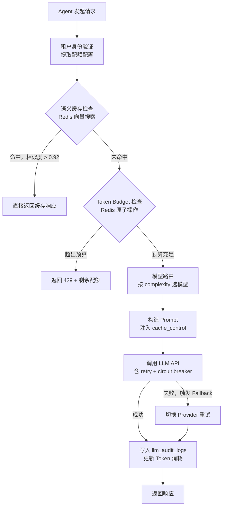
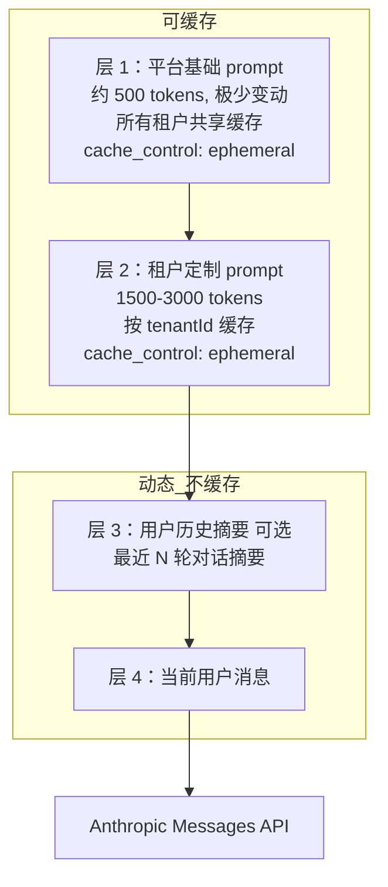

2023 年双十一，一家电商客户在促销活动开始后的 30 分钟内触发了账单报警。触发原因不是 Bug，而是 Agent 被正常使用：活动开始后，平台向 200 万用户推送了促销消息，其中约 6 万用户在前 30 分钟内发起了会话。每次会话平均包含 2.3 次 LLM 调用，每次调用的系统 prompt 约 3000 tokens——这些系统 prompt 在每次调用里都被完整发送，没有任何缓存。30 分钟内，仅系统 prompt 就消耗了 4 亿多 tokens，折合费用超过当月预算的 1.2 倍。

更糟的是，没有任何机制能阻止它继续跑。账单报警触发时，系统仍在正常处理请求，没有限流，没有降级，没有预算天花板。最终只能手动停掉整个服务。

这就是没有 LLM Gateway 的直接代价。

## 4.1 为什么自建 Gateway

面对上面这个问题，最直接的想法是引入第三方 LLM Gateway，比如 LiteLLM 或 Portkey。这些产品功能齐全，文档完善，看起来能解决我们的所有问题。但在做决策前，先想清楚一件事：**第三方 Gateway 本身是一个新的 SPOF（单点故障）**。

LiteLLM 或 Portkey 的服务故障，比 Anthropic 或 OpenAI 的故障更难恢复——后者可以切换 provider，而前者故障时你的整个路由层就不工作了。更关键的是，第三方 Gateway 的故障恢复不在你的控制范围内。

除了可靠性问题，还有两个工程层面的硬约束：

**丢失 Provider 特有功能。** Anthropic 的 Prompt Caching 需要在请求 body 里设置 `cache_control` 字段，这是 Anthropic 私有扩展，不属于 OpenAI 兼容接口规范。LiteLLM 在代理请求时会做格式转换，这个字段经常被过滤掉或未能正确透传。本章后面会详细讲，Prompt Caching 能把成本压低 90%，丢掉它损失很大。

**成本追踪粒度不够。** 第三方 Gateway 的账单按 API Key 或项目聚合，无法做到按租户精确统计。AgentFlow 是多租户 SaaS，需要知道每个租户当天花了多少钱、哪个模型用得最多、缓存命中率是多少。这些数据是产品计费和优化的基础，靠第三方无法实现。

**结论：LLM Gateway 应该是自研的薄层。** 不是一个大而全的 AI 中台，而是一个专注做好四件事的中间件：多 Provider 路由与 Fallback、Prompt Caching 优化、按租户限流、成本追踪。代码量控制在 1000 行以内，每个组件职责清晰，出问题时能快速定位。

这里强调"薄层"不是反对第三方工具，而是针对平台级产品的特定需求。如果你只是写一个个人项目或内部工具，LiteLLM 是合理选择——它省去了大量 provider 兼容层的工作。但对于 SaaS 平台，你需要对每次 LLM 调用有完整的控制权和可见性，这个需求第三方 Gateway 很难完全满足。

## 4.2 Gateway 架构设计

一个请求从 Agent 发出到拿到 LLM 响应，经过 Gateway 的完整路径如下：



每一步的职责是单一的，每一步可以独立测试、独立监控。下面是对内暴露的统一接口定义：

```typescript
// 所有 Agent 通过这个接口调用 LLM，不直接依赖具体 SDK
interface LLMGatewayRequest {
  tenantId: string;        // 租户 ID，用于配额检查和成本归因
  sessionId: string;       // 会话 ID，用于日志关联
  messages: Message[];     // 对话消息列表
  tools?: ToolDefinition[];// 工具定义（可选）
  complexity?: 'simple' | 'moderate' | 'complex'; // 影响模型选择
  stream?: boolean;        // 是否流式返回
  // 是否需要实时数据，true 时绕过语义缓存。
  // 适用场景：查实时库存、当前价格、最新订单状态等不能命中历史缓存的请求。
  // 4.8 节的语义缓存实现会读这个字段，true 直接跳过缓存查询并禁止写入。
  requiresRealtimeData?: boolean;
}

interface LLMGatewayResponse {
  content: string;
  model: string;           // 实际使用的模型（可能是 fallback 模型）
  usage: TokenUsage;       // token 消耗明细（含缓存命中数）
  provider: string;        // 实际使用的 provider
  cached: boolean;         // 是否来自语义缓存
  latencyMs: number;       // 端到端延迟
}
```

两个字段需要说明。`complexity` 由调用方显式传入，不在 Gateway 层做 NLP 分析——Gateway 不应该依赖 LLM 调用来决定路由策略，那会引入循环依赖。`stream` 目前只做标记，流式传输的完整实现在第7章。

## 4.3 多供应商路由与 Fallback

AgentFlow 的 Provider 优先级：

```
主力：Anthropic Claude（Sonnet 系列，性能与成本平衡最好）
  └─ Fallback 1：OpenAI GPT-4o-mini（Anthropic 服务降级时）
       └─ Fallback 2：降级响应（全部不可用时，返回预设的兜底答案）
```

这个顺序不是随意决定的。Anthropic 和 OpenAI 的底层基础设施不共享，两家同时故障的概率极低。GPT-4o-mini 选为 Fallback 而非 GPT-4o，是因为在 Fallback 场景下，可用性比性能更重要——用低成本模型保住服务继续运转，比用旗舰模型但要等待更有价值。

### 重试策略

网络抖动或 API 限速（HTTP 429）不应该立刻触发 Provider 切换。先在同一 Provider 内重试，重试间隔用指数退避：

```
第 1 次失败 → 等待 1 秒重试
第 2 次失败 → 等待 2 秒重试  
第 3 次失败 → 等待 4 秒重试
3 次全部失败 → 切换到 Fallback Provider
```

等待时间加入随机抖动（±20%），避免大量请求在同一时刻重试导致的"惊群效应"。

### 核心实现

```typescript
class LLMRouter {
  private providers: LLMProvider[];

  // 依次尝试每个 Provider，直到成功或全部失败
  async complete(request: LLMGatewayRequest): Promise<LLMResponse> {
    let lastError: Error | null = null;

    for (const provider of this.providers) {
      try {
        const response = await this.tryProvider(provider, request, 0);
        return response;
      } catch (err) {
        lastError = err as Error;
        // 记录切换事件，方便事后分析
        console.warn(`[LLMRouter] Provider ${provider.name} failed, trying next`, {
          error: (err as Error).message,
          tenantId: request.tenantId,
        });
      }
    }

    // 所有 Provider 都失败，返回降级响应
    return this.buildFallbackResponse(request, lastError!);
  }

  // 单个 Provider 的带重试调用
  private async tryProvider(
    provider: LLMProvider,
    request: LLMGatewayRequest,
    attempt: number
  ): Promise<LLMResponse> {
    const MAX_ATTEMPTS = 3;

    try {
      return await provider.complete(request);
    } catch (err) {
      if (attempt >= MAX_ATTEMPTS - 1) {
        throw err; // 重试次数用完，向上抛出触发 Provider 切换
      }

      // 只对可重试的错误重试（限速、网络抖动），不对认证错误重试
      if (!isRetryableError(err)) {
        throw err;
      }

      // 指数退避 + 随机抖动
      const baseDelay = Math.pow(2, attempt) * 1000;
      const jitter = baseDelay * 0.2 * (Math.random() * 2 - 1);
      await sleep(baseDelay + jitter);

      return this.tryProvider(provider, request, attempt + 1);
    }
  }
}
```

### Circuit Breaker

当某个 Provider 连续失败超过阈值，继续请求它只会增加延迟，应该直接跳过。Circuit Breaker 的完整实现在第10章（高并发）详细展开，那里会讨论分布式 Circuit Breaker 的状态存储、半开状态的探测机制等。

本章的实现用 Redis 存储失败计数，保持接口一致，方便后面替换为完整版本：

```typescript
// 检查某个 Provider 的 Circuit Breaker 是否处于打开状态
async function isCircuitOpen(
  redis: Redis,
  providerName: string
): Promise<boolean> {
  // 生产环境需要完整的 half-open 探测逻辑（见第10章）
  const failures = await redis.get(`circuit:${providerName}:failures`);
  return parseInt(failures ?? '0') >= CIRCUIT_BREAK_THRESHOLD;
}
```

> **生产注意**：Circuit Breaker 状态必须存在 Redis 里，不能存在进程内存里。多 Worker 部署时，如果每个 Worker 维护自己的内存状态，一个 Worker 触发了熔断，其他 Worker 不知道，仍会继续向故障的 Provider 发请求。单机开发时用单节点 Redis 即可，但 key 设计必须按多 Worker 方案来。

## 4.4 Prompt Caching：90% 成本节省

Anthropic 的 Prompt Caching 是本章最重要的内容。实现它并不复杂，但需要理解它的工作原理，否则很容易写出看似正确但实际完全无效的代码。

### 工作原理

Prompt Caching 的核心逻辑是：Anthropic 在服务器端缓存 prompt 的某个前缀，下次请求时如果前缀完全匹配，直接读取缓存，不重新计算。

几个关键数字（来自 Anthropic 文档，2024 年定价）：

| 操作 | 价格（每百万 tokens） |
|------|---------------------|
| 普通输入 | $3.00 |
| 缓存写入（首次） | $3.75（比普通贵 25%） |
| 缓存读取（命中） | $0.30（普通输入的 1/10） |
| 输出 | $15.00 |

缓存 TTL 是 5 分钟。在高频交互的客服场景里，5 分钟内同一租户的请求基本都会带相同的系统 prompt，缓存命中率通常能达到 85% 以上。

使用 `cache_control` 字段标记可缓存内容：

```typescript
// 设置缓存断点：这个内容块之前的所有内容都会被缓存
{ type: 'ephemeral' }
```

最少需要 1024 tokens 才能触发缓存。短于 1024 tokens 的 prompt，cache_control 标记会被忽略。

### 最容易犯的错误

**破坏 prompt 前缀的一致性。** 缓存命中的前提是前缀完全相同，任何微小的变化都会导致缓存失效。

```typescript
// 错误写法：把动态内容（时间戳）放在静态系统 prompt 前面
const messages = [
  {
    role: 'user',
    content: `当前时间：${new Date().toISOString()}
    
    系统说明：你是电商客服助手，负责处理订单查询、退款申请和物流跟踪...
    （后面还有 2000 tokens 的业务规则说明）
    
    用户问题：${userQuestion}`
  }
];
// 时间戳每秒都在变，系统 prompt 的前缀每次都不同，缓存永远不会命中
```

```typescript
// 正确写法：静态内容在前，动态内容在后，通过 content 数组分离
const messages = [
  {
    role: 'user',
    content: [
      {
        type: 'text' as const,
        // 2000 tokens 的静态系统说明，放在最前面
        text: `你是电商平台的客服助手，负责处理：
1. 订单查询：支持按订单号、商品名称、时间范围查询
2. 退款申请：7天内无理由退款，超过7天需人工审核
3. 物流跟踪：支持主流快递公司实时查询
...（完整的 2000 tokens 业务规则）`,
        cache_control: { type: 'ephemeral' }, // 标记可缓存
      },
      {
        type: 'text' as const,
        // 动态内容放在后面，不影响前面的缓存命中
        text: `当前时间：${new Date().toISOString()}\n\n用户问题：${userQuestion}`,
      }
    ]
  }
];
```

### 多租户场景的 Prompt 分层策略

单租户场景只需要分离静态和动态内容。多租户场景需要更精细的分层，因为不同租户的系统 prompt 不同，不能共用同一个缓存。

AgentFlow 把系统 prompt 分成四层（图 4-2，Prompt 4 层缓存结构）：



层 1 被所有租户共享，缓存命中后所有请求都能受益。层 2 按 tenantId 不同而不同，但同一租户的所有请求会复用同一份缓存（前提是租户的系统 prompt 没有变动）。两个 `cache_control` 断点分别标记两段静态前缀的末尾，Anthropic 按顺序从最靠后的断点开始匹配，最大化命中长度。

```typescript
// 构造多层缓存 prompt 的核心逻辑
function buildCachedMessages(
  platformPrompt: string,    // 层 1，全局共享
  tenantPrompt: string,      // 层 2，按租户
  conversationHistory: Message[], // 层 3，用户历史
  currentMessage: string     // 层 4，当前消息
): Message[] {
  // 把层 1 + 层 2 都标记为可缓存
  // 层 3 + 层 4 不缓存（动态内容）
  return [
    {
      role: 'user',
      content: [
        {
          type: 'text',
          text: platformPrompt,
          cache_control: { type: 'ephemeral' }, // 层 1 缓存断点
        },
        {
          type: 'text',
          text: tenantPrompt,
          cache_control: { type: 'ephemeral' }, // 层 2 缓存断点
        },
        // 历史对话作为普通文本追加，不标记缓存
        // 注意：content 可能是字符串或 TextContentBlock[]，需要统一处理
        ...conversationHistory.map(m => ({
          type: 'text' as const,
          text: `${m.role === 'user' ? '用户' : '助手'}：${
            typeof m.content === 'string'
              ? m.content
              : m.content.map(b => b.text).join('')
          }`,
        })),
        {
          type: 'text' as const,
          text: currentMessage,
        },
      ],
    },
  ];
}
```

### 验证缓存是否命中

从响应的 `usage` 字段读取，Anthropic 会告诉你实际发生了什么：

```typescript
const response = await anthropic.messages.create({ /* ... */ });

console.log({
  // 正常输入 tokens（按 $3.00/M 计费）
  input_tokens: response.usage.input_tokens,
  // 缓存写入 tokens（首次建立缓存，按 $3.75/M 计费）
  cache_creation_input_tokens: response.usage.cache_creation_input_tokens,
  // 缓存命中 tokens（按 $0.30/M 计费，便宜 10 倍）
  cache_read_input_tokens: response.usage.cache_read_input_tokens,
});

// 如果 cache_read_input_tokens > 0，说明缓存命中了
// 如果 cache_creation_input_tokens > 0，说明这次建立了新缓存（下次就能命中）
```

初次请求会看到 `cache_creation_input_tokens > 0`，说明缓存已建立。下一次带相同前缀的请求，应该看到 `cache_read_input_tokens > 0`。如果始终是 0，检查：
1. prompt 长度是否超过 1024 tokens（不够长则不会缓存）
2. 动态内容是否插入到了静态内容前面（破坏了前缀一致性）
3. cache_control 字段是否被 SDK 版本正确支持（查看 @anthropic-ai/sdk 的版本）

> **生产注意**：Prompt Caching 的 5 分钟 TTL 意味着如果同一租户的请求间隔超过 5 分钟，缓存会失效，下一次请求重新建立缓存时会多花 25% 的 cache creation 费用。对于低频使用的小租户，这个成本可能超过节省的费用。可以在成本追踪数据中监控缓存命中率，对命中率低的租户关闭缓存优化（减少代码复杂度）。

## 4.5 语义缓存

Prompt Caching 解决的是"同一个 prompt 的重复计算"问题。语义缓存解决的是另一个问题：**相似但不完全相同的问题，可以返回相同的答案**。

"我的订单什么时候到？"和"我下的单大概几天能收到？"是同一个问题的两种说法。如果已经对第一个问题调用过 LLM 并拿到了答案，对第二个问题就没必要再调用 LLM。

### 实现原理

1. 收到查询时，先用轻量 Embedding 模型（全书默认 `voyage-3`，1024 维，与第 6 章对齐；也可用 `text-embedding-3-small` 加 `dimensions: 1024` 截断）将文本向量化
2. 在 Redis Stack（支持向量搜索）中搜索最近邻
3. 如果最近邻的余弦相似度 > 0.92，返回缓存的答案
4. 否则调用 LLM，并把新的 query-response 对存入缓存

相似度阈值 0.92 是经验值。阈值太低会返回不相关的答案，太高则缓存命中率极低，失去意义。实际部署时需要根据业务领域调整——技术支持类问答（问法更规范）可以设 0.88，开放域问答需要设 0.95 以上。

```typescript
class SemanticCache {
  constructor(
    private redis: Redis,
    private embeddingModel: EmbeddingModel
  ) {}

  async get(
    query: string,
    tenantId: string
  ): Promise<CachedResponse | null> {
    // 1. 将 query 向量化（voyage-3，1024 维；与第 6 章 knowledge_chunks 维度对齐）
    const queryVector = await this.embeddingModel.embed(query);
    const vectorBuffer = Buffer.from(new Float32Array(queryVector).buffer);

    // 2. 在 Redis 中搜索最近邻
    // key 格式：idx:semantic-cache:{tenantId} — 按租户隔离，避免不同业务领域的干扰
    const results = await this.redis.call(
      'FT.SEARCH',
      `idx:semantic-cache:${tenantId}`,
      '*=>[KNN 1 @vector $vec AS __score]',
      'PARAMS', '2', 'vec', vectorBuffer,
      'SORTBY', '__score', 'ASC',
      'RETURN', '2', 'response', '__score',
      'DIALECT', '2'
    ) as unknown[];

    // FT.SEARCH 返回格式：[total_count, key, [field, value, ...], ...]
    const totalCount = results[0] as number;
    if (totalCount === 0 || results.length < 3) return null;

    const fields = results[2] as string[];
    const responseIdx = fields.indexOf('response');
    const scoreIdx = fields.indexOf('__score');
    if (responseIdx === -1 || scoreIdx === -1) return null;

    // Redis KNN 返回距离（越小越相似），余弦距离 = 1 - 余弦相似度
    const distance = parseFloat(fields[scoreIdx + 1]);
    const similarity = 1 - distance;

    if (similarity < SEMANTIC_CACHE_THRESHOLD) {
      return null; // 相似度不够，不能用缓存
    }

    return JSON.parse(fields[responseIdx + 1]) as CachedResponse;
  }

  async set(
    query: string,
    response: LLMResponse,
    tenantId: string,
    ttl: number = 3600
  ): Promise<void> {
    const queryVector = await this.embeddingModel.embed(query);
    const key = `semantic-cache:${tenantId}:${nanoid()}`;

    // 存储向量和原始响应
    await this.redis.hset(key, {
      query,
      response: JSON.stringify(response),
      vector: Buffer.from(new Float32Array(queryVector).buffer),
    });
    await this.redis.expire(key, ttl);
  }
}
```

### 重要限制

语义缓存只适用于答案不依赖实时数据的问题。"你们有什么退换货政策？"可以缓存。"我的订单 #12345 现在在哪？"不能缓存——这个问题的答案每小时都在变，而且不同用户的订单状态完全不同。

判断依据：如果回答这个问题需要调用外部工具（查订单、查库存），就不应该缓存——应该让 Agent 正常执行工具调用，工具层自己处理数据缓存。语义缓存只拦截"纯知识类"问题。

> **生产注意**：语义缓存依赖 Redis Stack（包含向量搜索模块），不是标准 Redis。生产环境需要单独部署 Redis Stack，或使用支持向量搜索的云服务（如 Upstash）。单机开发用 `redis/redis-stack` Docker 镜像。标准 Redis（无 Stack 模块）在调用 `FT.SEARCH` 时会报错，代码里需要降级处理——语义缓存不可用时直接调用 LLM，不要因为缓存问题让请求失败。

## 4.6 成本路由：按复杂度选模型

不是所有任务都需要最强的模型。AgentFlow 的 Agent 引擎在不同阶段对模型的要求差异很大：

| Agent 阶段 | 典型任务 | 合适的模型层级 |
|------------|---------|---------------|
| Planner（意图识别） | 判断用户问的是什么类型的问题 | simple |
| Executor（工具调用） | 组织工具参数、处理工具返回值 | moderate |
| Reflector（结果验证） | 判断答案是否完整、是否需要追问 | simple |
| 复杂分析 | 长文档理解、多跳推理 | complex |

对应的模型映射：

```typescript
const MODEL_TIERS = {
  // 分类、提取、简单判断——价格最低，速度最快
  simple: 'claude-3-haiku-20240307',
  // 多步推理、工具调用、需要上下文理解的任务——性能与成本的平衡点
  moderate: 'claude-sonnet-4-5',
  // 复杂分析、长文档处理、需要深度推理的任务——最贵但能力最强
  complex: 'claude-3-opus-20240229',
} as const;
```

**这三层之间的成本差距**：Haiku 的输入价格是 Sonnet 的约 1/8，Sonnet 是 Opus 的约 1/5。把 Planner 和 Reflector 从 Sonnet 换成 Haiku，在 AgentFlow 的实际流量中能减少约 35% 的总 token 成本。

### 复杂度判断

AgentFlow 用调用方显式指定作为主要方式，启发式规则作为兜底：

```typescript
function inferComplexity(request: LLMGatewayRequest): ModelTier {
  // 调用方显式指定，优先级最高
  if (request.complexity) {
    return request.complexity;
  }

  // 启发式规则：根据消息长度和工具数量推断
  const totalLength = request.messages.reduce(
    (sum, m) => sum + (typeof m.content === 'string' ? m.content.length : 0),
    0
  );
  const toolCount = request.tools?.length ?? 0;

  if (totalLength > 8000 || toolCount > 5) {
    return 'complex';
  }
  if (totalLength > 2000 || toolCount > 0) {
    return 'moderate';
  }
  return 'simple';
}
```

用 LLM 本身来判断请求复杂度（meta-routing）这个思路不实用——为了决定用哪个模型，先调用一次 LLM，额外增加了延迟和费用，在延迟敏感的客服场景里完全不合算。

### Fallback 模型的选择

成本路由还有一个容易被忽略的细节：当 Anthropic 不可用时，Fallback 到 OpenAI 应该用哪个模型。不能简单地用 Fallback Provider 的"同级别"模型——`gpt-4o` 对应 Claude Sonnet，`gpt-4o-mini` 对应 Claude Haiku，但在 Fallback 场景下，首要目标是**保证服务继续运转**，而不是保证质量与主力模型完全一致。

AgentFlow 的策略是：不论原始请求的复杂度是什么，Fallback 统一使用 `gpt-4o-mini`。原因是：

1. `gpt-4o-mini` 成本极低（$0.15/M input tokens），Fallback 期间的成本可控
2. 对于客服场景，Fallback 期间的用户预期本身就会降低（响应可能变慢）
3. 使用同一个 Fallback 模型，日志中容易识别"这段时间走了 Fallback"

如果业务需要在 Fallback 时也保持较高质量，可以改为按复杂度映射到 OpenAI 的同级模型，但这会增加 Fallback 期间的成本，需要根据业务情况权衡。

## 4.7 Token Budget 控制

每个租户在 Gateway 层有独立的 token 预算：

```typescript
interface TenantQuota {
  tenantId: string;
  dailyTokenLimit: number;      // 每日 token 上限，超过后请求被拒绝
  monthlyTokenLimit: number;    // 每月 token 上限
  requestsPerMinute: number;    // 每分钟请求数上限（防止瞬间流量冲击）
  burstAllowance: number;       // 突发允许倍数（默认 1.5x，允许短时间超出）
}
```

### 原子性：为什么必须用 Lua 脚本

预算检查和扣减必须是原子操作。如果分两步做（先读余量，再扣减），在高并发场景下会有竞态条件：两个请求同时读到"还有 100 tokens 余量"，然后都通过检查，最终消耗超出预算。

Redis 的 Lua 脚本在单个 Redis 节点上是原子执行的：

```typescript
// 检查并扣减 token 预算（Lua 脚本保证原子性）
const CHECK_AND_CONSUME_SCRIPT = `
  local key = KEYS[1]
  local limit = tonumber(ARGV[1])
  local estimated = tonumber(ARGV[2])
  local ttl = tonumber(ARGV[3])
  
  -- 获取当前已用量，不存在则为 0
  local current = tonumber(redis.call('GET', key) or '0')
  local remaining = limit - current
  
  -- 检查是否超出预算
  if current + estimated > limit then
    return {0, remaining}  -- 0 表示拒绝
  end
  
  -- 原子扣减
  local new_value = redis.call('INCRBY', key, estimated)
  
  -- 首次写入时设置 TTL（次日 00:00 过期）
  if new_value == estimated then
    redis.call('EXPIRE', key, ttl)
  end
  
  return {1, limit - new_value}  -- 1 表示允许
`;

async function checkAndConsumeQuota(
  redis: Redis,
  tenantId: string,
  estimatedTokens: number
): Promise<{ allowed: boolean; remaining: number }> {
  // key 格式：quota:{tenantId}:daily:{date}
  // {tenantId} 用花括号包裹，作为 Redis Cluster 的 hash tag，
  // 保证同一租户的所有配额 key 路由到同一节点，Lua 脚本才能原子执行
  const today = new Date().toISOString().slice(0, 10); // "2024-11-11"
  const key = `quota:{${tenantId}}:daily:${today}`;

  // 计算到明天 00:00 的剩余秒数（作为 TTL）
  const now = new Date();
  const tomorrow = new Date(now);
  tomorrow.setDate(tomorrow.getDate() + 1);
  tomorrow.setHours(0, 0, 0, 0);
  const ttlSeconds = Math.ceil((tomorrow.getTime() - now.getTime()) / 1000);

  const quota = await getTenantQuota(tenantId);
  const result = await redis.eval(
    CHECK_AND_CONSUME_SCRIPT,
    1,
    key,
    quota.dailyTokenLimit.toString(),
    estimatedTokens.toString(),
    ttlSeconds.toString()
  ) as [number, number];

  return {
    allowed: result[0] === 1,
    remaining: result[1],
  };
}
```

### 估算 Token 数量

调用 LLM 前不知道实际会消耗多少 tokens（输出长度不确定），需要估算。策略是：先按输入 tokens 预扣一个保守估计（输入 tokens × 1.5），调用完成后用实际消耗数量做最终扣减，多退少补。

```typescript
// 调用前：预扣估算量
const estimatedInputTokens = estimateInputTokens(request.messages);
const reservedTokens = Math.ceil(estimatedInputTokens * 1.5); // 保守估计

const { allowed, remaining } = await checkAndConsumeQuota(
  redis, tenantId, reservedTokens
);
if (!allowed) {
  throw new QuotaExceededError(tenantId, remaining);
}

// 调用 LLM...
const response = await provider.complete(request);

// 调用后：用实际消耗量修正（多退少补）
const actualTokens = response.usage.input_tokens + response.usage.output_tokens;
const adjustment = actualTokens - reservedTokens; // 可能是负数（多退）
if (adjustment !== 0) {
  await adjustQuota(redis, tenantId, adjustment);
}
```

### 成本追踪

每次 LLM 调用后，无论成功还是失败，都写入审计日志：

```typescript
interface LLMAuditLog {
  id: string;
  tenantId: string;
  sessionId: string;
  model: string;
  provider: string;
  // token 明细
  inputTokens: number;
  outputTokens: number;
  cacheCreationTokens: number;  // 建立缓存的 tokens（按较贵价格计费）
  cacheReadTokens: number;      // 命中缓存的 tokens（按较便宜价格计费）
  // 计算后的成本（美元）
  estimatedCost: number;
  // 元数据
  latencyMs: number;
  success: boolean;
  errorCode?: string;
  createdAt: Date;
}
```

成本计算在写入时立即完成，而不是事后通过账单反推——这样可以实时监控，在接近预算上限时提前预警：

```typescript
function calculateCost(
  model: string,
  usage: TokenUsage
): number {
  const pricing = MODEL_PRICING[model];
  if (!pricing) return 0;

  const inputCost = (usage.inputTokens / 1_000_000) * pricing.inputPerMillion;
  const outputCost = (usage.outputTokens / 1_000_000) * pricing.outputPerMillion;
  // 缓存写入比普通输入贵 25%
  const cacheCreationCost =
    ((usage.cacheCreationTokens ?? 0) / 1_000_000) * pricing.inputPerMillion * 1.25;
  // 缓存读取比普通输入便宜 90%
  const cacheReadCost =
    ((usage.cacheReadTokens ?? 0) / 1_000_000) * pricing.inputPerMillion * 0.1;

  return inputCost + outputCost + cacheCreationCost + cacheReadCost;
}
```

审计日志通过 Drizzle ORM 写入 PostgreSQL。在流量高峰期，直接写 DB 可能成为瓶颈——可以先写 Redis List，用异步 Worker 批量刷入 DB。这个优化在第11章（可观测性）实现，本章先用同步写入，保持代码简单。

> **生产注意**：成本追踪数据库表 `llm_audit_logs` 增长速度很快。在 `tenantId`、`createdAt` 字段上建复合索引，并设置按月分区（PostgreSQL Table Partitioning）。单机开发不做分区，但建好索引，避免后期迁移麻烦。

## 4.8 组装：Gateway 主类

前面几节分别实现了五个独立组件：`LLMRouter` 负责多 Provider 路由，`PromptCacheBuilder` 负责构造带缓存标记的 prompt，`SemanticCache` 负责语义相似度缓存，`QuotaManager` 负责 Token Budget 原子操作，`CostTracker` 负责审计日志。`LLMGateway` 主类的职责是按正确顺序编排这五个组件，不包含任何业务逻辑。

这种设计的好处不只是"代码整洁"。每个组件可以在没有其他组件的情况下独立测试：测试 `QuotaManager` 只需要一个 mock Redis；测试 `PromptCacheBuilder` 甚至不需要任何依赖，纯函数。`LLMGateway` 的集成测试只需要验证调用顺序和错误处理路径是否正确，不需要真实的 API Key。

调用顺序有一处关键的设计决策：**语义缓存检查放在 Token Budget 检查之前**。如果顺序反过来，语义缓存命中时已经预扣了 Token，还需要回滚，引入不必要的复杂度。当前顺序下，缓存命中则完全跳过 Token 扣减，逻辑更清晰。

把前面所有组件组合起来，对外暴露单一入口：

```typescript
class LLMGateway {
  constructor(
    private router: LLMRouter,
    private semanticCache: SemanticCache,
    private promptCacheBuilder: PromptCacheBuilder,
    private quotaManager: QuotaManager,
    private costTracker: CostTracker
  ) {}

  async complete(request: LLMGatewayRequest): Promise<LLMGatewayResponse> {
    const startTime = Date.now();

    // 提取最后一条用户消息文本（用于语义缓存查询）
    const lastMessage = request.messages.at(-1);
    const queryText = lastMessage
      ? (typeof lastMessage.content === 'string'
        ? lastMessage.content
        : lastMessage.content.map(b => b.text).join(''))
      : '';

    // 1. 语义缓存检查（在 quota 检查之前，命中缓存则不消耗 quota）
    if (!request.requiresRealtimeData) {
      const semanticHit = await this.semanticCache.get(queryText, request.tenantId);
      if (semanticHit) {
        return { ...semanticHit, cached: true, latencyMs: Date.now() - startTime };
      }
    }

    // 2. Token budget 检查（预扣估算量，调用后多退少补）
    const estimatedTokens = estimateInputTokens(request.messages);
    const reservedTokens = Math.ceil(estimatedTokens * 1.5); // 保守估计含输出
    await this.quotaManager.checkAndConsume(request.tenantId, reservedTokens);

    // 3. 构造带缓存优化的 prompt（注入 cache_control 分层标记）
    const tenantSystemPrompt = await getTenantSystemPrompt(request.tenantId);
    const optimizedMessages = this.promptCacheBuilder.build(tenantSystemPrompt, request.messages);

    // 4. 路由并调用 LLM
    const llmResponse = await this.router.complete({
      ...request,
      messages: optimizedMessages,
    });

    // 5. 修正实际 token 消耗（多退少补）
    await this.quotaManager.adjust(
      request.tenantId,
      llmResponse.usage,
      reservedTokens
    );

    // 6. 写入审计日志（异步，不阻塞响应）
    void this.costTracker.record({
      tenantId: request.tenantId,
      sessionId: request.sessionId,
      ...llmResponse,
      latencyMs: Date.now() - startTime,
    }).catch(err => console.error('[CostTracker] Failed to record', err));

    // 7. 更新语义缓存（仅限非实时类问题）
    if (!request.requiresRealtimeData) {
      void this.semanticCache.set(queryText, llmResponse, request.tenantId)
        .catch(() => {}); // 缓存写失败不影响正常响应
    }

    return {
      ...llmResponse,
      cached: false,
      latencyMs: Date.now() - startTime,
    };
  }
}
```

Gateway 的每个组件都可以独立替换和测试。`LLMRouter` 关心路由逻辑，`SemanticCache` 关心向量搜索，`QuotaManager` 关心 Redis 原子操作，`CostTracker` 关心 DB 写入。主类只负责编排，不包含任何业务逻辑。

## 对三个租户意味着什么

Gateway 的四个核心功能（路由 / 缓存 / 配额 / 审计）落到三个租户身上，权重完全不同。

**租户 A（电商）**：成本路由是最大单点收益。订单查询、退货咨询这种轻意图直接走 Haiku，复杂规划走 Sonnet，混合调度后单次会话成本能比"全 Sonnet"低一个数量级；Prompt Caching 的命中率也在这里最高，因为系统 prompt 和工具定义在双十一期间被几百万次调用复用。

**租户 B（SaaS 软件）**：语义缓存对 FAQ 类问题（"怎么导出账单"、"怎么开通 SSO"）命中率显著，因为同一个问题被多个客户重复问。缓存 key 用 embedding 而不是字符串匹配，正好覆盖"问法不同、意思一样"的情况。

**租户 C（金融机构）**：所有 LLM 调用必须写审计日志，request/response 全量留存。缓存命中也要写一条 audit 记录（标记 `cache_hit=true`），不能因为没真打到 provider 就漏审计。CostTracker 同时承担合规留档的职责。

## 本章小结

LLM Gateway 是平台成本和稳定性的核心控制点。本章实现的四个核心功能——多 Provider 路由与 Fallback、Prompt Caching、按租户 Token Budget 控制、成本追踪——在代码量上不大，但对平台运营影响极大。Prompt Caching 一项在客服场景就能把 token 成本压低 80-90%；Token Budget 控制避免了本章开头那个真实故障的再次发生。

下一章的 Skill 系统建立在 Gateway 之上，Agent 调用外部工具时产生的所有 LLM 交互，都会经过 Gateway 的限流和成本追踪。

## 参考资料

- [Anthropic Prompt Caching 文档](https://docs.anthropic.com/en/docs/build-with-claude/prompt-caching)
- [Anthropic API 定价](https://www.anthropic.com/pricing)
- [Redis Stack 向量搜索文档](https://redis.io/docs/stack/search/reference/vectors/)
- [Redis Lua 脚本原子性说明](https://redis.io/docs/manual/programmability/eval-intro/)
