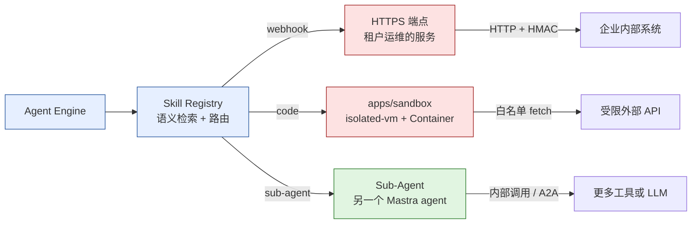
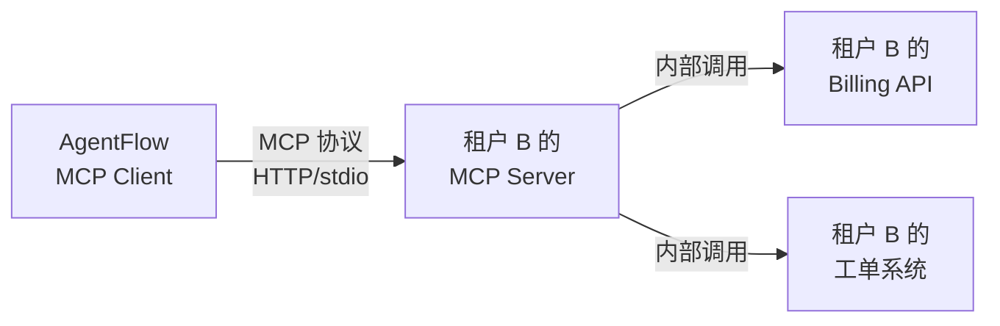
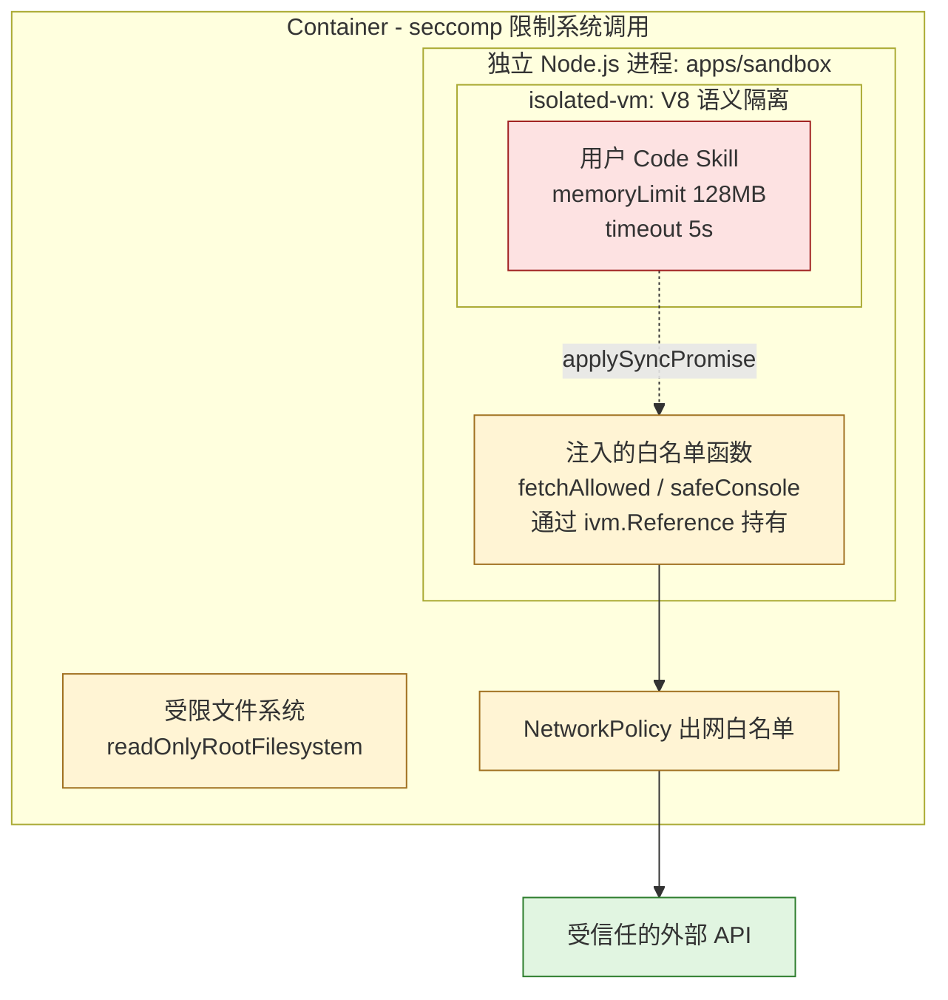
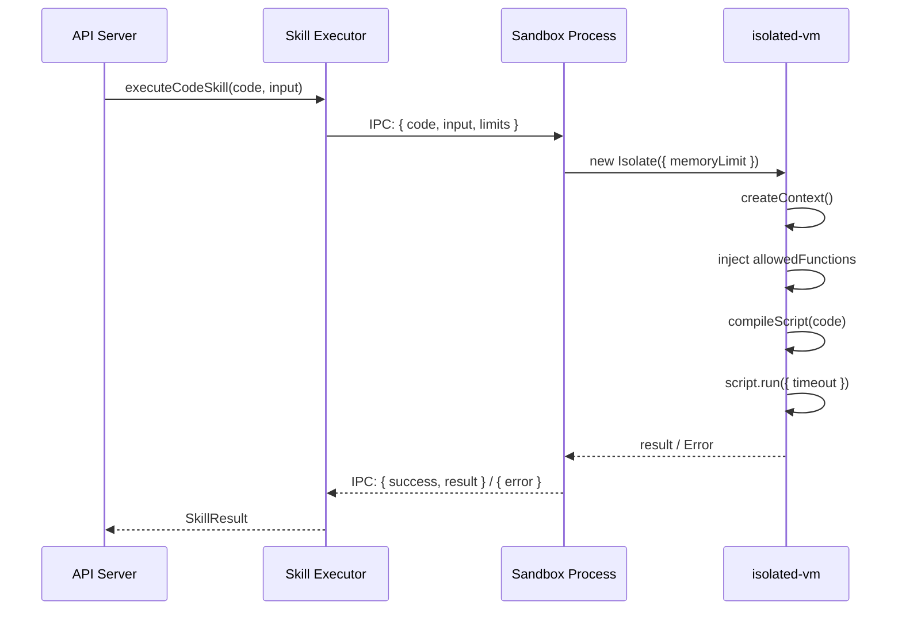

第3章结束时，AgentFlow 的工具是这样注册的：

```typescript
tools: {
  queryOrder: queryOrderTool,
  initiateRefund: initiateRefundTool,
  queryShipping: queryShippingTool,
},
```

这些工具全部硬编码在 agent 定义里。对于单租户场景没有问题，但 AgentFlow 是多租户 SaaS，问题在第一个 B 端客户接入时就出现了。

租户 B 是一家 SaaS 软件公司，他们的需求：当用户询问账单时，需要调用他们内部的计费系统 API。这个 API 只有租户 B 的工程师知道，接口格式、认证方式、返回数据结构全都是私有的。平台不可能预先内置这个工具——因为每个 B 端租户都有自己的业务系统，而且随时会变化。

更大的问题是，租户 A（电商）和租户 B（SaaS）的工具集完全不同：租户 A 需要查订单、查物流、处理退款；租户 B 需要查账单、创建工单、检索文档。如果把所有工具都注册到一个 agent 里，LLM 面对几十个工具时选择准确率会显著下降——每多一个不相关的工具，都是一个干扰项。

这就是为什么需要一个独立的 Skill 系统：**平台提供通用 Skill，企业按需接入自定义 Skill，Agent 运行时动态组装所需工具集**。

## 5.1 BullMQ 上手

在讲 Skill 执行流程之前，需要先把 BullMQ 的基础讲清楚，因为后面的异步 Skill 执行会直接用到它。

BullMQ 是一个基于 Redis 的任务队列库。它解决的核心问题是：把"立即执行"改成"可靠执行"。调用方把任务放进队列就返回，Worker 异步消费并执行，任务的执行状态持久化在 Redis 里。即使 Worker 进程崩溃，未完成的任务也会在重启后被重新投递。

这种语义在技术上叫 **at-least-once**：任务至少会被执行一次，但不保证恰好一次。Worker 崩溃重启后，上一个未 ack 的任务会被重新投递，可能导致重复执行。这个特性后面会有专门的处理方案。

### 核心概念

**Queue（队列）**：逻辑上的任务容器。生产者往队列里添加 Job，消费者从队列里取 Job。队列名是字符串，Redis 里对应一组有序集合（sorted set）。

**Job（任务）**：队列中的最小执行单元。包含任务数据（`data` 字段）、执行选项（重试次数、延迟时间等）和执行状态。Job 的生命周期：`waiting` → `active` → `completed | failed`。

**Worker（消费者）**：监听队列并执行 Job 的进程。Worker 用 `concurrency` 参数控制同时处理的 Job 数量，在单进程内实现并发。

这三个概念的关系可以用一个最小示例完整展示：

```typescript
import { Queue, Worker, Job } from 'bullmq';
import { Redis } from 'ioredis';

const connection = new Redis({ host: 'localhost', port: 6379 });

// 定义队列
const skillQueue = new Queue('skill-execution', { connection });

// 添加任务（生产者）
await skillQueue.add('execute-skill', {
  skillId: 'query-order',
  tenantId: 'tenant-a',
  input: { orderId: '#12345' },
});

// Worker 消费（消费者）
const worker = new Worker(
  'skill-execution',
  async (job: Job) => {
    // job.data 是添加时传入的数据
    const { skillId, tenantId, input } = job.data;
    // 执行 skill，返回结果
    const result = await executeSkill(skillId, tenantId, input);
    return result; // 返回值会存入 Job 的 returnvalue 字段
  },
  {
    connection,
    concurrency: 10, // 同时处理 10 个 Job
  }
);

// 监听 Worker 事件
worker.on('completed', (job, result) => {
  console.log(`Job ${job.id} 完成`, result);
});

worker.on('failed', (job, err) => {
  console.error(`Job ${job.id} 失败`, err.message);
});
```

> **生产注意**：单机示例里用 `concurrency: 10` 在单进程内处理并发，但实际吞吐取决于 Skill 的执行时间。生产中 Worker 是多进程部署（Kubernetes 多副本），每个进程保持较低的 concurrency（比如 5-10）以控制内存用量，通过增加副本数来扩展整体吞吐。单机与生产的关键差距在于：进程崩溃重启后，Redis 里未 ack 的 Job 会被重新投递——这要求每个 Skill 执行必须是幂等的，或者在幂等不可实现时，用 Job ID 做去重。

### 幂等性：at-least-once 的实际影响

at-least-once 的意思是：BullMQ 保证任务不会丢，但不保证只执行一次。Worker 在执行中途崩溃时，Redis 里的 Job 会回到 `waiting` 状态等待重新投递，同一个 Job 可能被执行两次。

对查询类 Skill（查天气、搜索网页），重复执行没有副作用，幂等性自然满足。真正的风险在写操作。以退款为例：

```typescript
// ❌ 直接执行退款，重试时会重复退款
async function executeRefund(orderId: string, amount: number) {
  await paymentService.refund(orderId, amount);
}

// ✅ 用 idempotencyKey 去重：支付服务层面保证相同 key 只退一次
async function executeRefund(orderId: string, amount: number, idempotencyKey: string) {
  await paymentService.refund(orderId, amount, {
    idempotencyKey, // 传给支付网关（Stripe、支付宝等均支持幂等 Key）
  });
}
```

`idempotencyKey` 在投递任务时生成（见 `SkillJobData.idempotencyKey`），贯穿整个执行链路。支付网关收到相同 `idempotencyKey` 的请求时，直接返回上次的成功结果，不会再次扣款。

对于不支持幂等 Key 的外部服务，需要在业务层做执行记录：任务执行前先查数据库有没有该 `idempotencyKey` 的成功记录，有则直接返回历史结果，没有才真正执行并写入记录。这个模式比依赖外部服务的幂等支持更通用，但需要额外的数据库写入。

### BullMQ vs Temporal

两者都是处理异步任务的工具，选择标准是任务的持久性需求：

**BullMQ** 适合短期异步任务（<5 分钟）。任务状态存在 Redis 里，如果 Redis 丢失数据，任务状态也会丢失。但 Redis 的单机吞吐极高（10w+ ops/s），适合需要低延迟调度的场景，比如 Skill 执行、邮件发送、图片处理。

**Temporal** 适合长期持久 Workflow。工作流的每一步都持久化到数据库，即使整个服务重启，工作流从上次断点继续执行。代价是复杂度更高，运行 Temporal 需要维护一个独立的服务集群。AgentFlow 里用 Temporal 的场景是跨天的复杂任务（比如"每月底生成 PDF 报告并发送"），而不是 Skill 执行这种秒级任务。

本章的 Skill 系统用 BullMQ，原因是 Skill 执行时间通常在 30 秒以内，不需要持久化 workflow 状态，低延迟调度更重要。

### BullMQ 在 Skill 系统中的位置

并不是所有 Skill 都走异步队列。AgentFlow 根据执行时间预期选择同步还是异步：

**同步执行**（直接调用，不经过队列）：适合响应时间 <5 秒的 Skill，比如天气查询、网页搜索。Agent 等待 Skill 结果后继续对话，整体响应链路短。

**异步执行**（经过 BullMQ 队列）：适合以下场景：
- 执行时间长（>5 秒），比如 PDF 生成、批量数据处理
- 允许后台静默执行，Agent 不需要等待结果（发邮件、写入日志）
- 需要重试保障，外部服务偶发故障时自动重试（Webhook Skill 连接到不稳定的企业内部服务）

异步执行的交互模式是：Agent 投递 Job 后返回一个 `jobId`，同时给用户发一条"正在处理，稍后通知"的消息。Job 完成后通过 WebSocket 推送结果，或者用户下次发消息时 Agent 检查 Job 状态。这个交互模式在第7章 Session 状态管理中完整实现。

## 5.2 Skill 的三种形态

AgentFlow 的 Skill 按执行模式分为三种，每种适合不同的接入场景。在设计接口之前，先明确每种形态的约束，后续的 Registry 和 Executor 都围绕这个分类展开。

### HTTP Webhook Skill

最简单的接入方式：企业提供一个 HTTPS 端点，AgentFlow 在需要时发起 HTTP 请求。

```typescript
interface WebhookSkillConfig {
  url: string;
  method: 'GET' | 'POST';
  // 请求头（通常包含认证信息，加密存储）
  headers: Record<string, string>;
  // 超时时间（毫秒）
  timeout: number;
  // 超时时是否重试一次
  retryOnTimeout: boolean;
  // 签名密钥：平台发出请求时会附上 HMAC-SHA256 签名
  // 企业服务端验证签名，防止伪造请求
  webhookSecret?: string;
}
```

适合场景：企业已有成熟的内部 API，不想改造代码，直接把现有 HTTP 端点注册进来。

约束：
- 延迟取决于企业网络和服务质量，平台无法控制。如果企业服务响应慢，Agent 的整体响应时间会被拖慢
- 安全审计困难：请求发出去之后，我们不知道对方的服务在做什么，数据如何处理
- 需要企业暴露公网端点，有一定的安全门槛

### Code Skill（JavaScript 沙箱）

企业在平台界面编写 JavaScript 代码，AgentFlow 在隔离的沙箱中执行。

```typescript
interface CodeSkillConfig {
  // 用户上传的 JavaScript 代码（ES2020，不支持 import/require）
  code: string;
  // 入口函数名，平台会调用 module[entrypoint](input, context)
  entrypoint: string;
  // 允许调用的外部 URL 白名单（沙箱内网络请求受限）
  allowedUrls?: string[];
  // 内存上限（MB，默认 128）
  memoryLimitMb: number;
  // CPU 时间上限（毫秒，默认 5000）
  cpuTimeLimitMs: number;
}
```

适合场景：轻量逻辑，比如数据格式转换、简单计算、调用企业 HTTP API。代码在平台内版本管理，执行可监控可审计。

约束：
- 只支持 JavaScript（沙箱是 V8 Isolate）
- 不能使用 npm 包，只能用原生 JS 和平台注入的白名单函数
- 内存和 CPU 时间有硬性上限

Code Skill 的安全实现是本章的核心内容，5.5 节会详细展开。

### Sub-Agent Skill

把一个完整的 Mastra Agent 作为 Skill 调用。适合复杂的多步骤任务，比如"生成月度销售报告"——这个任务需要查询数据库、做统计计算、调用图表生成 API、最后生成 PDF，超出了单次 LLM 调用能处理的范围。

```typescript
interface SubAgentSkillConfig {
  // Mastra Agent 的端点（内部服务或外部 A2A 协议端点）
  agentEndpoint: string;
  // 通信协议：内部直接调用或通过 A2A 协议
  protocol: 'internal' | 'a2a';
  // 超时（复杂任务可能需要更长时间）
  timeout: number;
}
```

Sub-Agent Skill 是 A2A（Agent-to-Agent）协议的典型应用场景：主 Agent 把复杂任务委托给专门的子 Agent，子 Agent 执行完返回结果。AgentFlow 内部的多个专业 Agent（账单分析 Agent、文档问答 Agent）都通过这种方式被组合使用。A2A 协议的完整实现在第9章，本章只关注 Skill 系统的调度层。

### 三种形态的架构对比

下图（图 5-1）把三种 Skill 形态的执行路径和隔离边界放在一起对比：



绿色（Sub-Agent）是平台内可信组件，红色（Webhook、Code Skill）是租户提交、平台不可信的代码。隔离边界决定了平台层要在哪一步做权限检查：Webhook 在 HTTPS 出口做签名和域名白名单，Code Skill 在沙箱内做内存/CPU/网络限制，Sub-Agent 共享平台的安全上下文不需要额外沙箱。

## 5.3 内置 Skill 库设计

AgentFlow 提供一套开箱即用的通用 Skill，覆盖大多数客服场景。设计这套 Skill 库的核心问题不是"提供哪些功能"，而是"如何让 LLM 在运行时准确选择正确的 Skill"。

### 统一接口

所有内置 Skill 遵循同一个接口：

```typescript
import { z } from 'zod';

// Skill 执行时的上下文信息
interface SkillContext {
  tenantId: string;
  sessionId: string;
  userId?: string;  // 终端用户 ID（如果已知）
  // 用于在 Skill 内部调用其他平台能力（比如查询租户配置）
  platformClient: PlatformClient;
}

// 内置 Skill 统一格式
interface BuiltinSkill {
  id: string;
  name: string;
  // description 会作为工具描述传给 LLM，直接影响 LLM 的选择决策
  description: string;
  category: SkillCategory;
  inputSchema: z.ZodSchema;
  outputSchema: z.ZodSchema;
  execute: (input: unknown, context: SkillContext) => Promise<unknown>;
  // 每分钟调用次数上限（平台级别，跨所有租户）
  rateLimit?: { rpm: number };
  // 超时（毫秒）
  timeout: number;
  // 结果是否可缓存（用于 LLM Gateway 的语义缓存）
  isCacheable: boolean;
}

type SkillCategory =
  | 'search'       // 信息检索
  | 'communication' // 邮件、通知
  | 'data'         // 数据查询
  | 'generation';  // 内容生成
```

### description 字段的写法

`description` 是影响 Agent 行为最关键的字段，比 Skill 的具体实现更重要。LLM 在运行时根据用户消息和每个 Skill 的 description 来决定调用哪个工具。description 写得模糊，LLM 就会选错。

看两个对比：

```typescript
// 查询天气的 Skill

// ❌ 模糊，LLM 可能在用户问"现在外面适合跑步吗"时选不到这个工具
description: '查询天气信息'

// ✅ 具体，包含适用场景和不适用场景
description: `查询指定城市的实时天气和未来 7 天预报。
适用：用户询问某地当前天气、温度、降雨概率、未来天气趋势。
不适用：历史天气查询（数据只保留最近 30 天）、室内环境温湿度。
输入城市名支持中文（"北京"）或英文（"Beijing"），不支持模糊地名（"北方"）。`

// 搜索网页的 Skill

// ❌ 过于宽泛，会和知识库检索混淆
description: '搜索信息'

// ✅ 明确区分和其他检索类 Skill 的边界
description: `通过 Brave Search 搜索互联网上的公开信息。
适用：查询新闻事件、公司公开信息、产品评测、技术文档、当前热点。
不适用：查询用户自己的数据（订单、账单、个人信息）——这类数据用专用的数据查询工具。
不适用：检索企业内部知识库——使用 search-knowledge-base 工具。
返回结果包含页面摘要和来源 URL，不保证实时性（结果可能有 24 小时延迟）。`
```

写 description 的规则：明确说明"适用"和"不适用"的场景，让 LLM 知道什么时候不该用这个工具，和其他功能相似的工具做明确区分。

### 内置 Skill 目录

AgentFlow 1.0 包含以下内置 Skill（实现在本章示例代码里）：

| Skill ID | 说明 | 依赖服务 | 可缓存 |
|----------|------|---------|--------|
| `search-web` | 网页搜索 | Brave Search API | 是（TTL 1 小时） |
| `query-weather` | 查天气 | OpenWeather API | 是（TTL 30 分钟） |
| `send-email` | 发邮件 | SMTP | 否 |
| `query-platform-data` | 查平台结构化数据 | PostgreSQL | 否 |
| `generate-image` | 生成图片 | DALL-E 3 / SD | 否 |

`query-platform-data` 是这里面比较特殊的一个：它允许 Agent 用自然语言查询平台自己的数据库（比如"这个月退款率最高的是哪个 SKU"），内部是一个 Text-to-SQL 流程。Text-to-SQL（schema linking、安全约束的 SQL 生成、结果回译）本身是一个独立大主题，不在本书范围内。这里只把它作为一个普通 skill 注册占位，具体实现作为读者扩展练习，可以参考 Vanna.ai 或 langgraph 的 SQL agent 实现。

### Skill 的版本控制

内置 Skill 的 `execute` 逻辑随平台代码部署，改变行为时需要版本管理。租户可能依赖某个 Skill 的特定行为——比如 `search-web` 的返回结构——贸然修改会破坏他们的 Code Skill（用户代码里硬编码了字段名）。

处理原则：
- `inputSchema` 和 `outputSchema` 变更视为破坏性更新，需要发 changelog 并给租户迁移窗口
- `execute` 内部逻辑优化（性能、准确率）不算破坏性更新，不需要通知
- 新增字段不算破坏性更新（向后兼容），删除字段是破坏性更新

实践中，AgentFlow 用 `skillId` 包含版本号（`search-web-v2`）来管理破坏性变更，让旧版本 Skill 与新版本并行运行，租户有充分时间迁移。

## 5.4 用户自定义 Skill：MCP 协议

平台内置的 Skill 无法覆盖每个租户的私有业务系统。AgentFlow 通过 MCP（Model Context Protocol）让企业接入自己的自定义工具。

### MCP 是什么

MCP 是 Anthropic 于 2024 年提出的开放协议，定义了 AI 应用如何发现和调用外部工具（Tools）、读取外部资源（Resources）以及使用提示词模板（Prompts）。协议本身是语言无关的，目前有 TypeScript、Python 等官方 SDK。

对 AgentFlow 来说，MCP 解决的问题是：用标准协议替代私有接口，让任何企业都能用同一种方式接入自定义工具，而不需要学习 AgentFlow 特有的扩展接口。

Claude、Cursor、Continue 等 AI 工具都支持 MCP，这意味着企业实现一个 MCP Server 之后，不只能接入 AgentFlow，也能接入其他 MCP 兼容的 AI 产品，避免重复开发。

### MCP 架构



MCP Server 运行在租户 B 的环境里，AgentFlow 通过标准 MCP 协议（HTTP Transport 或 stdio）调用它。租户 B 完全控制 MCP Server 的实现，平台不需要知道其内部细节。

### 实现 MCP Server（租户侧）

租户 B 用 `@modelcontextprotocol/sdk`（版本 >= 1.0.0）实现 MCP Server：

```typescript
import { McpServer } from '@modelcontextprotocol/sdk/server/mcp.js';
import { StdioServerTransport } from '@modelcontextprotocol/sdk/server/stdio.js';
import { z } from 'zod';

const server = new McpServer({
  name: 'tenant-b-tools',       // Server 名称，用于日志标识
  version: '1.0.0',
});

// 注册账单查询工具
server.tool(
  'get-user-billing',                    // 工具 ID
  '查询指定用户当月账单明细，包含各功能模块的用量和费用', // description（影响 LLM 选择）
  {
    // 输入 schema，用 zod 定义
    userId: z.string().describe('用户 ID'),
    month: z.string().optional().describe('账单月份，格式 YYYY-MM，默认当月'),
  },
  async ({ userId, month }) => {
    // 调用租户 B 自己的 Billing API
    const targetMonth = month ?? getCurrentMonth();
    const bill = await fetchBillingFromInternalAPI(userId, targetMonth);

    // 返回格式固定：content 数组，每项是 { type, text/data }
    return {
      content: [
        {
          type: 'text' as const,
          text: JSON.stringify({
            userId,
            month: targetMonth,
            totalAmount: bill.total,
            breakdown: bill.items,
          }),
        },
      ],
    };
  }
);

// 注册工单创建工具
server.tool(
  'create-support-ticket',
  '为用户创建技术支持工单，返回工单编号',
  {
    userId: z.string(),
    title: z.string().describe('工单标题'),
    description: z.string().describe('问题描述'),
    priority: z.enum(['low', 'medium', 'high']).default('medium'),
  },
  async ({ userId, title, description, priority }) => {
    const ticket = await createTicketInJira({ userId, title, description, priority });
    return {
      content: [{ type: 'text' as const, text: `工单已创建，编号：${ticket.id}` }],
    };
  }
);

// 启动（stdio transport 适合本地进程调用）
const transport = new StdioServerTransport();
await server.connect(transport);
```

Transport 选择：
- **stdio**：MCP Server 作为子进程运行，通过标准输入输出通信。适合开发测试和本地部署
- **HTTP（Streamable HTTP）**：MCP Server 作为 HTTP 服务运行，AgentFlow 通过 HTTP 调用。适合生产环境，支持多实例部署

`@modelcontextprotocol/sdk` 1.0.0 起，HTTP Transport 改为 Streamable HTTP（支持 SSE 流式响应），替代了早期的 SSE-only Transport。实际部署时用 HTTP Transport，stdio 用于本地开发。

### AgentFlow 侧：注册和调用 MCP Skill

租户在 AgentFlow 控制台填写 MCP Server 的地址，平台把配置存入 `skills` 表（`type = 'mcp'`）：

```typescript
interface MCPSkillConfig {
  // HTTP transport 端点（生产环境）
  serverUrl?: string;
  // stdio 命令（本地开发）
  stdioCommand?: string;
  stdioArgs?: string[];
  // 认证（Bearer Token）
  authToken?: string;
  // 允许使用哪些工具（不填则允许全部）
  allowedTools?: string[];
}
```

Agent 运行时，Skill Executor 用 MCP Client 动态发现 Server 暴露的工具，然后根据用户消息选择并调用：

```typescript
import { Client } from '@modelcontextprotocol/sdk/client/index.js';
import { StreamableHTTPClientTransport } from '@modelcontextprotocol/sdk/client/streamableHttp.js';

async function callMCPSkill(config: MCPSkillConfig, toolName: string, args: unknown) {
  const client = new Client({ name: 'agentflow', version: '1.0.0' });

  // 连接 MCP Server
  const transport = new StreamableHTTPClientTransport(new URL(config.serverUrl!));
  await client.connect(transport);

  // 调用工具
  const result = await client.callTool({ name: toolName, arguments: args as Record<string, unknown> });

  await client.close();
  return result;
}
```

> **生产注意**：每次调用都创建新的 MCP Client 连接成本较高。生产中应维护一个连接池，按 `tenantId + serverUrl` 缓存已建立的连接，设置空闲超时（比如 5 分钟无调用则断开）。单机示例里省略了连接池，每次调用后立即关闭连接。

## 5.5 Code Skill 沙箱：isolated-vm

这是本章安全性要求最高的部分。用户上传的代码是不受信任的，执行环境的设计直接决定了平台的安全边界。

> **生产注意**：`isolated-vm` 是 native addon（C++ 直接挂到 V8 引擎），对 Node.js 版本和构建工具链很挑剔。开始本节代码前，确认环境符合第 2.0 节的要求：
> - **Node.js 锁在 20.11 LTS**：Node 22/24 上 V8 ABI 变化频繁，`isolated-vm` 的 native binding 经常编译失败或加载时报段错误。生产部署也要锁 Node 20，不要让 CI 自动升级
> - **Python 3.9+**：`node-gyp` 在 native build 阶段调用，缺了 Python 整个 `npm install` 会直接失败
> - **build-essential（Linux）/ Xcode Command Line Tools（macOS）**：没有 prebuilt binary，每台机器首次安装都要从源码编译，缺了 C/C++ 工具链报错信息会让人摸不着头脑
>
> 如果首次 `npm install` 卡在 `isolated-vm` 编译失败，第一反应应该是检查 Node 版本（`node --version` 应该是 v20.x）和 Python 是否在 PATH 里。

### 不用 `eval()` 的原因

最直接的想法是用 Node.js 内置的 `vm` 模块或直接 `eval()`：

```typescript
// ❌ 极度危险，绝对不能这样做
eval(userCode);

// ❌ vm 模块不提供真正的隔离
const vm = require('vm');
vm.runInNewContext(userCode, { input });
```

`vm.runInNewContext` 只是提供了一个独立的全局对象，但运行在同一个 V8 实例里。已知的逃逸路径：

```javascript
// 通过 constructor chain 逃逸，访问 Node.js 全局
({}).__proto__.constructor.constructor('return process')().env
// 在 vm 沙箱里，这行代码可以读取 process.env，获取所有环境变量（含 API Key）
```

Node.js 的 `vm` 文档明确写道："The vm module is not a security mechanism. Do not use it to run untrusted code."

`vm2` 是一个试图修补 `vm` 缺陷的第三方库，但已经有 CVSS 9.8 的沙箱逃逸 CVE（CVE-2023-29017），官方仓库已停止维护。不要用。

### 沙箱方案对比

| 方案 | 隔离强度 | 冷启动 | 维护状态 |
|------|---------|--------|---------|
| `vm` / `eval` | 无隔离 | <1ms | 内置 |
| vm2 | 差（已有 CVSS 9.8 CVE） | <5ms | 已停止维护 |
| isolated-vm | 中（V8 语义隔离） | <5ms | 活跃 |
| Deno subprocess | 高（OS 进程隔离） | 50-200ms | 活跃 |
| WASM（WASI） | 中 | 10-50ms | Node.js WASI 尚不稳定 |

选用 **isolated-vm** 的理由：冷启动 <5ms 满足 Skill 执行的延迟要求，V8 Isolate 提供的语义隔离能防住绝大多数攻击向量（prototype 污染、全局变量访问、无限循环资源耗尽）。

### isolated-vm 的工作原理

isolated-vm 让每个 Code Skill 运行在独立的 V8 Isolate 里。V8 Isolate 是 V8 引擎内的独立执行单元，有自己的堆（heap）、独立的 JavaScript 全局对象，不共享任何 prototype chain。两个 Isolate 里的 `Array`、`Object` 等内置类型是不同的实例，Isolate A 无法访问 Isolate B 的任何对象。

这和 Node.js 的 `worker_threads` 不同：Worker Thread 共享同一个 V8 Isolate（虽然线程间内存不直接共享，但全局类型和内置对象是共享的）。

**跨 Isolate 传递数据的安全约束**

两个 Isolate 之间不能直接传递 JavaScript 对象，因为对象属于特定 Isolate 的堆，跨 Isolate 访问会引发内存错误。isolated-vm 提供了两种安全的跨 Isolate 数据传递方式：

- `ExternalCopy`：把数据序列化（类似 `JSON.stringify`）后传入或取出。适合传递数据（字符串、数字、普通对象）。如果数据包含不可序列化的内容（函数、Symbol），会抛出错误
- `Reference`：在当前 Isolate 里保存一个指向另一个 Isolate 中对象的引用句柄。适合向沙箱注入可调用的函数。沙箱内通过 `applySync` / `applySyncPromise` 调用，每次调用都会跨越 Isolate 边界，在持有 Reference 的 Isolate 里执行

这两种方式是沙箱的关键安全机制：注入数据时用 `ExternalCopy`（深拷贝，断开引用关系），注入函数时用 `Reference`（函数体在外部执行，沙箱无法修改函数逻辑）。用户代码无法通过这两种机制逃逸，只能消费我们明确提供的能力。

isolated-vm 的关键 API：

```typescript
import ivm from 'isolated-vm';

// 创建 Isolate，限制堆内存 128MB
// memoryLimit 触发后 Isolate 会抛出 RangeError，而不是让整个 Node 进程 OOM
const isolate = new ivm.Isolate({ memoryLimit: 128 });

// 创建执行上下文（每次执行创建新的 Context，隔离全局状态）
const context = await isolate.createContext();
const jail = context.global;

// 安全注入：让沙箱内代码能调用外部函数
// 注意：注入的函数以 Reference 形式传递，而不是直接暴露 JS 对象
// 这确保了沙箱内代码只能调用我们明确允许的函数
await jail.set(
  'fetchAllowed',
  new ivm.Reference(async (url: string, options?: string) => {
    // 在沙箱外执行，享有完整的 Node.js 权限
    // 但我们在这里做白名单检查，限制可访问的 URL
    if (!isUrlWhitelisted(url)) {
      throw new Error(`URL 不在白名单内: ${url}`);
    }
    const parsedOptions = options ? JSON.parse(options) : {};
    const response = await fetch(url, parsedOptions);
    return response.text();
  })
);

// 注入只读的输入数据（通过 JSON 序列化，防止对象引用传递）
await jail.set('__input__', new ivm.ExternalCopy(input).copyInto());

// 编译用户代码（编译阶段会做语法检查）
const script = await isolate.compileScript(`
  (async function() {
    // 用户代码在这里执行
    // 只能访问我们注入的 __input__ 和 fetchAllowed
    ${userCode}
  })()
`);

// 执行，设置 CPU 时间上限（timeout 单位毫秒）
// timeout 超出后抛出 Error: Script execution timed out
const resultRef = await script.run(context, { timeout: 5000 });

// 从沙箱内取出结果（同样通过序列化，防止沙箱对象泄漏到外部）
const result = await resultRef?.copy();

// 执行完毕后立即释放 Isolate（回收 V8 堆内存）
isolate.dispose();
```

### 为什么 isolated-vm 不够，还需要容器边界

isolated-vm 解决的是 JavaScript 语义层面的隔离：prototype 污染、全局变量访问、内存和 CPU 的软性限制。但它有两个未覆盖的攻击面：

1. **V8 漏洞**：V8 引擎本身偶尔会有沙箱逃逸漏洞（历史上出现过多次）。isolated-vm 的隔离建立在 V8 正确性的假设上，V8 有 bug 时这个假设失效
2. **Native Addon 攻击**：如果 Isolate 内的代码能想办法触发 native addon 调用（比如通过某个暴露给沙箱的函数间接触发），可以绕过 JS 层隔离

因此，AgentFlow 的沙箱架构是双层（图 5-2，isolated-vm + Container 双层沙箱）：



红色是不可信代码区，黄色是平台控制的护栏层，绿色是受信外部。isolated-vm 防住 JS 层攻击（prototype 污染、内存耗尽），Container + seccomp 防住系统调用层攻击（读文件、开网络连接、fork 进程），NetworkPolicy 防住通过 fetchAllowed 间接绕过的出网攻击。任一层被突破，另两层仍在工作。

> **生产注意**：单机示例里简化为：isolated-vm 运行在独立的 Node.js 子进程（`apps/sandbox`），主进程通过 IPC（`child_process.fork`）与沙箱进程通信。这替代了生产中的独立 Container，保留了进程隔离的效果，但缺少 seccomp 限制。生产部署时，`sandbox` 进程运行在独立的 Docker 容器里，配合 `--security-opt seccomp=sandbox-seccomp.json` 的 seccomp profile，禁止 `open`、`socket` 等系统调用。

### 完整执行流程



## 5.6 Skill Registry：语义检索

当一个 Agent 有几十甚至上百个可用 Skill 时，运行时需要快速找到最相关的几个，而不是把所有 Skill 描述全部塞进 LLM 的 context。

把 1000 个 Skill 的 description 全部放入 context，在实践中行不通：一方面 token 数会超过大多数模型的上限，另一方面大量不相关信息会稀释真正有用的内容，降低 LLM 的选择准确率。

解决方案是两阶段检索：**向量召回 + LLM 精排**。

### 数据库 Schema

```sql
-- 启用 pgvector 扩展
CREATE EXTENSION IF NOT EXISTS vector;

CREATE TABLE skills (
  id UUID PRIMARY KEY DEFAULT gen_random_uuid(),
  -- NULL 表示平台内置 Skill，否则是租户自定义 Skill
  tenant_id UUID REFERENCES tenants(id),
  name VARCHAR(255) NOT NULL,
  description TEXT NOT NULL,
  -- 'builtin' | 'webhook' | 'code' | 'mcp' | 'subagent'
  type VARCHAR(50) NOT NULL,
  -- 类型相关配置（webhook URL、code 内容、mcp endpoint 等）
  config JSONB NOT NULL,
  -- 输入/输出 schema（JSON Schema 格式，用于 LLM 了解参数结构）
  input_schema JSONB NOT NULL,
  output_schema JSONB NOT NULL,
  -- description 的向量表示，维度 1024（voyage-3，全书默认 embedding 模型）
  -- 切到 OpenAI text-embedding-3-small 时改为 vector(1536) 并重建索引
  embedding vector(1024),
  is_active BOOLEAN DEFAULT true,
  rate_limit_rpm INTEGER,
  timeout_ms INTEGER DEFAULT 30000,
  created_at TIMESTAMPTZ DEFAULT NOW(),
  updated_at TIMESTAMPTZ DEFAULT NOW()
);

-- HNSW 索引，余弦相似度。比 IVFFlat 的优点：不需要预先训练，增量插入不需要重建索引
CREATE INDEX idx_skills_embedding ON skills
  USING hnsw (embedding vector_cosine_ops)
  WITH (m = 16, ef_construction = 64);

-- 按租户查询的常规索引
CREATE INDEX idx_skills_tenant ON skills (tenant_id, is_active);
```

HNSW（Hierarchical Navigable Small World）索引适合增量更新的场景——每次有新 Skill 注册时不需要重建索引，新向量直接插入。`m = 16` 和 `ef_construction = 64` 是 pgvector 文档推荐的平衡参数，召回率约 95%，查询延迟 <10ms（百万级向量规模）。

**Embedding 模型选择**

`embedding` 列用 `voyage-3`（1024 维，全书默认），备选 OpenAI `text-embedding-3-small`（1536 维，切换时需重建索引）。这里的选择有几个工程约束：

- **与 Knowledge Base 对齐**：第 6 章的 `knowledge_chunks` 表也是 1024 维 voyage-3，Skill 表和 Knowledge 表用同一套向量空间，未来如果需要跨表 JOIN 或共享 embedding pipeline，不会卡在维度不匹配上
- **维度上限**：pgvector 1.0.0 起支持最多 2000 维，`text-embedding-3-large`（3072 维）超出限制。OpenAI 系列如果硬要用，可以传 `dimensions: 1024` 截断到与 voyage-3 对齐
- **一致性**：Skill 注册时（写入 `embedding`）和查询时（向量化 `userMessage`）必须使用相同的模型和相同的维度。模型切换时，所有已存储的向量需要重新计算，不能混用
- **多语言**：voyage-3 和 `text-embedding-3-small` 对中英文混合内容表现都不错，适合 Skill description 这类中英夹杂的文本
- **成本**：voyage-3 价格约 $0.06/M tokens，`text-embedding-3-small` 约 $0.02/M tokens，一个 Skill description 约 100 tokens，注册 1000 个 Skill 的向量化成本不到 $0.01，可以忽略不计

### 检索实现

```typescript
async function findRelevantSkills(
  userMessage: string,
  tenantId: string,
  topK: number = 10
): Promise<Skill[]> {
  // 第一步：向量化用户消息
  // 用和 embedding 列相同的模型（voyage-3），否则向量空间不对齐
  const embedding = await embedText(userMessage);

  // 第二步：pgvector 最近邻搜索（召回阶段）
  // 返回平台内置（tenant_id IS NULL）+ 该租户自定义的 Skill
  // <=> 是余弦距离算子，值越小越相似
  const candidates = await db.query<Skill & { distance: number }>(
    `SELECT
       id, name, description, type, config, input_schema, output_schema,
       embedding <=> $1 AS distance
     FROM skills
     WHERE (tenant_id IS NULL OR tenant_id = $2)
       AND is_active = true
     ORDER BY distance
     LIMIT $3`,
    [pgvector.toSql(embedding), tenantId, topK * 2]  // 多取一倍，留给精排过滤
  );

  if (candidates.rows.length === 0) return [];

  // 第三步：LLM 精排（从召回结果中选最相关的 topK 个）
  // 用小模型（claude-haiku / gpt-4o-mini），减少延迟和成本
  return rerankWithLLM(candidates.rows, userMessage, topK);
}

async function rerankWithLLM(
  candidates: Array<Skill & { distance: number }>,
  userMessage: string,
  topK: number
): Promise<Skill[]> {
  // 构造精排 prompt：让 LLM 从候选 Skill 中选出最合适的几个
  const candidateList = candidates
    .map((s, i) => `${i + 1}. [${s.id}] ${s.name}: ${s.description}`)
    .join('\n');

  const response = await llmClient.generate({
    model: 'claude-3-haiku-20240307',
    messages: [
      {
        role: 'user',
        content: `用户消息："${userMessage}"

以下是候选 Skill 列表：
${candidateList}

请选出最适合处理该用户消息的 ${topK} 个 Skill，按相关性从高到低排序。
只返回 Skill 编号，用逗号分隔，例如：3,1,7`,
      },
    ],
  });

  // 解析 LLM 返回的编号，映射回 Skill 列表
  const selectedIndices = response.content
    .split(',')
    .map((s) => parseInt(s.trim(), 10) - 1)
    .filter((i) => i >= 0 && i < candidates.length);

  return selectedIndices.map((i) => candidates[i]);
}
```

### Skill 注册时自动生成 embedding

注册新 Skill 时，Registry 自动计算 description 的向量并存入 `embedding` 列：

```typescript
async function registerSkill(skill: CreateSkillInput): Promise<Skill> {
  // 计算 description 的向量（用于后续语义检索）
  const embedding = await embedText(skill.description);

  const result = await db.query(
    `INSERT INTO skills (tenant_id, name, description, type, config,
                         input_schema, output_schema, embedding,
                         rate_limit_rpm, timeout_ms)
     VALUES ($1, $2, $3, $4, $5, $6, $7, $8, $9, $10)
     RETURNING *`,
    [
      skill.tenantId ?? null,
      skill.name,
      skill.description,
      skill.type,
      JSON.stringify(skill.config),
      JSON.stringify(skill.inputSchema),
      JSON.stringify(skill.outputSchema),
      pgvector.toSql(embedding),
      skill.rateLimitRpm ?? null,
      skill.timeoutMs ?? 30000,
    ]
  );

  return result.rows[0];
}
```

description 更新时需要重新计算 embedding，否则语义检索结果会基于旧的向量。Registry 的 `updateSkill` 方法在检测到 description 变化时自动触发重新向量化。

> **生产注意**：向量化调用外部 API（OpenAI Embeddings），有延迟和成本。注册时同步等待向量化结果会增加接口响应时间。生产中可以先插入记录（`embedding = NULL`），通过 BullMQ 异步计算并回填。新注册的 Skill 在向量化完成前无法通过语义检索找到，但对正确性没有影响（只是新 Skill 有短暂的"冷启动"期，约 1-2 秒）。

## 对三个租户意味着什么

Skill 的四种形态对三个租户不是均匀分布的，每类租户主要用其中一两种。

**租户 A（电商）**：基本只用平台内置 Skill（查物流、查订单、发邮件、发短信），不需要自定义。原因是业务逻辑相对标准，平台维护的内置库已经覆盖。MCP 和 Code Skill 对这类租户更多是噪音。

**租户 B（SaaS 软件）**：主战场是 MCP Skill——把自己的 billing API、工单系统、文档检索接口包装成 MCP server，由 AgentFlow 注册接入。MCP 标准化协议是关键，因为租户 B 的工程团队希望自己迭代 server，不依赖平台发版。

**租户 C（金融机构）**：Code Skill 才是核心场景，需要在 agent 中执行复杂的合规检查、风控规则计算这类业务逻辑。但每个 Code Skill 上线都要走严格的权限审核——5.5 节里的 isolated-vm 双层沙箱不是"加分项"是"准入门槛"，没有沙箱合规团队不会签字。

## 本章小结

本章把 AgentFlow 的 Skill 系统从"硬编码工具列表"升级为可扩展的动态系统。三个关键设计决策：

1. **分离 Skill 类型**：Webhook 给已有 API 用，Code Skill 给轻量逻辑用，MCP 给标准协议接入用，Sub-Agent 给复杂任务委托用。一套框架覆盖 80% 的接入场景
2. **双层沙箱**：isolated-vm 做 JS 语义隔离，Container + seccomp 做系统调用限制。任一层被突破，另一层还在
3. **两阶段检索**：向量召回解决 token 上限问题，LLM 精排解决语义理解问题。两者各做自己擅长的事

第6章进入知识库系统，解决另一个 B 端需求：企业上传内部文档，Agent 在回答时能引用最新的企业知识，而不是依赖 LLM 的训练数据。

## 参考资料

- BullMQ 文档：https://docs.bullmq.io
- isolated-vm GitHub：https://github.com/laverdet/isolated-vm
- MCP 规范：https://modelcontextprotocol.io/specification
- pgvector HNSW 索引文档：https://github.com/pgvector/pgvector#hnsw
- CVE-2023-29017（vm2 沙箱逃逸）：https://github.com/patriksimek/vm2/issues/533
