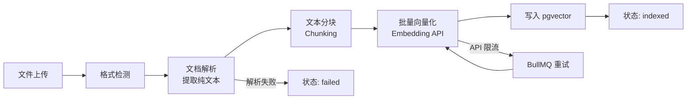
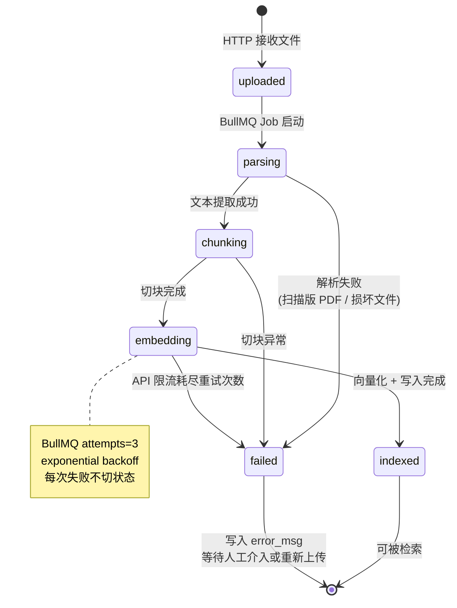
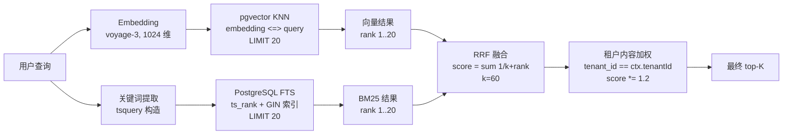

## 从一个无法回答的问题开始

双十一活动期间，有用户问客服 Agent："活动期间购买的商品可以无理由退货吗？"

这个问题难倒了 Agent。原因不是 LLM 不够聪明，而是答案根本不在任何数据库表里。订单表里没有，商品信息表里也没有。答案在一份上传到后台的 PDF 文件——《双十一活动条款》第 7 条。

没有 RAG，Agent 只有两个选择：说"我不知道"，或者用训练数据里的通用知识编一个听起来像那么回事但实际上不准确的答案。两个选择对企业客服来说都不可接受。

本章构建 AgentFlow 的知识库子系统，解决这个问题。

核心链路是这样的：运营人员上传 PDF 文档 → 系统自动解析、切块、向量化，存入 pgvector → 用户提问时，用向量相似度检索相关片段 → 将片段拼入 prompt，让 LLM 生成有据可查的回答。这就是 RAG（Retrieval-Augmented Generation）的完整流程。

## 6.1 pgvector 上手

pgvector 是 PostgreSQL 的向量扩展。选它不是因为它是最快的向量数据库（专用向量库如 Qdrant 在纯检索性能上更强），而是因为项目已经在用 PostgreSQL，用同一个数据库存向量可以减少一个基础设施依赖，而且能利用 PostgreSQL 原有的权限控制、事务、备份机制。

对于 AgentFlow 这种多租户 SaaS，`tenant_id` 过滤本来就需要 JOIN 或条件查询，pgvector 在同一个查询里就能处理，不需要在应用层做两次 IO 再合并结果。

### 安装与初始化

pgvector 以扩展形式安装，需要在数据库里显式激活：

```sql
-- 安装扩展（容器启动脚本或迁移文件里执行一次即可）
CREATE EXTENSION IF NOT EXISTS vector;
```

第 2 章的 `docker-compose.yml` 里用的镜像是 `pgvector/pgvector:pg16`，已经内置了扩展二进制，执行上面的 SQL 就可以激活。

### 核心表结构

知识库的数据模型分两层：文档（Document）和分块（Chunk）。

```sql
-- 文档表：记录每个上传文档的元数据和处理状态
CREATE TABLE documents (
  id          UUID PRIMARY KEY DEFAULT gen_random_uuid(),
  tenant_id   UUID NOT NULL REFERENCES tenants(id) ON DELETE CASCADE,
  name        VARCHAR(255) NOT NULL,
  -- 文档处理状态机：uploaded → parsing → chunking → embedding → indexed | failed
  status      VARCHAR(50) NOT NULL DEFAULT 'uploaded',
  file_path   TEXT,
  file_type   VARCHAR(50),          -- pdf / docx / md / txt
  version     INTEGER DEFAULT 1,
  chunk_count INTEGER DEFAULT 0,
  error_msg   TEXT,                 -- 失败时记录原因
  created_at  TIMESTAMPTZ DEFAULT NOW(),
  updated_at  TIMESTAMPTZ DEFAULT NOW()
);

-- 分块表：文档切块后的实际内容和向量
CREATE TABLE knowledge_chunks (
  id          UUID PRIMARY KEY DEFAULT gen_random_uuid(),
  tenant_id   UUID REFERENCES tenants(id) ON DELETE CASCADE,
  -- tenant_id IS NULL 表示平台内置知识库，所有租户可访问
  document_id UUID NOT NULL REFERENCES documents(id) ON DELETE CASCADE,
  content     TEXT NOT NULL,
  -- 全书统一 1024 维，对应默认 embedding 模型 voyage-3。
  -- 切换到 OpenAI text-embedding-3-small（1536 维）时需要把这列改成 vector(1536) 并重建索引。
  embedding   vector(1024),
  metadata    JSONB DEFAULT '{}',   -- 存储页码、标题等附加信息
  chunk_index INTEGER NOT NULL,     -- 在文档中的顺序位置
  is_deleted  BOOLEAN DEFAULT FALSE, -- 软删除标记，文档更新时使用
  created_at  TIMESTAMPTZ DEFAULT NOW()
);
```

### 索引类型与选择

pgvector 支持两种索引：

**IVFFlat**：将向量空间分成若干个 Voronoi 单元，查询时只扫描最近的几个单元。内存占用低，但精度取决于 `lists` 参数，且**必须在表里有数据之后才能建索引**，空表建 IVFFlat 没有意义。

```sql
-- IVFFlat 索引：lists 值建议约等于 sqrt(总行数)
-- 适合数据量中等、内存受限的场景
CREATE INDEX idx_chunks_ivfflat ON knowledge_chunks
  USING ivfflat (embedding vector_cosine_ops)
  WITH (lists = 100);
```

**HNSW**（Hierarchical Navigable Small World）：基于图结构的近似最近邻算法。可以边插入边使用索引，不需要预先有数据，查询速度比 IVFFlat 快，但内存占用更高（每个向量约 $m \times 8$ 字节的额外开销，$m$ 默认 16）。

```sql
-- HNSW 索引：m 是每个节点的最大连接数，ef_construction 影响构建质量
-- 生产推荐配置
CREATE INDEX idx_chunks_hnsw ON knowledge_chunks
  USING hnsw (embedding vector_cosine_ops)
  WITH (m = 16, ef_construction = 64);
```

> **生产注意**：开发环境数据量小，可以不建索引（pgvector 会做全表扫描，几千行没有感知）。生产环境优先选 HNSW，`m = 16, ef_construction = 64` 是 pgvector 官方推荐的起点配置，不需要调参就能有不错的召回率。`ef_construction` 越大，索引质量越好但构建越慢。

### 基础向量查询

Drizzle ORM 目前对 pgvector 的原生支持有限，直接用 `db.execute(sql\`...\`)` 写向量查询最清晰：

```typescript
import { drizzle } from 'drizzle-orm/node-postgres';
import { sql } from 'drizzle-orm';
import pgvector from 'pgvector';

// 向量相似度检索，cosine distance（<=>) 越小表示越相似
// 1 - cosine_distance = cosine_similarity
async function vectorSearch(
  db: ReturnType<typeof drizzle>,
  tenantId: string,
  queryEmbedding: number[],
  limit: number = 5
) {
  const embeddingStr = pgvector.toSql(queryEmbedding);

  const results = await db.execute(sql`
    SELECT
      id,
      content,
      metadata,
      document_id,
      1 - (embedding <=> ${embeddingStr}::vector) AS similarity
    FROM knowledge_chunks
    WHERE
      (tenant_id = ${tenantId} OR tenant_id IS NULL)
      AND is_deleted = FALSE
    ORDER BY embedding <=> ${embeddingStr}::vector
    LIMIT ${limit}
  `);

  return results.rows;
}
```

`<=>` 是 pgvector 的余弦距离算符。余弦距离越小（趋向 0），向量越相似。所以 ORDER BY 用升序，`similarity = 1 - distance` 越大越好。

## 6.2 文档入库的生命周期

文档从上传到可检索，要经过五个阶段。每个阶段都可能失败，需要状态跟踪和错误恢复。



这五个阶段不能在 HTTP 请求里同步执行——光 PDF 解析加 embedding API 调用就可能超过 30 秒，直接在请求链路里做会导致超时。正确的做法是：HTTP 接口只负责接收文件，写入 `documents` 表（状态 `uploaded`），然后投递一个 BullMQ Job，异步完成后续所有处理。

文档状态机的合法转换（图 6-2，文档入库 5 阶段状态机）：



状态字段持久化在 `documents.status` 列。每个非终态转换都在数据库事务里完成，避免出现"embedding 写了一半"的中间态。`failed` 是终态，需要运维手动重置为 `uploaded` 后才能重跑——这是有意的设计，防止已知坏文件无限重试浪费 embedding API 配额。

### BullMQ Pipeline Job 定义

```typescript
// 入库流水线的 Job 数据结构
interface IngestionJobData {
  documentId: string;
  tenantId: string;
  filePath: string;
  fileType: 'pdf' | 'docx' | 'md' | 'txt';
}

// 在 Worker 里处理入库流水线
const ingestionWorker = new Worker<IngestionJobData>(
  'knowledge:ingestion',
  async (job) => {
    const { documentId, tenantId, filePath, fileType } = job.data;

    // 每个阶段更新状态，方便前端轮询进度
    await updateDocumentStatus(documentId, 'parsing');
    const text = await parseDocument(filePath, fileType);

    await updateDocumentStatus(documentId, 'chunking');
    const chunks = chunkText(text, { strategy: 'semantic', chunkSize: 512, overlap: 1 });
    // overlap: 1 表示保留上一个 chunk 的最后 1 句作为新 chunk 的开头（语义策略下单位为句子数）

    await updateDocumentStatus(documentId, 'embedding');
    // batchEmbed 的完整签名：batchEmbed(texts, provider, options)
    // provider 是 VoyageEmbeddingProvider 或 OpenAIEmbeddingProvider 实例
    const embeddings = await batchEmbed(chunks.map(c => c.content), provider);

    // 批量写入，更新 chunk_count，最后切换状态
    await saveChunks(documentId, tenantId, chunks, embeddings);
    await updateDocumentStatus(documentId, 'indexed');
  },
  { connection: redisConnection, concurrency: 3 }
);
```

> **生产注意**：`concurrency: 3` 在单机开发环境里是三个并发协程，生产中对应 3 个并发 Worker 实例。BullMQ 支持跨进程/跨机器的 Worker 水平扩展，只要共享同一个 Redis，加机器直接增大处理能力。Embedding API 通常有速率限制（OpenAI 是 TPM/RPM 双限），`concurrency` 设置需要和 API 配额匹配。

## 6.3 文档解析

不同格式的解析复杂度差距很大。

### Markdown 和纯文本

最简单的情况。Markdown 文件直接读文本，可以按标题（`#`、`##`）分块，这样每个 chunk 对应一个完整小节，语义完整性天然保证。

```typescript
import * as fs from 'fs/promises';

async function parseMarkdown(filePath: string): Promise<string> {
  // Markdown 直接读取，保留原始格式供分块器使用
  return fs.readFile(filePath, 'utf-8');
}

async function parsePlainText(filePath: string): Promise<string> {
  return fs.readFile(filePath, 'utf-8');
}
```

### PDF

PDF 是最常见也最棘手的格式。PDF 的设计目标是打印排版，不是机器读取，里面的文字存储顺序可能和视觉顺序不一致，表格和多列布局在提取时会乱序。

`pdf-parse` 是 npm 生态里使用最广泛的 PDF 文字提取库，基于 PDF.js，对标准的数字原生 PDF（即由 Word/LaTeX 等软件导出的 PDF）效果不错：

```typescript
import pdfParse from 'pdf-parse';
import * as fs from 'fs/promises';

async function parsePDF(filePath: string): Promise<string> {
  const buffer = await fs.readFile(filePath);
  const data = await pdfParse(buffer);
  // data.text 是所有页面的文本拼接，data.numpages 是总页数
  return data.text;
}
```

两个已知限制需要在系统里说清楚：

1. **扫描版 PDF**（手机拍照转 PDF、旧版扫描仪输出）：里面存的是图片，`pdf-parse` 提取出的文字为空。处理这类文件需要 OCR（如 Tesseract 或云端 OCR API）。本书不展开，建议在上传页面提示用户"扫描版 PDF 需要先转为可选中文字的 PDF"。

2. **表格**：PDF 里的表格提取质量很差，行列顺序经常混乱。如果文档里有重要的表格数据，建议在上传前将表格转为 Markdown 格式。

### Word/DOCX

`mammoth` 专门处理 `.docx` 格式，能把 Word 文档转为 Markdown 或 HTML，对正文、标题、列表、表格都有较好支持：

```typescript
import mammoth from 'mammoth';

async function parseDocx(filePath: string): Promise<string> {
  // 转为 Markdown 格式，便于后续按标题分块
  const result = await mammoth.convertToMarkdown({ path: filePath });

  if (result.messages.length > 0) {
    // messages 里是转换警告，比如"不支持的样式 xxx"
    // 不是错误，记录日志即可
    console.warn('DOCX 转换警告:', result.messages);
  }

  return result.value;
}
```

注意：复杂 Word 文档（使用了文本框、多列布局、自定义样式）的转换质量会下降。这不是 `mammoth` 的 bug，是 DOCX 格式本身的结构复杂性。建议提示用户优先上传结构简单的文档，或者直接上传 Markdown。

## 6.4 分块策略

分块是 RAG 质量最关键的工程决策之一，却常被低估。块太小，上下文不完整，LLM 没有足够信息生成准确答案；块太大，检索时噪声多，相似度被稀释，召回率下降，而且会超出 LLM 的 context window。

### 固定大小分块

最简单的实现，按字符数切割：

```typescript
interface ChunkOptions {
  chunkSize: number;   // 块的目标大小（字符数）
  overlap: number;     // 相邻块的重叠字符数，保留上下文连贯性
}

function fixedSizeChunk(text: string, options: ChunkOptions): string[] {
  const { chunkSize, overlap } = options;
  const chunks: string[] = [];
  let start = 0;

  while (start < text.length) {
    const end = Math.min(start + chunkSize, text.length);
    chunks.push(text.slice(start, end));
    // 下一个 chunk 从 (start + chunkSize - overlap) 开始
    // overlap 确保块边界处的语义不会完全丢失
    start += chunkSize - overlap;
  }

  return chunks;
}
```

固定字符数切割不关心句子边界，可能把"退货期限为 30" 和 "天，自收货日起计算" 切成两个 chunk，检索时两个 chunk 的语义都不完整。

### 语义分块

在句子或段落边界切割，保证每个 chunk 都是完整的语义单元：

```typescript
interface SemanticChunk {
  content: string;
  index: number;
}

function semanticChunk(text: string, maxChunkSize: number, overlap: number = 1): SemanticChunk[] {
  // 按中文句末标点分割句子
  // 同时处理换行段落
  const sentences = text
    .split(/(?<=[。！？\n])\s*/)
    .map(s => s.trim())
    .filter(s => s.length > 0);

  const chunks: SemanticChunk[] = [];
  let currentChunk = '';
  let lastSentence = '';  // 用于 overlap：保留上一个 chunk 的最后一句

  for (const sentence of sentences) {
    // 如果加上当前句子会超过 maxChunkSize，先保存当前 chunk
    if (currentChunk.length + sentence.length > maxChunkSize && currentChunk.length > 0) {
      chunks.push({ content: currentChunk.trim(), index: chunks.length });
      // 新 chunk 以上一个 chunk 的最后一句开头（overlap）
      currentChunk = overlap > 0 ? lastSentence + '\n' : '';
    }
    lastSentence = sentence;
    currentChunk += sentence + '\n';
  }

  // 处理最后一个 chunk
  if (currentChunk.trim().length > 0) {
    chunks.push({ content: currentChunk.trim(), index: chunks.length });
  }

  return chunks;
}
```

### 按 Markdown 标题分块

对于有明确结构的文档（产品手册、FAQ、政策条款），按标题分块效果最好——每个块对应一个完整小节，语义高度内聚：

```typescript
interface MarkdownChunk {
  content: string;
  heading: string;   // 对应的标题，写入 metadata 方便调试
  level: number;     // 标题层级（1-6）
  index: number;
}

function markdownChunk(text: string, maxChunkSize: number = 1500): MarkdownChunk[] {
  const lines = text.split('\n');
  const chunks: MarkdownChunk[] = [];
  let currentContent = '';
  let currentHeading = '（无标题）';
  let currentLevel = 0;

  for (const line of lines) {
    const headingMatch = line.match(/^(#{1,6})\s+(.+)/);

    if (headingMatch) {
      const level = headingMatch[1].length;
      const heading = headingMatch[2];

      // 遇到新标题时，保存当前积累的内容
      if (currentContent.trim().length > 0) {
        // 如果当前块超过 maxChunkSize，递归用语义分块处理
        if (currentContent.length > maxChunkSize) {
          const subChunks = semanticChunk(currentContent, maxChunkSize);
          for (const sub of subChunks) {
            chunks.push({
              content: sub.content,
              heading: currentHeading,
              level: currentLevel,
              index: chunks.length,
            });
          }
        } else {
          chunks.push({
            content: currentContent.trim(),
            heading: currentHeading,
            level: currentLevel,
            index: chunks.length,
          });
        }
      }

      currentHeading = heading;
      currentLevel = level;
      currentContent = line + '\n';  // 标题本身也包含在 chunk 里
    } else {
      currentContent += line + '\n';
    }
  }

  // 处理最后一个节
  if (currentContent.trim().length > 0) {
    chunks.push({
      content: currentContent.trim(),
      heading: currentHeading,
      level: currentLevel,
      index: chunks.length,
    });
  }

  return chunks;
}
```

### 如何选择分块策略

| 文档类型 | 推荐策略 | 参数建议 |
|----------|----------|----------|
| 结构化文档（产品手册、FAQ） | 按 Markdown 标题分块 | maxChunkSize=1500 |
| 合同、条款、密集正文 | 语义分块 | chunkSize=512，overlap=1句 |
| 纯散文、新闻文章 | 固定大小分块 | chunkSize=400，overlap=80 |
| 问答对（每条 Q&A 独立） | 不分块，每个 Q&A 是一个 chunk | — |

上面的参数是起点，不是终点。实际 chunk 大小要根据使用的 embedding 模型的 token 上限调整（OpenAI text-embedding-3-small 的 token 上限是 8191，中文字符约 1 token 对应 1.5-2 个字）。

### 层级分块（进阶）

有一种场景固定分块处理不好：用户问了一个需要结合多个段落才能完整回答的问题。单个 chunk 太小，上下文不够；扩大 chunk 尺寸，检索精度又下降。

解法是层级分块：同一段内容同时生成"大块"（段落级，~2048 token）和"小块"（句子级，~128 token）。小块用于精确检索，命中后用父节点的大块作为实际上下文传给 LLM。

LlamaIndex.TS 内置了这种模式：

```typescript
import { HierarchicalNodeParser, getNodesFromDocument, Document } from 'llamaindex';

const parser = new HierarchicalNodeParser({
  chunkSizes: [2048, 512, 128],  // 从粗到细三个粒度
});

const document = new Document({ text: rawText });
const nodes = getNodesFromDocument(document, parser);
// nodes 里同时包含三个粒度的 chunk，并记录了父子关系
```

层级分块对于检索质量提升明显，代价是存储量增加（同一内容存三份），以及检索逻辑更复杂。本书的示例代码用语义分块，层级分块作为进阶选项。

## 6.5 向量化：调用 Embedding API

拿到文本块之后，需要把它们转成向量（embedding），才能做相似度检索。

AgentFlow 的 embedding 模型选用 Anthropic 的 `voyage-3`（通过 Voyage AI API 独立调用，不经过 Anthropic Messages API）或 OpenAI 的 `text-embedding-3-small`。voyage-3 默认输出 1024 维，与前面建表时的 `vector(1024)` 对应；如果切换为 text-embedding-3-small，需要将建表语句改为 `vector(1536)`，并重新生成所有向量。

### 批量处理与速率限制

Embedding API 的调用有两个实际约束：

1. **单次请求 token 上限**：OpenAI 是 8191 tokens/请求，Voyage AI 是 120K tokens/请求，每次批量请求不能超过这个限制
2. **RPM/TPM 速率限制**：不同 tier 的配额不同，超出会返回 429 错误

对于一个包含 200 个 chunk 的文档，不能一次性把全部 chunk 发给 API，需要分批处理：

```typescript
import Anthropic from '@anthropic-ai/sdk';

// 注意：voyage embedding 通过单独的 voyageai 包调用
// 这里用 OpenAI 格式展示逻辑，实际可替换为任意 embedding 提供商
async function batchEmbed(
  texts: string[],
  batchSize: number = 20,
  delayMs: number = 100
): Promise<number[][]> {
  const embeddings: number[][] = [];

  for (let i = 0; i < texts.length; i += batchSize) {
    const batch = texts.slice(i, i + batchSize);

    // 调用 embedding API
    const batchEmbeddings = await embedBatch(batch);
    embeddings.push(...batchEmbeddings);

    // 批次间等待，避免触发速率限制
    // 生产环境应该用指数退避重试，而不是固定等待
    if (i + batchSize < texts.length) {
      await new Promise(resolve => setTimeout(resolve, delayMs));
    }

    console.log(`向量化进度: ${Math.min(i + batchSize, texts.length)}/${texts.length}`);
  }

  return embeddings;
}
```

> **生产注意**：`delayMs: 100` 是单机演示用的简单限流，生产中应该用令牌桶（Token Bucket）算法做精确的速率控制，并对 429 错误做指数退避重试（初始间隔 1s，最多重试 5 次，上限 60s）。BullMQ 的 Job 重试机制可以处理这个场景：在 Worker 里抛出错误，BullMQ 会按配置的 backoff 策略自动重试。

## 6.6 混合检索：向量 + BM25

纯向量检索有一个死角：精确词汇匹配。

用户问"订单 #ORD-20241111-88888 的发货状态"，这个订单号在向量空间里会被编码成一个高维向量，但它的语义完全由这串数字决定。向量检索找到的是"语义相似的句子"，不是"包含这串数字的句子"，结果可能是其他订单的记录。

BM25 是传统全文检索的核心算法，本质是 TF-IDF 的改进版。它对精确词汇匹配非常有效，补上了向量检索的短板。

混合检索的思路是：同时跑两路检索，分别得到两个排名列表，再用 RRF（Reciprocal Rank Fusion）算法融合成最终排名。

### PostgreSQL 全文搜索

pgvector 的宿主 PostgreSQL 自带全文搜索，不需要额外部署 Elasticsearch：

```sql
-- 给 knowledge_chunks 表加全文搜索列（生成列，自动维护）
ALTER TABLE knowledge_chunks
  ADD COLUMN tsv TSVECTOR
  GENERATED ALWAYS AS (to_tsvector('simple', content)) STORED;

-- GIN 索引加速全文搜索
CREATE INDEX idx_chunks_tsv ON knowledge_chunks USING gin(tsv);
```

> **生产注意**：这里用 `'simple'` 配置，它按空格和标点分词，对中文的支持非常有限（会把整段中文当成一个 token）。真正的中文全文搜索需要 `zhparser`（基于 SCWS）或 `pg_jieba` 扩展。`pgvector/pgvector:pg16` 镜像没有内置这些扩展，生产部署需要自行构建包含中文分词的 PostgreSQL 镜像，或者用阿里云 RDS for PostgreSQL（支持 zhparser）。

### RRF 融合查询

RRF 的核心公式很简单：对于每个结果，它的分数 = $\sum \frac{1}{k + \text{rank}_i}$，其中 $k$ 是平滑常数（通常取 60），$\text{rank}_i$ 是该结果在第 $i$ 路检索中的排名。

不需要调权重，两路检索的贡献自动通过排名位置体现——排名靠前的结果贡献大，排名靠后的贡献小。下图（图 6-3，混合检索 RRF 融合流程）展示了一个用户查询从输入到最终排名的完整过程：



两路检索完全独立、可并行：向量路负责语义相似（"我的快递在哪"匹配"物流跟踪查询"），BM25 路负责精确匹配（订单号、产品 SKU、专有名词）。融合后按 RRF 分数排序，再叠加租户加权（6.7 节），最后输出 top-K 给 Agent。整段逻辑在一条 SQL 里完成，不需要应用层做两次查询再合并。

```sql
-- 混合检索查询（使用 RRF 融合向量检索和全文检索结果）
WITH
vector_results AS (
  SELECT
    id,
    ROW_NUMBER() OVER (ORDER BY embedding <=> $1::vector) AS rank
  FROM knowledge_chunks
  WHERE
    (tenant_id = $2 OR tenant_id IS NULL)
    AND is_deleted = FALSE
  LIMIT 20
),
bm25_results AS (
  SELECT
    id,
    ROW_NUMBER() OVER (ORDER BY ts_rank(tsv, query) DESC) AS rank
  FROM knowledge_chunks,
       to_tsquery('simple', $3) AS query
  WHERE
    (tenant_id = $2 OR tenant_id IS NULL)
    AND is_deleted = FALSE
    AND tsv @@ query
  LIMIT 20
)
SELECT
  kc.id,
  kc.content,
  kc.metadata,
  kc.document_id,
  -- RRF 分数：k=60 是行业常用默认值
  (COALESCE(1.0 / (60.0 + vr.rank), 0.0) +
   COALESCE(1.0 / (60.0 + br.rank), 0.0)) AS rrf_score
FROM knowledge_chunks kc
LEFT JOIN vector_results vr ON kc.id = vr.id
LEFT JOIN bm25_results br ON kc.id = br.id
WHERE (vr.id IS NOT NULL OR br.id IS NOT NULL)
  AND kc.is_deleted = FALSE
ORDER BY rrf_score DESC
LIMIT $4;
```

参数说明：`$1` 是查询向量，`$2` 是 `tenantId`，`$3` 是 BM25 查询关键词（需要先做分词和 `tsquery` 格式化），`$4` 是返回条数。

### 将用户问题转换为 tsquery

用户的自然语言问题不能直接传给 `to_tsquery`，需要先提取关键词并格式化：

```typescript
function buildTsquery(text: string): string {
  // 简单实现：按空格和标点切分，取有意义的词（长度 > 1）
  // 生产环境应使用 jieba 或其他中文分词工具
  const tokens = text
    .split(/[\s，。！？、：；""''【】（）\(\)\[\]]+/)
    .map(t => t.trim())
    .filter(t => t.length > 1);

  if (tokens.length === 0) return '';

  // 用 | 连接表示 OR，& 表示 AND
  // 对于用户问题，OR 召回更多结果，配合 RRF 重排
  //
  // 注意：to_tsquery 对特殊字符（& | ! : 等）会报 SQL 语法错误。
  // 生产中应使用 plainto_tsquery($config, $text) 代替手工拼接，
  // 它会自动将自然语言转为安全的 tsquery 表达式。
  return tokens.join(' | ');
}
```

## 6.7 多租户隔离与内置知识库

AgentFlow 有两类知识库内容：

1. **平台内置知识库**：通用的客服话术、平台通用条款，所有租户共享。`tenant_id = NULL`。
2. **租户自定义知识库**：各租户上传的私有文档，仅限该租户访问。`tenant_id = <租户 UUID>`。

检索时合并两个来源：

```sql
WHERE (tenant_id = $tenantId OR tenant_id IS NULL)
```

这个条件在前面的查询里已经包含了。不需要在应用层做两次查询再合并，数据库一次搞定。

### 租户优先级提升

当租户内容和平台内置内容的相似度接近时，通常优先展示租户自定义内容——它更针对该租户的业务场景，准确性更高。

在 RRF 分数上加一个提升系数：

```typescript
interface SearchResult {
  id: string;
  content: string;
  metadata: Record<string, unknown>;
  documentId: string;
  rrfScore: number;
  tenantId: string | null;   // null 表示平台内置
}

function boostTenantResults(
  results: SearchResult[],
  tenantId: string,
  boostFactor: number = 1.2
): SearchResult[] {
  return results
    .map(r => ({
      ...r,
      // 租户自己的内容乘以提升系数
      rrfScore: r.tenantId === tenantId ? r.rrfScore * boostFactor : r.rrfScore,
    }))
    .sort((a, b) => b.rrfScore - a.rrfScore);
}
```

### 可配置的知识库策略

金融类租户（AgentFlow 的租户 C）可能需要完全关闭平台内置知识库，防止通用内容干扰监管合规的回答：

```typescript
interface KnowledgeSearchOptions {
  tenantId: string;
  query: string;
  queryEmbedding: number[];
  includeBuiltin: boolean;      // false 时只查租户自己的知识库
  tenantContentBoost: number;   // 租户内容排名提升系数，默认 1.2
  limit: number;
  strategy: 'vector' | 'bm25' | 'hybrid';  // 检索策略
}
```

`includeBuiltin: false` 时，SQL 里的条件从 `(tenant_id = $tenantId OR tenant_id IS NULL)` 改为 `tenant_id = $tenantId`。这个配置存在租户配置表里，检索时按租户读取。

## 6.8 知识库更新：增量索引与软删除

文档更新是运营人员的日常操作，处理不当会出现两个问题：

- **空窗期**：先删旧 chunks，再写新 chunks，中间有几秒用户查到的是空结果
- **脏数据**：写新 chunks 到一半系统挂了，数据库里新旧 chunks 混在一起

软删除解决这两个问题：旧 chunks 不直接删除，而是标记 `is_deleted = TRUE`；新 chunks 写入完成后，在同一个事务里把旧 chunks 标记为软删除。整个切换是原子的。

```typescript
async function updateDocument(
  db: ReturnType<typeof drizzle>,
  documentId: string,
  tenantId: string,
  newContent: string,
  fileType: DocumentFileType
): Promise<void> {
  // 1. 解析和分块
  const text = await parseDocument('/tmp/updated-file', fileType);
  const chunks = chunkText(text, { strategy: 'semantic', chunkSize: 512, overlap: 1 });
  const embeddings = await batchEmbed(chunks.map(c => c.content));

  // 2. 在事务里完成：写新 chunks + 软删除旧 chunks
  await db.transaction(async (tx) => {
    // 写入新 chunks
    const newChunkIds = await insertChunks(tx, documentId, tenantId, chunks, embeddings);

    // 软删除旧 chunks（排除刚写入的新 chunks）
    await tx.execute(sql`
      UPDATE knowledge_chunks
      SET is_deleted = TRUE
      WHERE document_id = ${documentId}
        AND id != ALL(${newChunkIds}::uuid[])
        AND is_deleted = FALSE
    `);

    // 更新文档元数据
    await tx.execute(sql`
      UPDATE documents
      SET chunk_count = ${chunks.length},
          version = version + 1,
          updated_at = NOW()
      WHERE id = ${documentId}
    `);
  });
}
```

事务提交后，检索立刻能看到新 chunks，旧 chunks 被标记为 `is_deleted = TRUE`，查询里的 `AND is_deleted = FALSE` 条件会自动过滤掉它们。

软删除的 chunks 不需要立即清理，可以保留一段时间（比如 7 天）用于审计，然后用定时任务批量删除：

```sql
-- 定时清理软删除的 chunks（保留 7 天以上的才清理）
DELETE FROM knowledge_chunks
WHERE is_deleted = TRUE
  AND created_at < NOW() - INTERVAL '7 days';
```

> **生产注意**：大表上的 DELETE 操作会产生大量 WAL 日志并引发表膨胀（PostgreSQL 的 MVCC 机制）。生产环境建议用分批删除（每次最多删 1000 行，循环执行），并在低峰期运行，避免影响检索性能。

## 6.9 在 Agent 中使用知识库

知识库构建完成后，需要接入 Agent 的检索链路。标准模式是这样的：

```typescript
// Agent 处理用户消息时的 RAG 步骤
async function answerWithRAG(
  userMessage: string,
  tenantId: string
): Promise<string> {
  // 1. 将用户问题向量化
  const queryEmbedding = await embedSingleText(userMessage);

  // 2. 混合检索相关 chunks
  const chunks = await hybridSearch({
    tenantId,
    query: userMessage,
    queryEmbedding,
    includeBuiltin: true,
    tenantContentBoost: 1.2,
    limit: 5,
    strategy: 'hybrid',
  });

  if (chunks.length === 0) {
    // 没有检索到相关内容，让 LLM 明确表示不知道
    return await callLLM(userMessage, '');
  }

  // 3. 拼装 context，传入 LLM
  const context = chunks
    .map((c, i) => `[来源 ${i + 1}]\n${c.content}`)
    .join('\n\n---\n\n');

  return await callLLM(userMessage, context);
}

async function callLLM(userMessage: string, context: string): Promise<string> {
  const client = new Anthropic();

  const systemPrompt = context
    ? `你是一个企业智能客服助手。请基于以下知识库内容回答用户问题。
如果知识库内容不能回答问题，请明确说明，不要编造信息。

知识库内容：
${context}`
    : '你是一个企业智能客服助手。你没有找到与该问题相关的知识库内容，请如实告知用户。';

  const response = await client.messages.create({
    model: 'claude-sonnet-4-5',
    max_tokens: 1024,
    system: systemPrompt,
    messages: [{ role: 'user', content: userMessage }],
  });

  return response.content[0].type === 'text' ? response.content[0].text : '';
}
```

这是 RAG 的最简形式。生产中还会在这基础上加：

- **重排序（Reranking）**：用交叉编码器对检索结果重新打分，召回更准确
- **查询改写（Query Rewriting）**：让 LLM 把用户的口语化问题改写为检索效果更好的查询
- **引用追踪**：在回答里标注"依据来源 1（《双十一条款》第 7 条）"，让用户可以验证

这些进阶技术在第 11 章（可观测性与评估）里会结合 Langfuse 做效果追踪和对比评估，这里不展开。

## 对三个租户意味着什么

知识库三个租户的差异最大——内容、更新频率、合规要求几乎没有交集。

**租户 A（电商）**：知识库内容是促销条款、退换货规则、活动 FAQ，属于"半静态"——一个促销周期内基本不变，活动结束后整批替换。重建索引可以选在低峰期跑全量，对增量索引的要求不高。

**租户 B（SaaS 软件）**：产品文档每天更新，新功能上线、bug fix 说明、API 变更都要求"今天发布今天能被检索到"。6.8 节的增量索引 + 软删除 + 事务切换是租户 B 必须打开的能力，不是 nice-to-have。

**租户 C（金融机构）**：知识库分两级，公开知识库（公开产品资料）和内部知识库（内部规章、风控手册），不同用户角色看到不同知识库。除了 6.7 节的 RLS 隔离，每一次检索行为都要写审计日志——"谁，什么时候，检索了哪条内部文档"——为合规审查留底。

## 本章小结

本章构建了 AgentFlow 知识库子系统的完整链路：文档解析、分块、向量化、存储，再到检索和多租户隔离。几个关键工程决策值得记住：

- pgvector 不是向量库性能最强的选择，但它让向量检索和关系数据共处一个事务，对多租户 SaaS 的隔离逻辑实现最简单
- 分块策略比模型选择对 RAG 质量的影响更大；对结构化文档优先按标题分块，比固定大小分块的效果好一个数量级
- 混合检索（向量 + BM25 + RRF）是目前实践效果最稳定的检索方案，不需要调权重
- 软删除 + 事务切换是文档更新时避免空窗期和脏数据的标准解法

## 参考资料

- [pgvector 官方文档](https://github.com/pgvector/pgvector)
- [pgvector HNSW 索引说明](https://github.com/pgvector/pgvector#hnsw)
- [Reciprocal Rank Fusion 原论文](https://plg.uwaterloo.ca/~gvcormac/cormacksigir09-rrf.pdf)
- [LlamaIndex.TS 文档](https://ts.llamaindex.ai/)
- [mammoth.js DOCX 转换库](https://github.com/mwilliamson/mammoth.js)
- [pdf-parse npm 包](https://www.npmjs.com/package/pdf-parse)

---

> 本章来自《百万级 AI Agent 平台架构》开源版 · 作者「递归客」  
> 在线阅读完整书系：[inferloop.dev](https://inferloop.dev)  
> 源码仓库：[github.com/diguike/book-enterprise-agent](https://github.com/diguike/book-enterprise-agent)
