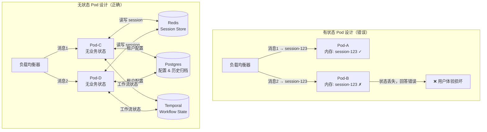
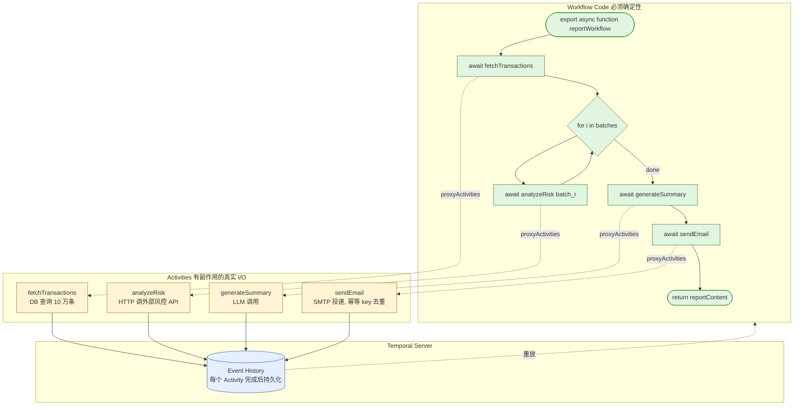
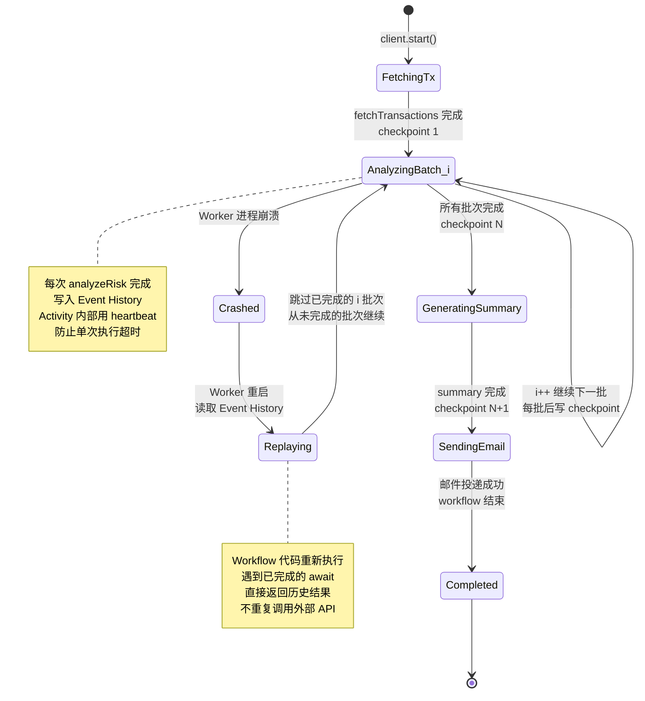

## 从一次诡异的"失忆"故障说起

AgentFlow 上线一个月后，租户 A（电商）的客服主管提了一个工单：用户有时候和 Agent 聊着聊着，Agent 突然"忘了"前面说过的事。用户说"帮我查一下刚才那笔订单"，Agent 回答"请问您要查哪笔订单"。

排查日志发现，这种情况稳定地出现在单个用户发送第二条消息的时候。看一下部署配置：AgentFlow 运行着 3 个 Pod，前面有一个 Nginx 做负载均衡，轮询策略。

问题很清楚了。用户第一条消息打到 Pod-A，Pod-A 的内存里创建了这个 session 的状态：消息历史、解析出的意图、临时变量。用户第二条消息轮询到 Pod-B，Pod-B 内存里什么都没有，从一个空白 session 开始处理，自然不知道前面说了什么。

这是最典型的有状态服务水平扩展失败。

解法只有一个：Pod 必须无状态化。所有需要跨请求保留的数据，必须存在 Pod 之外——Redis、Postgres、或者专为分布式状态设计的系统。本章解决这个问题，同时处理另一个更难的问题：长时间运行的多步工作流（比如生成月度合规报告，需要跑 10 分钟）如何在中途崩溃后从断点续传，而不是从头重来。

## 7.1 Agent 无状态化设计

**核心原则只有一条**：Agent Worker Pod 本身不持有任何业务状态。

这句话听起来简单，落地时很多人会把握不准"什么算业务状态"。下面明确划分。

### 必须外置的状态

**对话历史（messages[]）**：这是最常见的遗漏。Mastra Agent 默认把消息历史存在内存的 `ConversationManager` 里。单 Pod 跑得好好的，一扩展就出问题。解决方案是 Redis，用 List 结构存最近 N 条消息，到期自动清理。

**用户偏好、租户配置**：包括租户的系统 prompt 模板、功能开关、API 配额设置。这些数据变化频率低，适合放 Postgres，读取时加 Redis 缓存。

**当前任务执行状态**：如果 Agent 正在执行一个多步任务（比如正在处理第 3 步），这个"进度"不能在内存里。用 Temporal 的 Workflow 状态机来管理——这是本章后半部分的主题。

**文件和生成物**：用户上传的文档、Agent 生成的报告。这些必须放对象存储（S3 或 Cloudflare R2），Pod 只保存指向存储的 URL。

### 可以留在内存里的

并非所有东西都要外置，过度外置会引入不必要的网络延迟：

- **连接池**：数据库连接池、Redis 连接池。连接建立有开销，进程内复用是正确做法
- **已编译的代码**：Node.js 的 JIT 编译结果、TypeScript 编译后的模块缓存
- **静态配置**：Skill 注册表（进程启动时从数据库加载一次，除非触发热更新信号）、内置工具列表

判断依据只有一个：这份数据如果消失了（Pod 重启），会不会影响用户的下一条请求？会，就必须外置。不会，就可以留内存。

### 架构对比

下面的图展示了有状态 Pod 设计在扩展时的失败模式，以及无状态设计如何解决它：



Pod-C 和 Pod-D 可以处理同一个 session 的任意请求，因为"记忆"不在它们内部，在 Redis 里。

## 7.2 Redis 会话管理

Redis 承担两个职责：存活跃 session 的实时状态，以及暂存最近的消息历史。之所以选 Redis 而不是直接用 Postgres，原因很实际：session 读写频率极高（每条消息至少一次读、一次写），需要毫秒级响应；同时 session 有自然的过期时间（用户不活跃后自动清理），Redis 的 TTL 机制比定时任务清理更干净。

### Session 数据结构

```typescript
interface ConversationMessage {
  role: 'user' | 'assistant' | 'system';
  content: string;
  timestamp: number;
  // 用于上下文压缩的评分（7.3 节详述）
  importanceScore?: number;
  // tool_use 场景下的工具调用信息
  toolCallId?: string;
  toolName?: string;
}

interface AgentConfig {
  systemPrompt: string;
  model: string;
  maxTokens: number;
  temperature: number;
  enabledSkills: string[];
}

interface SessionData {
  sessionId: string;
  tenantId: string;
  userId: string;
  messages: ConversationMessage[];   // 最近 N 条消息（Redis 侧缓存）
  agentConfig: AgentConfig;
  activeSkills: string[];
  metadata: Record<string, unknown>;  // 扩展字段，不同租户可定制
  createdAt: number;
  lastActiveAt: number;
}
```

### Key 设计

```
session:{sessionId}            → SessionData（JSON string）
session:{sessionId}:messages   → List（消息队列，最近 50 条）
tenant:{tenantId}:sessions     → Set（该租户所有活跃 sessionId）
```

注意花括号 `{sessionId}` 的写法——这是 Redis Cluster 的 hash tag。在 Redis Cluster 模式下，同一个 hash tag 内的 key 会被路由到同一个节点，从而保证针对同一个 session 的 pipeline 操作可以在单节点上原子执行。

### TTL 策略

Session 的生命周期管理容易出问题，这里明确规定：

1. 活跃 session 的 TTL 设为 **1800 秒**（30 分钟）。每次读写都重置 TTL（滑动过期）
2. Session TTL 到期时，触发 **归档流程**：将完整消息历史写入 Postgres 的 `conversation_archives` 表，供后续分析使用
3. 不要在 Redis 里存全量历史。消息积累到 50 条以上，早期消息通过 7.3 节的压缩机制处理或归档到 Postgres

> **生产注意**：Redis 的 key 过期通知（keyspace notification）默认关闭，需要在 `redis.conf` 里设置 `notify-keyspace-events KEA`，或通过 `CONFIG SET` 动态开启。但过期通知不是 100% 可靠的——如果 Redis 在通知发送前重启，归档回调不会触发。生产环境必须有补偿机制：定期扫描 Postgres 里最后活跃时间超过阈值的 session，检查 Redis 里是否已归档。

### RedisSessionStore 实现

```typescript
// 见 examples/src/session-store.ts
```

核心逻辑在三个方法：`get` 负责读取 session 并刷新 TTL，`set` 负责写入完整 session 数据，`appendMessage` 负责追加消息到 List 结构。

appendMessage 使用 pipeline 将 `LPUSH`、`LTRIM`、`EXPIRE` 三个命令打包发送，避免三次网络往返。LPUSH 是从 List 头部插入（新消息在前），LTRIM 保留前 50 条（最新的 50 条），这样 List 始终是最近 50 条消息，按时间倒序排列。

> **生产注意**：`pipeline().exec()` 在单机 Redis 是原子的。在 Redis Cluster 中，pipeline 可以跨节点批量发送，但不保证原子性。要保证原子性，必须确保所有 key 在同一个 slot——用 hash tag `{sessionId}` 可以做到这点：`session:{sessionId}`、`session:{sessionId}:messages` 都包含相同的 hash tag，会被路由到同一个 Cluster 节点。

### Session 归档

Session 过期时，需要把消息历史持久化到 Postgres：

```sql
CREATE TABLE conversation_archives (
  id UUID PRIMARY KEY DEFAULT gen_random_uuid(),
  -- session_id 加 UNIQUE 约束：一个 session 只归档一次，
  -- 同时为 archive 方法里的 ON CONFLICT (session_id) DO UPDATE 提供唯一索引
  session_id UUID NOT NULL UNIQUE,
  tenant_id UUID NOT NULL,
  user_id UUID NOT NULL,
  messages JSONB NOT NULL,
  metadata JSONB,
  started_at TIMESTAMPTZ NOT NULL,
  ended_at TIMESTAMPTZ DEFAULT NOW()
);

CREATE INDEX ON conversation_archives (tenant_id, ended_at DESC);
CREATE INDEX ON conversation_archives (user_id, ended_at DESC);
```

归档操作在单独的 worker 进程里执行，避免占用处理请求的主进程资源。

## 7.3 长对话上下文管理

用户连续对话 100 轮之后，消息历史会积累大量 token。Claude Sonnet 4.5 支持 200K context window，但有两个现实约束：

1. **成本**：每次调用都要把完整历史塞进 prompt，token 数越多，每次调用的费用越高，而历史消息里大量内容对当前问题根本没帮助
2. **延迟**：更大的输入意味着更长的 prefill 时间，影响用户体验

解决方案是动态上下文压缩：保留重要的消息，对不重要的消息做摘要或丢弃。

### 重要性评分

每条消息在存入时计算一个 0-1 的重要性分数：

```
score = relevance_to_current × 0.4
      + recency × 0.3
      + frequency_of_reference × 0.2
      + user_marked_important × 0.1
```

各维度说明：

- **relevance_to_current**：与当前最新消息的语义相关度。简化实现里可以用关键词重叠率替代，精确实现用向量余弦相似度
- **recency**：时间衰减。最新消息为 1.0，每过去 5 条消息衰减 0.1，最低 0.0
- **frequency_of_reference**：该消息的内容在后续对话中被引用或重复的次数。用户多次提到某个订单号，那条消息的分数应该高
- **user_marked_important**：用户明确标记（比如"记住这点"）的消息加权

### 压缩触发与执行

压缩触发条件：消息数超过 50 条，或者估算 token 数超过 100K。

压缩策略不是简单地截断前面的内容，而是分级处理：

1. 始终保留：第一条 system prompt、最近 20 条消息（无论分数）
2. score < 0.3 的 assistant 消息：丢弃
3. score 在 0.3-0.6 之间的 assistant 消息：替换为一句话摘要
4. score >= 0.6 的消息：保留原文
5. 所有 user 消息：永远保留（用户原话不可篡改）

这个策略有一个保底机制：即使激进压缩后 token 数仍然超限，也必须保留最近 20 条消息，然后在剩余空间里尽量多塞高分消息。

```typescript
// token 估算（不用真正调用 tokenizer，这个估算对中文场景足够准确）
function estimateTokenCount(text: string): number {
  // 中文字符约 1.5 tokens，英文词约 1.3 tokens（以空格分隔）
  const chineseChars = (text.match(/[一-鿿]/g) || []).length;
  const otherChars = text.length - chineseChars;
  return Math.ceil(chineseChars * 1.5 + otherChars * 0.3);
}
```

> **生产注意**：严格精确的 token 计数需要调用对应模型的 tokenizer（Anthropic 提供了 token counting API，`client.beta.messages.countTokens()`）。估算方法在 90% 的场景下误差在 15% 以内，对于压缩触发阈值判断够用，但如果你的场景对 token 成本非常敏感，建议换成精确计数。

### 摘要生成

低分 assistant 消息的摘要化可以用简单规则（取前 50 字符），也可以用 LLM 生成一句话摘要。后者效果更好但引入额外 LLM 调用成本。对于 AgentFlow 的场景，选择折中方案：批量压缩时，把需要摘要的消息一次性发给 LLM，生成所有摘要，而不是逐条调用。

## 7.4 Temporal 上手：核心概念

从这里开始进入本章最难的部分。先用一个具体故障建立需求感。

### 为什么需要 Temporal

租户 C（金融机构）在月末需要生成合规报告。这个任务的步骤是：

1. 从数据库拉取该月全部交易记录（约 10 万条，耗时 30 秒）
2. 逐批调用风险评估 API，每批 100 条，共 1000 次请求（耗时约 3 分钟）
3. 把分析结果传给 LLM 生成摘要（耗时 1 分钟）
4. 发邮件给合规团队

整个流程大约需要 5 分钟。

用传统方案（一个长时间运行的 async 函数）实现这个功能，会遇到什么问题：

- 如果在第 2 步的第 500 次 API 调用时服务器重启，从头开始，前面的 500 次调用和已经拉取的数据全部丢失
- 如果网络抖动导致某次 API 调用超时，整个流程失败，需要重试逻辑从头实现
- 如果 LLM API 在第 3 步返回 429（超限），需要等待后重试，但你的函数早已超时
- 没有可视化界面查看"目前跑到第几步"

Temporal 解决了这些问题。它的本质是一个持久化的工作流引擎：Workflow 的执行状态被序列化并持久化到数据库，每个步骤完成后就相当于"存档"，崩溃后从最近的存档点继续。

### 核心概念

先建立概念模型，用读者熟悉的东西类比：

| Temporal 概念 | 类比 | 说明 |
|--------------|------|------|
| Workflow | async 函数 | 描述工作流的控制逻辑（顺序、分支、循环）|
| Activity | await 调用 | 实际执行工作（DB 查询、HTTP 请求、LLM 调用）|
| Worker | Node.js 进程 | 托管并运行 Workflow 和 Activity 代码 |
| Temporal Server | 可靠的任务调度中心 | 存储 Workflow 状态，分发 Activity 任务 |
| Task Queue | 消息队列 | Temporal Server 通过它把任务分发给 Worker |

Workflow 和 Activity 的分工是 Temporal 设计里最重要的约定，也是最容易搞错的地方。

**Workflow** 负责编排：调用哪些 Activity、顺序是什么、出错怎么处理。Workflow 代码必须是确定性的——给定同样的输入和历史事件序列，每次重放必须产生同样的结果。

**Activity** 负责执行：真正做有副作用的事情（网络请求、数据库读写、文件操作）。Activity 代码没有确定性要求，可以随机、可以依赖当前时间。

### Workflow 确定性要求（最常见的坑）

Temporal 在 Worker 崩溃重启后，会重放 Workflow 的历史事件来恢复状态。重放意味着 Workflow 代码会被执行多次。如果代码里有不确定性，每次重放的结果会不同，导致状态不一致。

```typescript
// 错误：以下用法在 Workflow 代码里会导致重放不一致
import type * as activities from './activities';

export async function reportWorkflow(tenantId: string): Promise<void> {
  const timestamp = Date.now();       // 错误：每次重放时间不同
  const random = Math.random();       // 错误：每次重放随机数不同
  await new Promise((r) => setTimeout(r, 5000)); // 错误：使用原生 setTimeout
  const result = await fetch('...');  // 错误：网络请求不应该在 Workflow 里
}
```

```typescript
// 正确：使用 Temporal 提供的确定性 API
import { proxyActivities, sleep, workflowInfo } from '@temporalio/workflow';
import type * as activities from './activities';

const { fetchTransactions } = proxyActivities<typeof activities>({
  startToCloseTimeout: '10 minutes',
});

export async function reportWorkflow(tenantId: string): Promise<void> {
  const info = workflowInfo();
  // info.startTime 是从 Temporal Server 事件历史里读取的，重放时一致

  await sleep('5 seconds');  // Temporal 的 sleep，确定性的，不是 setTimeout

  // 网络请求必须封装成 Activity，通过 proxyActivities 调用
  await fetchTransactions(tenantId);
}
```

Workflow 函数本身用 `export async function` 即可，不需要任何装饰器或工厂函数包裹——Temporal SDK 通过 `Worker.create({ workflowsPath })` 配置的入口文件去发现导出的 async 函数。Activity 则是普通函数对象，作为参数传给 `Worker.create({ activities })`。

简单记：**Workflow 里只写控制流（if/else、for、await Activity），Activity 里写所有 I/O**。

下图（图 7-2，Workflow vs Activity 关系）用一个简化的代码视角说明两者的关系：



绿色（Workflow）是 async 函数，每个 `await` 是一个 checkpoint；黄色（Activity）才是真正做 I/O 的代码；蓝色（Event History）是 Temporal Server 在每次 Activity 完成后写入的持久化记录。崩溃重启时 Temporal 把 Event History 重放给 Worker，已完成的 Activity 直接返回历史结果，从未完成的那个 `await` 继续往下走。

### 断点续传的原理

理解断点续传为什么能工作，需要知道 Temporal 怎么记录状态：

每次 Activity 完成，Temporal Server 把结果写入 Workflow 的 **Event History**（事件历史）。Worker 重启后，Temporal 把这份历史发给 Worker，Worker 重放 Workflow 代码：遇到已经有记录的 Activity 调用，直接用历史里的返回值（不重新执行）；遇到还没执行的 Activity，才真正运行。

这就是为什么 Workflow 必须确定性——重放时同样的代码路径必须产生同样的 Activity 调用序列，这样历史记录才能正确对应。

## 7.5 Temporal：持久执行实战

### 本地环境准备

开发阶段用 Temporal 的本地 Docker 镜像：

```bash
# 启动 Temporal 开发服务器（包含 Server、UI、数据库）
docker run --rm -p 7233:7233 -p 8233:8233 \
  temporalio/auto-setup:latest

# 访问 Temporal Web UI
# http://localhost:8233
```

Temporal Server 监听 7233 端口（gRPC），Worker 通过这个端口连接。Web UI 在 8233 端口，可以查看 Workflow 执行状态、事件历史、任务队列。

> **生产注意**：`temporalio/auto-setup` 镜像使用 SQLite 作为后端存储，仅供开发。生产环境需要使用 `temporalio/server` 镜像并配置 PostgreSQL 或 MySQL 作为持久化后端。还需要配置 Elasticsearch 才能支持复杂的 Workflow 搜索查询。

### 月度报告 Workflow 完整实现

以月度合规报告为例，展示完整的 Workflow + Activity 实现：

```typescript
// workflow.ts 核心结构
import { proxyActivities, sleep, workflowInfo } from '@temporalio/workflow';
import type * as activities from './activities';

// 通过 proxyActivities 声明要调用的 Activity
// 这里配置的是针对这组 Activity 的统一超时和重试策略
const { fetchTransactions, analyzeRisk, generateSummary, sendEmail } =
  proxyActivities<typeof activities>({
    // startToCloseTimeout: Activity 从开始执行到完成的最长时间
    startToCloseTimeout: '10 minutes',
    retry: {
      maximumAttempts: 3,
      initialInterval: '1 second',
      backoffCoefficient: 2,  // 指数退避
      maximumInterval: '30 seconds',
    },
  });

export async function monthlyReportWorkflow(tenantId: string): Promise<string> {
  const info = workflowInfo();
  
  // 每个 await Activity 调用都是一个 checkpoint
  // 如果在这里崩溃，重启后从 fetchTransactions 返回值的地方继续
  const transactions = await fetchTransactions(tenantId);
  
  // 分批处理：每批 1000 条，支持在任意批次间断点续传
  const batchSize = 1000;
  const batches = Math.ceil(transactions.length / batchSize);
  
  for (let i = 0; i < batches; i++) {
    const batch = transactions.slice(i * batchSize, (i + 1) * batchSize);
    // 注意：如果在第 500 批崩溃，重启后会从第 501 批继续
    // 但前 500 批的 analyzeRisk 调用不会重复执行（结果在 Event History 里）
    await analyzeRisk(tenantId, batch, i);
    
    // 批次间稍作间隔，避免下游 API 过载
    if (i < batches - 1) {
      await sleep('500 milliseconds');
    }
  }
  
  const reportContent = await generateSummary(tenantId);
  await sendEmail(tenantId, reportContent);
  
  return reportContent;
}
```

关键点是 `for` 循环里的每个 `await analyzeRisk()`——每次调用完成后，Temporal 都会记录一条事件。如果第 300 次调用后 Worker 崩溃，重启后前 300 次的结果直接从 Event History 里读取，第 301 次才会真正执行。

下图（图 7-3，月度报告 Workflow 状态机与 checkpoint 恢复）展示了正常路径和崩溃恢复路径：



崩溃恢复路径里没有"从头开始"这个分支——Temporal 的事件溯源决定了任何时候重启都从 Event History 的下一条事件继续。这就是为什么 Workflow 代码必须确定性：重放时同样的 if/else 分支必须走同一条路，否则历史记录对不上。

### Activity 实现要点

Activity 是真正执行 I/O 的地方，有两个重要机制：

**心跳（Heartbeat）**：长时间运行的 Activity 需要定期发送心跳，告诉 Temporal Server 它还活着。如果 Temporal Server 超过 `heartbeatTimeout` 没收到心跳，会认为 Activity 失败并重试。

```typescript
import { Context } from '@temporalio/activity';

export async function fetchTransactions(tenantId: string) {
  const ctx = Context.current();
  
  // 定期发送心跳，防止被 Temporal 认为超时
  ctx.heartbeat('开始拉取交易记录');
  
  // 模拟批量读取，实际场景里这是真正的 DB 查询
  const allTransactions: Transaction[] = [];
  let page = 0;
  
  while (true) {
    const batch = await db.query(/* 分页查询 */);
    if (batch.length === 0) break;
    
    allTransactions.push(...batch);
    page++;
    
    // 每读 10 页发一次心跳
    if (page % 10 === 0) {
      ctx.heartbeat(`已读取 ${allTransactions.length} 条记录`);
    }
  }
  
  return allTransactions;
}
```

**幂等性**：Activity 可能被重试，必须保证多次执行结果一致。发邮件这类操作天然不幂等——如果发送成功但 Activity 在返回前崩溃，Temporal 会重试，导致邮件发两次。解决方案是用幂等 key（比如 `tenantId + workflowRunId`）在应用层做去重。

```typescript
import { Context } from '@temporalio/activity';

export async function sendEmail(tenantId: string, content: string): Promise<void> {
  const ctx = Context.current();

  // 用 Workflow Run ID 作为邮件幂等 key，防止重试时重复发送
  // ctx.info.workflowExecution 在被 Workflow 调用时一定存在
  const idempotencyKey = `email-${ctx.info.workflowExecution.runId}`;

  // 检查是否已发送（存在幂等记录则跳过）
  const alreadySent = await checkEmailSent(idempotencyKey);
  if (alreadySent) {
    return; // 幂等处理：已发送则直接返回
  }

  await emailService.send({ tenantId, content });
  await markEmailSent(idempotencyKey);
}
```

### Worker 启动

Worker 是一个 Node.js 进程，负责连接 Temporal Server 并执行被分发的任务：

```typescript
// worker.ts
import { Worker, NativeConnection } from '@temporalio/worker';
import { fileURLToPath } from 'url';
import { dirname, resolve } from 'path';
import * as activities from './activities.js';

const __dirname = dirname(fileURLToPath(import.meta.url));

async function startWorker(): Promise<void> {
  // NativeConnection 是 Worker 专用连接（基于 Rust core），与 Client 用的
  // Connection 不同，性能更好但 API 更受限
  const connection = await NativeConnection.connect({
    address: process.env.TEMPORAL_ADDRESS ?? 'localhost:7233',
  });

  const worker = await Worker.create({
    connection,
    // Workflow 入口文件路径：Temporal Worker 用独立的 V8 isolate 加载并 bundle 它
    workflowsPath: resolve(__dirname, 'workflow.js'),
    activities,
    taskQueue: 'agentflow-reports', // 与发起 Workflow 时指定的 task queue 一致
  });

  console.log('Temporal Worker 启动，监听 task queue: agentflow-reports');
  await worker.run(); // 阻塞，持续消费任务
}

startWorker().catch(console.error);
```

发起 Workflow 执行用 Temporal Client：

```typescript
import { Client } from '@temporalio/client';

const client = new Client({
  connection: { address: process.env.TEMPORAL_ADDRESS ?? 'localhost:7233' },
});

// 发起一个 Workflow 执行
const handle = await client.workflow.start(monthlyReportWorkflow, {
  taskQueue: 'agentflow-reports',
  workflowId: `monthly-report-${tenantId}-${yearMonth}`,  // 业务唯一 ID
  args: [tenantId],
});

console.log(`Workflow 已启动: ${handle.workflowId}`);

// 等待结果（也可以不等，让 Workflow 在后台运行）
const result = await handle.result();
```

`workflowId` 使用业务含义的唯一 ID（而不是随机 UUID）有一个好处：如果同一个月份的报告被意外触发两次，Temporal 会返回第一个 Workflow 的 handle，不会重复创建。

## 7.6 会话审计日志

租户 C 是金融机构，合规要求每次 LLM 调用、每次 Skill 执行都要有完整的可查日志，保留至少 7 年。这个要求比一般的应用日志严格得多：不能丢，不能篡改，必须精确到每次操作。

### 表结构设计

```sql
CREATE TABLE audit_logs (
  id          UUID        PRIMARY KEY DEFAULT gen_random_uuid(),
  tenant_id   UUID        NOT NULL,
  session_id  UUID        NOT NULL,
  event_type  VARCHAR(50) NOT NULL,  -- 'llm_call' | 'skill_execution' | 'session_start' | 'session_end'
  actor       VARCHAR(255),          -- 操作者：用户 ID 或系统标识 'system'
  payload     JSONB       NOT NULL,  -- 事件详情（已脱敏）
  created_at  TIMESTAMPTZ NOT NULL DEFAULT NOW()
);

-- 大表必须有这个索引，否则按租户查日志会全表扫描
CREATE INDEX idx_audit_tenant_time ON audit_logs (tenant_id, created_at DESC);
CREATE INDEX idx_audit_session ON audit_logs (session_id, created_at DESC);
```

payload 字段的 schema 按 event_type 不同而不同，下面是 `llm_call` 事件的 payload 结构：

```typescript
interface LlmCallPayload {
  model: string;
  inputTokens: number;
  outputTokens: number;
  latencyMs: number;
  skillsUsed: string[];
  // 注意：这里不存原始消息内容，存脱敏后的摘要
  promptSummary: string;  // 前 100 字符，用于可读性
  responseStatus: 'success' | 'error' | 'timeout';
  errorCode?: string;
}
```

### 关键设计决策

**同步写入**：审计日志必须同步写入，不能异步。异步写入（放进队列延迟处理）在崩溃时会丢失日志，违反合规要求。

但同步写入不能阻塞主流程太久：数据库写入超时设置为 500ms，超时后记录到本地文件并触发告警，而不是让主请求失败。

**独立连接池**：审计写入必须使用独立于主业务的数据库连接池。如果共用主业务连接池，一旦审计写入慢，会消耗主业务可用连接，最终拖垮整个服务。独立连接池的容量按预期审计 QPS 设置即可（一般 5-10 个连接足够）：

```typescript
const auditPool = new Pool({
  connectionString: pgUrl,
  max: 5,                          // 与主业务连接池隔离
  connectionTimeoutMillis: 200,    // 获取连接超时即视为写入失败
});
```

```typescript
// 审计日志写入的超时控制
async function writeAuditLog(log: AuditLog): Promise<void> {
  const timeoutPromise = new Promise<never>((_, reject) =>
    setTimeout(() => reject(new Error('审计日志写入超时')), 500)
  );
  
  try {
    await Promise.race([
      db.insert(auditLogsTable).values(log),
      timeoutPromise,
    ]);
  } catch (err) {
    // 超时或写入失败：降级到本地文件，不能让审计失败影响主流程
    await appendToLocalFallback(log);
    alerting.error('审计日志写入失败', { error: err });
  }
}
```

**PII 脱敏**：消息内容里可能含有用户的手机号、身份证号、银行卡号。写入审计日志前必须脱敏。脱敏用正则替换，但**正则顺序极其关键**——必须从"最具体、最长"到"最宽松、最短"，否则较宽松的正则会先吞掉较具体的字符串：

```typescript
function sanitizePii(text: string): string {
  return text
    // 1. 身份证号：18 位（前 17 位数字 + 末位 0-9 或 X），最先匹配
    //    保留前 6 位行政区划码和后 4 位
    .replace(/\b(\d{6})\d{8}(\d{3}[\dXx])\b/g, '$1********$2')
    // 2. 银行卡号：13-19 位连续数字（这里写 12-15 位前缀 + 后 4 位）
    .replace(/\b\d{12,15}(\d{4})\b/g, '****$1')
    // 3. 手机号：11 位，中国大陆以 1 开头
    .replace(/\b(1\d{2})\d{4}(\d{4})\b/g, '$1****$2');
}
```

如果反过来——先匹配 13-19 位的银行卡正则——18 位的身份证号会被当成银行卡处理（替换为 `****1234`），原本应该保留的前 6 位被错误地擦掉。同样，如果先用宽松的手机号正则匹配（比如 `\d{3}\d{4}\d{4}`），会切碎更长的银行卡号。

这个方案覆盖常见场景，但不是万能的。金融机构的真实合规场景通常需要更完整的 PII 扫描（包括姓名识别、地址识别），可以对接专门的数据脱敏服务。

**不可篡改性**：存入 `audit_logs` 表的记录不应该被 UPDATE 或 DELETE。在应用层约定"只允许 INSERT"，并通过数据库权限（REVOKE UPDATE, DELETE）强制执行。定期把日志归档到对象存储（加密+内容 hash），防止数据库层面的篡改。

### 批量写入优化

高并发场景下（双十一的租户 A），每个 LLM 调用都触发一次数据库写入会造成大量小 INSERT，效率低。可以用批量写入：在内存里积累 100ms 内的审计日志，一次批量 INSERT。

这里存在一个权衡：批量写入会引入最多 100ms 的延迟，如果这 100ms 内服务崩溃，这批日志丢失。对于电商租户（租户 A）可以接受，对于金融租户（租户 C）不可接受。方案是按租户配置写入策略：

```typescript
const writeStrategy = tenantConfig.auditLogMode === 'strict' 
  ? 'sync'    // 租户 C：同步写入，零容忍丢失
  : 'batch';  // 租户 A：批量写入，换取性能
```

## 对三个租户意味着什么

Session 这一层的设计决策对三个租户落到的瓶颈完全不同。

**租户 A（电商）**：双十一峰值下 session 数量爆炸，Redis 必须用 Cluster 分片，hash tag 设计（`{sid:xxx}:meta`）从一开始就要按多节点 key 规则来。每会话不能存太多历史，上下文压缩策略偏激进（保留最近 N 轮 + 关键摘要），用响应延迟换 Redis 内存。

**租户 B（SaaS 软件）**：文档问答场景的对话往往很长（用户一直追问、对比、扩展），上下文压缩策略偏保守，多保留语义信息少压缩。Token 预算配额按租户配置，避免单个长会话把成本打爆。

**租户 C（金融机构）**：会话审计日志走 sync 模式（上面代码里的 `auditLogMode='strict'`），每条 LLM 调用、每次工具执行都同步写入 Postgres，宁可慢一点也不能漏。涉及人工审批的会话用 Temporal workflow 持久化，可以在审批节点上挂几小时甚至几天等待人工签字。

## 本章小结

无状态化是水平扩展的前提，不是可选项。会话状态外置到 Redis，配置外置到 Postgres，长任务状态交给 Temporal——这三层分工覆盖了 AgentFlow 的所有状态管理需求。

Temporal 带来了复杂度，但它换来的是"长任务不会因为基础设施故障而从头重来"。对于需要长时间处理的企业级工作流，这个特性本质上是在用可接受的复杂度换取更低的运营成本（LLM API 费用、用户等待时间）。

上下文压缩没有完美方案，只有权衡。保留更多历史 → 成本更高；压缩更激进 → 可能影响回答质量。本章给出的重要性评分模型是一个起点，实际部署后需要根据业务数据调整各维度权重。

## 参考资料

- Temporal TypeScript SDK 文档：https://docs.temporal.io/dev-guide/typescript
- Temporal 确定性约束说明：https://docs.temporal.io/workflows#deterministic-constraints
- Redis Cluster hash tag 规范：https://redis.io/docs/reference/cluster-spec/#hash-tags
- Anthropic Token Counting API：https://docs.anthropic.com/en/api/messages-count-tokens

---

> 本章来自《百万级 AI Agent 平台架构》开源版 · 作者「递归客」  
> 在线阅读完整书系：[inferloop.dev](https://inferloop.dev)  
> 源码仓库：[github.com/diguike/book-enterprise-agent](https://github.com/diguike/book-enterprise-agent)
