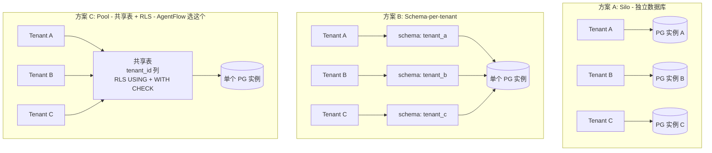
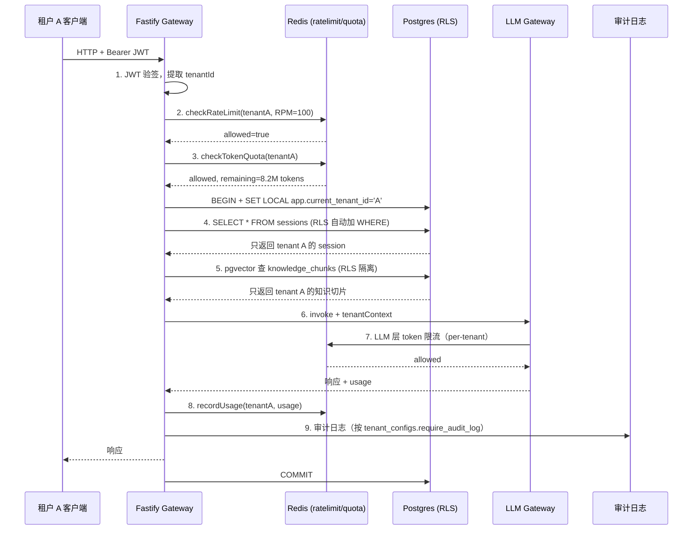

## 从一次"邻居打架"故障说起

某个周二下午，AgentFlow 的值班工程师收到租户 A（电商）的紧急工单：客服 Agent 响应时间从正常的 1.2 秒飙升到 8 秒，用户投诉涌入。

排查日志发现，LLM API 的 P99 延迟正常，问题出在配额上——同一时段租户 C（金融机构）在批量跑历史对话合规扫描，两小时内消耗了平台 70% 的每日 Token 配额。Anthropic 那边的 Tier 4 RPM 被打满，所有租户的 LLM 调用都开始排队，包括租户 A 正在进行的实时客服对话。

根因很简单：前 7 章的实现虽然到处传 `tenantId`，但只是把它当成一个标记字段写进 SQL 的 WHERE 子句。共用同一个 Anthropic API Key、同一个 Postgres 实例、同一份 Redis 缓存、同一个 worker 池，没有任何机制阻止一个租户的流量挤占另一个租户的资源。从架构上看 AgentFlow 已经是多租户系统了，但隔离做得不够，本质上仍然是个"共享系统"。

本章把多租户系统的四个核心机制做扎实：

- **数据隔离**：选合适的隔离模型，保证一个租户的 SQL 永远查不到另一个租户的数据
- **配置隔离**：每个租户独立的 system prompt、Skill 白名单、模型偏好、合规开关
- **配额隔离**：日/月 token 上限，每分钟请求数上限，单次请求 token 上限
- **流量隔离**：限流挡在最外层，防止单租户挤占共享资源

做完之后，租户 C 那种批量任务只能撞自己的天花板，撞不到租户 A。

## 8.1 租户隔离模型选型

多租户 SaaS 一开始就必须决定数据怎么隔离。这个决定一旦定型就很难改，迁移成本极高。业界三个主流方案先逐一列出，再说为什么 AgentFlow 选 C。下图（图 8-1，三种隔离方案对比）把三种方案的物理结构画在一起：



横向对比三个维度（基础设施成本 / 隔离强度 / 运维复杂度）：方案 A 隔离最强但成本最高，方案 C 成本最低但隔离强度依赖 RLS 正确配置，方案 B 是中间值且在数百租户后扩展性最差。AgentFlow 主线走 C，对金融租户保留 A 作为高价 SKU 单独部署。

### 方案 A：完全独立数据库（Siloed）

每个租户一套独立的 PostgreSQL 实例，物理隔离，没有任何共享。

优势是隔离强度最高——不存在跨租户的 SQL 查询路径，即便应用层有 Bug，也无法访问其他租户的数据。合规审计最简单，直接给审计方一个独立实例就行。

劣势同样明显：每个 PostgreSQL 实例有固定的基础资源开销（内存、连接数、运维人力）。假设 AgentFlow 有 500 个租户，即便每个实例只用 2 核 4G，也是 500 个实例的运维复杂度。租户入驻流程变成了数据库实例创建流程，上线时间从秒级变成分钟级。

适合场景：金融、医疗等强合规行业，客户数量少（几十个），单客户合同金额大（百万级年费），愿意为隔离付出高额基础设施成本。

### 方案 B：独立 Schema（Schema-per-tenant）

同一个 PostgreSQL 实例，每个租户拥有独立的 Schema（类似命名空间）。`tenant_a.sessions`、`tenant_b.sessions` 是不同的表，不会相互干扰。

连接池是关键约束：pgBouncer 等连接池无法很好地处理 Schema 切换，每个 Schema 实际上需要独立的连接池配置，连接数随租户数线性增长。PostgreSQL 默认最大连接数 100，稍微优化后通常 1000 以内——意味着这个方案撑不住超过几百个租户。

另一个问题是 Schema 迁移。执行一次 `ALTER TABLE` 要对所有租户的 Schema 跑一遍，迁移脚本复杂度随租户数增加。1000 个租户的 Schema 迁移，就算每个跑 10 毫秒，总共也要 10 秒，还得处理部分成功的情况。

适合场景：中型 SaaS，租户数控制在几百以内，有专职 DBA，租户之间隔离需求高但没到独立实例的程度。

### 方案 C：共享表 + Row-Level Security（AgentFlow 的选择）

所有租户共用同一张表，每行有 `tenant_id` 字段。PostgreSQL 的 Row-Level Security（RLS）策略在数据库层强制过滤，应用层查询 `SELECT * FROM sessions` 时，RLS 自动附加 `WHERE tenant_id = current_tenant`。

成本最低，管理最简单，Schema 迁移一次就全部搞定，连接池压力完全没有按租户倍增。

核心风险是隔离强度相对较低：如果应用层设置租户上下文的步骤有 Bug（比如中间件漏执行），RLS 依然是数据库层的最后防线，但防线宽度比方案 A 薄。对于高合规租户（比如金融机构），需要额外的审计措施来弥补。

**AgentFlow 选择方案 C 的具体理由**：

1. 租户数量目标是数万级，方案 A 和 B 的成本和运维复杂度都无法接受
2. AgentFlow 的金融客户（租户 C）有独立审计日志需求，通过 `require_audit_log` 配置单独处理，不需要独立数据库实例
3. pgvector 向量索引在 RLS 下性能可接受（HNSW 索引不受 RLS 影响，过滤发生在索引扫描后）
4. 开发团队熟悉 PostgreSQL RLS，可以在 3 天内完整实现和测试

方案选型本质上是成本、隔离强度、工程复杂度的三角取舍。AgentFlow 还保留了一个混合策略——enterprise 套餐的金融客户允许签合同时单独申请"独立数据库"部署，落到方案 A，作为价格更高的 SKU。这样主线走 RLS，少数高合规客户做独立部署。

> **生产注意**：从方案 C 迁到方案 A 的难度远低于反向迁移。迁出去只是把单租户数据导出到新实例；迁回来要合并 schema、消解主键冲突、重建索引，几乎等于重写一遍数据层。

## 8.2 Row-Level Security 实现

先看一个真实的反面教材：

```typescript
// 错误示例：依赖应用层过滤
async function getSessions(tenantId: string) {
  return db.query('SELECT * FROM sessions WHERE tenant_id = $1', [tenantId]);
}

// 某天为了"快速排查"加了个 admin 接口
async function getAllSessions() {
  return db.query('SELECT * FROM sessions');  // 漏掉 tenant_id 过滤
}
```

只要有一个写 SQL 的地方漏了 `WHERE tenant_id`，租户隔离就崩了。RLS 把这个过滤下沉到数据库层，应用层即使漏写过滤条件也安全。

### 开启 RLS

```sql
-- 表级开启 RLS
-- ENABLE：让策略对普通用户生效（owner 默认豁免）
-- FORCE：让表的 owner 也受策略约束；如果应用用 owner 角色连接，少了 FORCE 等于没开
ALTER TABLE sessions ENABLE ROW LEVEL SECURITY;
ALTER TABLE sessions FORCE ROW LEVEL SECURITY;

-- 创建隔离策略
-- USING 作用于 SELECT/UPDATE/DELETE 的可见性
-- WITH CHECK 作用于 INSERT/UPDATE 的写入校验
-- 两者都设置，防止应用 bug 把行写到错误的 tenant_id
CREATE POLICY tenant_isolation ON sessions
  USING      (tenant_id = current_setting('app.current_tenant_id')::UUID)
  WITH CHECK (tenant_id = current_setting('app.current_tenant_id')::UUID);

-- 其他核心表同样处理
ALTER TABLE messages ENABLE ROW LEVEL SECURITY;
ALTER TABLE messages FORCE ROW LEVEL SECURITY;
CREATE POLICY tenant_isolation ON messages
  USING      (tenant_id = current_setting('app.current_tenant_id')::UUID)
  WITH CHECK (tenant_id = current_setting('app.current_tenant_id')::UUID);

ALTER TABLE knowledge_chunks ENABLE ROW LEVEL SECURITY;
ALTER TABLE knowledge_chunks FORCE ROW LEVEL SECURITY;
CREATE POLICY tenant_isolation ON knowledge_chunks
  USING      (tenant_id = current_setting('app.current_tenant_id')::UUID)
  WITH CHECK (tenant_id = current_setting('app.current_tenant_id')::UUID);
```

只写 USING 时，攻击者可以通过 INSERT 把 `tenant_id` 写成其他租户的值，再用别的途径读到——所以 WITH CHECK 不能省。

### 在应用层注入租户上下文

RLS 依赖 `app.current_tenant_id` 这个会话变量，应用层必须在每次查询前设置它。这是一个 Fastify 中间件的工作：

```typescript
// 从连接池取出连接，设置租户上下文，然后执行业务查询
async function withTenantContext<T>(
  pool: Pool,
  tenantId: string,
  fn: (client: PoolClient) => Promise<T>
): Promise<T> {
  const client = await pool.connect();
  try {
    // SET LOCAL 的作用域是当前事务
    // 必须在事务内执行，确保连接归还连接池前变量被清除
    await client.query('BEGIN');
    await client.query(
      `SET LOCAL app.current_tenant_id = '${tenantId}'`
    );
    const result = await fn(client);
    await client.query('COMMIT');
    return result;
  } catch (err) {
    await client.query('ROLLBACK');
    throw err;
  } finally {
    client.release();
  }
}
```

为什么用 `SET LOCAL` 而不是 `SET`？`SET` 设置的变量在连接的整个生命周期内有效，连接池复用连接时会把上一个请求的 `tenant_id` 带给下一个请求。`SET LOCAL` 的作用域是当前事务，事务提交或回滚后自动清除，配合 `BEGIN/COMMIT` 使用可以做到每个请求的上下文完全隔离。

> **生产注意**：pgBouncer 有三种连接池模式：Session、Transaction、Statement。`SET LOCAL` 只在 Transaction 模式下行为正确——该模式下每个事务结束后连接才归还池，会话变量在归还前被清除。在 Statement 模式下，每条 SQL 独立分配连接，`BEGIN` 和 `SET LOCAL` 可能落在不同连接上，会话变量设置会失效。AgentFlow 生产环境使用 pgBouncer Transaction 模式，单机开发直接用 `pg` 库的连接池，行为一致。

### RLS 不是 silver bullet

RLS 是数据层的最后一道防线，不是唯一防线。下面几个陷阱要单独处理。

**忘记 SET LOCAL**。如果中间件出 bug 没设置 GUC 变量，下一次 `current_setting('app.current_tenant_id')` 会抛错 `unrecognized configuration parameter`。这是预期行为——宁可整个请求失败，也不能让查询返回所有租户的数据。中间件里加一个守卫，未注入 tenant 上下文的请求直接 503。

**BYPASSRLS 角色滥用**。Postgres 允许某些角色（`BYPASSRLS` 属性）绕过 RLS。这是给跨租户的平台组件用的（ConfigManager 预热、账单对账、容量统计、客户支持工单排查）。AgentFlow 用两个独立连接池：业务请求路径用 `agentflow_app`（受 RLS 约束，每次 SET LOCAL），平台组件用 `agentflow_platform`（BYPASSRLS）。两个池的连接字符串保存在不同的 secrets 里，应用代码物理隔离。`tenant_configs` 表本身也启用了 RLS，ConfigManager 在请求路径外读取任意租户配置时必须走 `agentflow_platform`，否则会因 GUC 未设置而报错——这是部署 RLS 后第一个会踩到的坑。

**物化视图和 SECURITY DEFINER 函数**。视图默认继承基表的 RLS，但 `CREATE MATERIALIZED VIEW` 会绕过（物化时用的是创建者权限）。`SECURITY DEFINER` 函数同样会绕过 RLS。AgentFlow 的代码评审有专门 checklist 拦这两种写法。

**跨租户 JOIN**。RLS 策略每张表独立，JOIN 时两边都过滤。但如果某张表上 RLS 没开（漏掉了），JOIN 会暴露未隔离的数据。所以推荐的做法是给所有业务表都启用 RLS，宁可冗余也不要遗漏。

在 AgentFlow 的监控体系中（第 11 章），还会追踪"RLS 被触发但无数据返回"的异常查询模式，反向暴露应用层逻辑 Bug（漏掉 tenantId 注入导致看不到任何行）。

## 8.3 租户配置管理

每个租户可以独立定制 Agent 的行为。电商租户需要简洁快速的回答；金融租户需要合规审计日志；SaaS 客户需要把 Agent 锁定在自己的知识库上，不允许调用通用搜索 Skill。

### 配置表结构

```sql
CREATE TABLE tenant_configs (
  tenant_id UUID PRIMARY KEY REFERENCES tenants(id) ON DELETE CASCADE,

  -- Agent 行为配置
  system_prompt TEXT,                          -- 覆盖平台默认 system prompt
  allowed_skill_ids UUID[],                    -- Skill 白名单，NULL 表示允许全部
  knowledge_base_ids UUID[],                   -- 绑定的知识库 ID 列表
  max_context_turns INTEGER DEFAULT 20,        -- 最大对话轮数（影响 context window 用量）

  -- LLM 配置
  preferred_model VARCHAR(100),                -- 首选模型，NULL 使用平台默认
  fallback_model VARCHAR(100),                 -- 配额不足时的降级模型
  enable_builtin_knowledge BOOLEAN DEFAULT true,

  -- 合规与安全配置
  require_audit_log BOOLEAN DEFAULT false,     -- 是否记录完整审计日志（金融租户必开）
  pii_masking_enabled BOOLEAN DEFAULT false,   -- 敏感信息脱敏
  allowed_ip_ranges CIDR[],                    -- IP 白名单，NULL 不限制

  -- 元数据
  updated_at TIMESTAMPTZ DEFAULT NOW(),
  updated_by UUID                              -- 最后修改人
);
```

`allowed_skill_ids` 用 PostgreSQL 原生数组类型，查询时用 `@>` 操作符：

```sql
-- 检查某个 skill 是否在租户白名单内
SELECT allowed_skill_ids @> ARRAY[$1::UUID]
FROM tenant_configs
WHERE tenant_id = $2;
```

### 三级缓存策略

配置表是热路径——每个 Agent 请求都要读一次配置来决定用哪个模型、哪些 Skill 可用。单层 Redis 缓存解决了 DB 压力，但每个请求仍要一次 RTT；高 QPS 下这部分网络开销会显著拖慢 P50。所以 ConfigManager 用三级缓存：

- **L1：进程内 Map**，TTL 30 秒，免网络，命中率最高（同 worker 上同租户连续请求都打到这里）
- **L2：Redis**，TTL 5 分钟，跨 worker 共享，承接 L1 miss
- **L3：Postgres**，权威源，承接 Redis miss

写路径必须保证三级一致：**先写 Postgres → 再删 Redis → 通过 Redis Pub/Sub 通知所有 worker 清本地缓存 → 当前进程也清掉自己的本地缓存**。顺序不能反——如果先删缓存再写 DB，并发读会把旧值重新灌进缓存。

完整实现见 `examples/src/config-manager.ts`，下面是关键路径的伪代码：

```typescript
async getTenantConfig(tenantId: string): Promise<TenantConfig | null> {
  // L1
  const local = this.localCache.get(tenantId);
  if (local && local.expireAt > Date.now()) return local.config;

  // L2
  // Redis key 带花括号是 Redis Cluster hash tag 写法，
  // 同一租户的所有 key 落到同一个 slot，Lua 脚本和事务才能跨 key
  const cacheKey = `tenant:config:{${tenantId}}`;
  const cached = await this.redis.get(cacheKey);
  if (cached) {
    const config = this.deserializeConfig(cached);
    this.setLocalCache(tenantId, config);
    return config;
  }

  // L3：回源 Postgres，回填 L1 + L2
  const config = await this.loadFromDatabase(tenantId);
  if (!config) return null;
  await this.redis.setex(cacheKey, 300, this.serializeConfig(config));
  this.setLocalCache(tenantId, config);
  return config;
}

async updateTenantConfig(tenantId: string, patch: Partial<TenantConfig>) {
  // 1. 持久化写
  await this.writeToDatabase(tenantId, patch);
  // 2. 失效 Redis（其他进程 L2 miss 后会从 DB 拉到新值）
  await this.redis.del(`tenant:config:{${tenantId}}`);
  // 3. Pub/Sub 通知所有进程清 L1（生产多 worker 必需，单机空跑）
  await this.redis.publish('tenant:config:invalidate', tenantId);
  // 4. 当前进程的 L1 也立即清掉
  this.localCache.delete(tenantId);
}
```

订阅端在 ConfigManager 构造函数里挂一次：

```typescript
this.redisSub.subscribe('tenant:config:invalidate');
this.redisSub.on('message', (channel, message) => {
  if (channel === 'tenant:config:invalidate') {
    this.localCache.delete(message);   // message 是 tenantId
  }
});
```

> **生产注意**：Pub/Sub 是 at-most-once 的，订阅端断连期间发出的消息会丢。所以 L1 TTL 必须保留（这里设 30 秒），即使消息丢失，最坏情况也是 30 秒后自动失效。不能把 L1 TTL 设成无限然后只依赖 Pub/Sub。

> **生产注意**：如果 Postgres 启用了读副本，写 DB 后立即 Pub/Sub 触发其他进程的 L2 回源查询，可能落到尚未复制的副本上，读到旧值。AgentFlow 的做法是 config 读写都走主库（流量不大，主库扛得住）。如果未来读量起来，可以在 publish 前 sleep 一个最大复制延迟（一般 100ms 内）。

5 分钟的 L2 TTL 意味着即使 Pub/Sub 整条链路失效，配置修改最多延迟 5 分钟生效。对于 `require_audit_log` 这类安全相关配置，写入时除了走上面的失效流程，还会同步调用一次该租户当前活跃 worker 的强制清缓存接口（第 11 章会涉及），宁可多一次 RTT 也不要因为缓存延迟导致审计日志漏记。

## 8.4 计费与配额追踪

配额体系设计的核心矛盾是：检查要快（热路径），记录要准（账单对账）。这两个目标用不同的存储解决——Redis 做实时配额检查，PostgreSQL 做账单记录。

### 配额定义

```typescript
interface TenantQuota {
  tenantId: string;
  plan: 'starter' | 'pro' | 'enterprise';

  // LLM Token 配额
  dailyTokenLimit: number;      // 每日 Token 上限
  monthlyTokenLimit: number;    // 每月 Token 上限

  // 请求频率配额
  requestsPerMinute: number;    // 每分钟请求数
  requestsPerDay: number;       // 每日请求总数

  // 资源配额
  customSkillLimit: number;         // 自定义 Skill 数量上限
  knowledgeBaseSizeGb: number;      // 知识库总存储上限
  concurrentSessionLimit: number;   // 最大并发 session 数
}

// 不同套餐的配额预设
const PLAN_QUOTAS: Record<TenantQuota['plan'], Omit<TenantQuota, 'tenantId' | 'plan'>> = {
  starter: {
    dailyTokenLimit: 1_000_000,
    monthlyTokenLimit: 20_000_000,
    requestsPerMinute: 20,
    requestsPerDay: 5_000,
    customSkillLimit: 3,
    knowledgeBaseSizeGb: 1,
    concurrentSessionLimit: 50,
  },
  pro: {
    dailyTokenLimit: 10_000_000,
    monthlyTokenLimit: 200_000_000,
    requestsPerMinute: 100,
    requestsPerDay: 50_000,
    customSkillLimit: 20,
    knowledgeBaseSizeGb: 10,
    concurrentSessionLimit: 500,
  },
  enterprise: {
    dailyTokenLimit: 100_000_000,
    monthlyTokenLimit: 2_000_000_000,
    requestsPerMinute: 1_000,
    requestsPerDay: 500_000,
    customSkillLimit: 100,
    knowledgeBaseSizeGb: 100,
    concurrentSessionLimit: 5_000,
  },
};
```

### 实时配额检查

每次 LLM 请求前检查今日剩余配额，请求完成后扣减实际消耗。注意顺序：**先查后扣，不是预占再释放**。

理由：LLM 的实际 token 消耗只有响应回来才知道——输出长度是模型决定的，Anthropic prompt caching 命中率取决于上游 KV cache 的状态，连输入 token 数都和 tokenizer 的实现细节有关。如果按估算值预扣，等响应回来再"补差/退还"，对账逻辑会变得很复杂，而且任何崩溃/超时都会留下脏配额。

代价是多个并发请求可能同时通过检查、实际消耗叠加后轻微超额。AgentFlow 用两个手段缓解：

1. **预留 10% buffer**：检查阈值是 `dailyTokenLimit * 0.9`，留出并发场景的安全垫
2. **单次 token 上限**：单次请求估算 token > 10 万直接拒绝，防止单个超大请求把租户配额一次性打穿。这个数值的依据是 AgentFlow 线上的 P99.9 上下文长度约 3 万 token，10 万已经是 3x 的安全边界，正常客服/分析对话不会超出，超出基本是配置错误或 prompt injection

超出日限直接返回 429。超出月限有两个策略选项：

- **硬拒绝**：直接返回错误，租户要么充值要么等下月。适合 starter 套餐——价格敏感，不会接受任何隐式升级
- **降级**：自动切到便宜模型（比如 Haiku 替代 Sonnet）。响应质量下降但服务不中断，适合 enterprise 套餐——他们更怕中断而不是变贵

策略选哪个由 `tenant_configs.fallback_model` 字段决定：有值就降级，没值就拒绝。

```typescript
// 检查今日 Token 配额是否充足
async function checkDailyTokenQuota(
  tenantId: string,
  estimatedTokens: number
): Promise<QuotaCheckResult> {
  const today = new Date().toISOString().slice(0, 10); // YYYY-MM-DD
  const usageKey = `quota:tokens:daily:{${tenantId}}:${today}`;

  const [used, limit] = await Promise.all([
    redis.get(usageKey).then(v => parseInt(v ?? '0', 10)),
    getQuotaLimit(tenantId, 'dailyTokenLimit'),
  ]);

  const remaining = limit - used;

  if (remaining < estimatedTokens) {
    // 计算配额重置时间（明天 00:00 UTC）
    const resetAt = getNextMidnightUTC();
    return {
      allowed: false,
      reason: 'daily_token_limit_exceeded',
      used,
      limit,
      resetAt,
    };
  }

  return { allowed: true, used, limit, remaining };
}

// 请求完成后扣减实际消耗的 Token
async function deductTokenUsage(
  tenantId: string,
  inputTokens: number,
  outputTokens: number,
  cacheHitTokens: number
): Promise<void> {
  const today = new Date().toISOString().slice(0, 10);
  const totalTokens = inputTokens + outputTokens;

  // 所有 key 共享 {tenantId} hash tag，在 Redis Cluster 下落到同一 slot，
  // pipeline 内的命令可以原子执行
  const dailyKey = `quota:tokens:daily:{${tenantId}}:${today}`;
  const monthKey = `quota:tokens:monthly:{${tenantId}}:${today.slice(0, 7)}`;

  // 用 pipeline 而不是 Promise.all：减少 RTT，并且让 INCRBY + EXPIRE
  // 在同一次往返中完成，避免极端情况下 INCRBY 后进程崩溃留下无过期时间的 key
  const pipe = redis.pipeline();
  pipe.incrby(dailyKey, totalTokens);
  pipe.expire(dailyKey, 25 * 3600);            // 25 小时，跨自然日有缓冲
  pipe.incrby(monthKey, totalTokens);
  pipe.expire(monthKey, 32 * 24 * 3600);       // 32 天，覆盖最长月份
  await pipe.exec();

  // 异步写入账单记录（非阻塞，写失败不影响主流程）
  recordBillingUsage(tenantId, inputTokens, outputTokens, cacheHitTokens).catch(
    err => logger.error({ err, tenantId }, 'billing record write failed')
  );
}
```

### 账单记录表

账单记录用于月末对账和向客户出具发票，必须准确。费用以分（cents）为单位存储，彻底避免浮点数精度问题。

```sql
CREATE TABLE billing_records (
  id UUID PRIMARY KEY DEFAULT gen_random_uuid(),
  tenant_id UUID NOT NULL REFERENCES tenants(id),
  period_start DATE NOT NULL,
  period_end DATE NOT NULL,

  -- Token 用量明细
  total_input_tokens BIGINT DEFAULT 0,
  total_output_tokens BIGINT DEFAULT 0,
  total_cache_hit_tokens BIGINT DEFAULT 0,   -- 命中缓存的 token（计费优惠）
  total_requests INTEGER DEFAULT 0,

  -- 费用明细（以分为单位）
  input_token_cost_cents INTEGER DEFAULT 0,
  output_token_cost_cents INTEGER DEFAULT 0,
  amount_cents INTEGER DEFAULT 0,            -- 总费用
  currency CHAR(3) DEFAULT 'USD',

  -- 账单状态
  -- draft：当月进行中，数据持续累积
  -- finalized：月末结算完毕，不再变更
  -- paid：已收款
  status VARCHAR(20) DEFAULT 'draft'
    CHECK (status IN ('draft', 'finalized', 'paid')),

  created_at TIMESTAMPTZ DEFAULT NOW(),
  updated_at TIMESTAMPTZ DEFAULT NOW()
);

-- 每个租户每个月只有一条 draft 记录
CREATE UNIQUE INDEX billing_records_tenant_period
  ON billing_records(tenant_id, period_start)
  WHERE status = 'draft';
```

每次 `deductTokenUsage` 调用都会更新当月的 `billing_records` 草稿行。月末的结算脚本把所有 `draft` 记录标记为 `finalized`，计算最终费用，生成发票。

## 8.5 租户限流与防滥用

限流要解决的问题跟配额不同：配额控制的是总量（今天总共用了多少 Token），限流控制的是速率（每分钟不能超过多少请求）。两者都需要，缺一不可。

### 入口层限流：滑动窗口算法

固定窗口算法有临界问题：在窗口边界前后各发半数请求，实际速率是限制值的两倍。滑动窗口更准确。常见的两种 Redis 实现：

- **精确滑动窗口（zset 法）**：每个请求作为 ZSet 元素，score 是时间戳，每次 `ZREMRANGEBYSCORE` 清掉 60 秒前的元素再 `ZCARD` 计数。优点是精确，缺点是每个请求占一条数据，限制 100 RPM 的租户在 1 分钟内会留下 100 个元素。租户数多时内存压力大
- **加权两桶法**：维护"当前分钟桶"和"上一分钟桶"两个计数器，按当前分钟已过比例加权得到过去 60 秒的近似计数。每个租户只占两个 INT key，内存常数，精度对限流场景足够（误差不会超过单分钟桶大小）

AgentFlow 选加权两桶法，`examples/src/quota-manager.ts` 是完整实现。核心 Lua 脚本只有十几行：

```lua
local current_key = KEYS[1]
local previous_key = KEYS[2]
local limit = tonumber(ARGV[1])
local elapsed_ratio = tonumber(ARGV[2])   -- 当前分钟已过比例（0-1）

local current = tonumber(redis.call('GET', current_key) or '0')
local previous = tonumber(redis.call('GET', previous_key) or '0')

-- 滑动窗口估算：上一分钟剩余权重 + 当前分钟实际值
local estimated = math.floor(previous * (1 - elapsed_ratio)) + current

if estimated >= limit then
  return {0, estimated}
end

redis.call('INCR', current_key)
redis.call('EXPIRE', current_key, 120)
return {1, estimated + 1}
```

TypeScript 侧调用：

```typescript
const currentMinute = Math.floor(Date.now() / 60_000);
const elapsedRatio = (Date.now() % 60_000) / 60_000;

// 两个 key 必须共享 {tenantId} hash tag，保证 Cluster 下落同 slot
const currentKey  = `ratelimit:{${tenantId}}:${currentMinute}`;
const previousKey = `ratelimit:{${tenantId}}:${currentMinute - 1}`;

const [allowed, estimated] = await redis.eval(
  SLIDING_WINDOW_SCRIPT,
  2, currentKey, previousKey,
  limitPerMinute.toString(), elapsedRatio.toString()
) as [number, number];
```

> **生产注意**：单机 Redis 的 Lua 脚本是单线程串行执行的，原子性天然保证。Redis Cluster 模式下，Lua 脚本要求所有 KEYS 在同一个 hash slot——`{tenantId}` 的花括号写法让 Redis Cluster 只用花括号内的部分计算 slot，同一租户的 `currentKey`、`previousKey` 都在同一节点，脚本才能跨 key 操作。如果忘记加 hash tag，Cluster 会直接返回 `CROSSSLOT` 错误。

### LLM 层限流：排队而不是直接拒绝

入口层限流直接返回 429，适合超出每分钟请求数的情况。LLM API 的 Token 速率限制不同：租户可能在 5 分钟内把配额用完，但后 55 分钟的请求应该等待而不是报错。

这里用 BullMQ 的延迟队列：超出 Token/min 速率时，把请求放入延迟队列，等待令牌桶补充后再执行。对话型请求不适合等太久（用户在等着），批量分析型请求可以等几分钟。

AgentFlow 通过请求头 `X-Request-Priority: realtime | batch` 区分，实时请求超时限制 3 秒，批量请求可以等待 5 分钟。

### 防滥用：异常检测

配额和限流解决的是正常使用场景下的隔离。防滥用要解决的是恶意或异常场景：

**单次请求防护**：单次请求估算 token 超过 10 万直接拒绝（`SINGLE_REQUEST_TOKEN_LIMIT = 100_000`），不进入队列也不走 LLM。这个阈值的依据是 AgentFlow 线上对话的 P99.9 上下文长度约 3 万 token，10 万是 3x 的安全边界，正常的客服或分析对话不会超出。超出基本是两种情况：知识库召回逻辑 bug 把一整本手册塞进 context；或者恶意输入触发的 prompt injection。两种都应该尽早拒绝。

**7 日均值告警**：记录每个租户的 7 日平均 Token 消耗。如果某小时的消耗超过 7 日均值的 3 倍，触发告警——可能是租户在跑批量任务，也可能是 API key 泄漏被滥用。

```typescript
async function detectUsageAnomaly(
  tenantId: string,
  currentHourTokens: number
): Promise<void> {
  // 读取过去 7 天的每小时平均值
  const avg7dKey = `usage:avg7d:{${tenantId}}`;
  const avg = await redis.get(avg7dKey).then(v => parseFloat(v ?? '0'));

  if (avg > 0 && currentHourTokens > avg * 3) {
    await alertingService.send({
      level: 'warning',
      tenantId,
      message: `异常用量检测：当前小时消耗 ${currentHourTokens} Token，` +
               `7日均值 ${avg.toFixed(0)}，超出 3 倍阈值`,
    });
  }
}
```

**自动熔断**：如果告警触发后 30 分钟内消耗继续攀升，自动将租户降级到最低速率限制，并发送邮件要求人工确认。自动熔断是最后手段，触发条件要保守，错误熔断的代价比流量洪峰更大。

## 8.6 数据隔离：完整路径

把前面几节串起来。一次完整的 Agent 请求从外部进入 AgentFlow，经过的每个环节都要做"租户感知"——少一环就是漏洞。下图是租户 A 的一次请求在系统内的完整路径：



逐环节梳理隔离机制和可能的泄漏点：

1. **JWT 提取**：JWT 是租户身份的唯一来源。漏洞点是签名密钥泄露——攻击者用泄露的密钥签发任意 `tenantId`。缓解：密钥放 KMS / Vault，每个环境独立密钥，定期轮换
2. **入口限流**：漏掉中间件挂载 = 限流形同虚设。缓解：路由配置走代码生成，统一在 `app.ts` 注册全局 `preHandler`，禁止单路由 opt-out
3. **配额检查**：检查和扣减是分离的（前置查，后置写），并发场景下可能"双花"——多个请求同时通过预检查，叠加后实际超额。缓解：buffer + 配额本身是软上限（不是硬约束），偶发超 5% 业务可接受
4. **Postgres RLS**：忘记 SET LOCAL = RLS 失效（具体表现是查询报错，比放行所有数据安全得多）。缓解：用 `withTenantContext()` 包装所有 DB 调用，把 SET LOCAL 包在事务开头，禁止直接调 `pool.query()`
5. **pgvector 检索**：HNSW 索引本身不理解 `tenant_id`，索引扫描返回所有相似向量后，RLS 在结果集层过滤。最坏情况下会扫描大量其他租户的向量再丢弃。优化：用 `tenant_id` 分区索引（PG 16 的分区剪枝）减少无效扫描。漏洞点是把 embedding 缓存到 Redis 时忘了带 tenant 前缀——所有 Redis key 都强制 `{tenantId}` hash tag，code review checklist 检查
6. **LLM 调用**：调用 Anthropic 用的是公司级 API Key，理论上 Anthropic 那边看不到租户隔离。漏洞点是日志泄露——把 prompt 内容打到共享日志系统时混进了其他租户的数据。缓解：日志结构化，每条日志强制带 `tenant_id` 字段
7. **LLM 层限流**：与入口限流互补，挡住"少量请求大 token"。漏掉这层 = 单租户能耗尽公司级配额（开篇故事就是这种情况）
8. **用量上报**：上报失败 = 配额计数不准。缓解：本地 buffer + 异步重试，上报失败不阻塞主请求
9. **审计日志**：`require_audit_log=true` 的租户（如金融机构）会把完整的 LLM 输入输出写入 `audit_events` 表。这张表同样开启 RLS，但审计查询通常由合规系统用单独的数据库连接发起，要在该连接上同样设置 `app.current_tenant_id`，避免出现"合规系统能跨租户查"的隐患

每一环都有自己的失效模式。多租户系统的隔离不能依赖单一防线，而是要求任何一环出 bug 时其他环仍然有效——这是工程上"纵深防御"的具体落地方式。

## 8.7 完整实现：把所有模块接起来

```typescript
// AgentFlow 请求处理入口，整合所有多租户组件
async function handleAgentRequest(
  request: FastifyRequest,
  reply: FastifyReply
): Promise<void> {
  const { tenantId } = request.tenant; // 由 JWT 中间件注入
  const { message, sessionId } = request.body as AgentRequestBody;

  // 1. 加载租户配置（Redis 缓存）
  const config = await configManager.get(tenantId);

  // 2. 检查请求速率
  const rateLimit = await quotaManager.checkRateLimit(
    tenantId,
    config.quota.requestsPerMinute
  );
  if (!rateLimit.allowed) {
    return reply.status(429).send({
      error: 'rate_limit_exceeded',
      retryAfter: rateLimit.retryAfter,
    });
  }

  // 3. 估算 Token 用量，检查日配额
  const estimatedTokens = estimateTokens(message, config.maxContextTurns);
  const quotaCheck = await quotaManager.checkDailyTokens(tenantId, estimatedTokens);
  if (!quotaCheck.allowed) {
    return reply.status(429).send({
      error: 'daily_quota_exceeded',
      resetAt: quotaCheck.resetAt,
    });
  }

  // 4. 在数据库事务中设置租户上下文，执行业务查询
  const result = await withTenantContext(dbPool, tenantId, async (client) => {
    // RLS 自动过滤，这里的查询只能看到当前租户的数据
    const session = await getOrCreateSession(client, sessionId, tenantId);
    const history = await getRecentMessages(client, sessionId, config.maxContextTurns);
    const knowledgeChunks = await searchKnowledge(
      client,
      message,
      config.knowledgeBaseIds
    );
    return { session, history, knowledgeChunks };
  });

  // 5. 调用 LLM
  const llmResponse = await llmGateway.complete({
    tenantId,
    model: config.preferredModel ?? DEFAULT_MODEL,
    systemPrompt: config.systemPrompt,
    messages: buildMessages(result.history, result.knowledgeChunks, message),
  });

  // 6. 扣减配额，写入账单记录
  await quotaManager.deductTokens(tenantId, llmResponse.usage);

  // 7. 写入会话记录（RLS 保证写入正确的 tenant）
  await withTenantContext(dbPool, tenantId, async (client) => {
    await saveMessage(client, sessionId, tenantId, message, llmResponse.content);

    // 金融租户需要完整审计日志
    if (config.requireAuditLog) {
      await writeAuditLog(client, tenantId, {
        requestId: request.id,
        input: message,
        output: llmResponse.content,
        model: llmResponse.model,
        usage: llmResponse.usage,
      });
    }
  });

  return reply.send({ content: llmResponse.content });
}
```

这个流程把本章各节的组件串联起来。关键点是每一步都通过 `tenantId` 明确绑定，没有任何"当前全局租户"的全局状态——并发场景下全局状态会被请求间踩踏。

## 对三个租户意味着什么

这章的隔离模型本身是统一的，三个租户共享同一套 RLS 策略和配额框架，差异只在配置参数。

**租户 A（电商）**：QPS 高、对 RLS 的延迟敏感（每次查询多一层 `current_setting('app.tenant_id')` 判断）。8.5 节的滑动窗口限流参数按租户 A 的双十一峰值配置，速率上限是其他租户的几十倍。

**租户 B（SaaS 软件）**：经常需要做跨会话的数据分析（"我这个月所有客户问得最多的问题"），这类查询走"运营查询专用"路径，仍然在 `tenant_id = B` 的 RLS 边界内，但 SQL 复杂度高，需要单独的只读副本承接。

**租户 C（金融机构）**：合规审计的特殊性在于"平台运营方"偶尔需要跨租户查询（合规自查、监管报送）。这类查询必须走 BYPASSRLS 专用连接池——单独的 DB role、独立的 Postgres user，连接池物理隔离于业务流量，任何业务代码不能直接拿到这个连接。BYPASSRLS 走出来的查询每条都写审计日志，由独立团队审查。

## 本章小结

多租户不是给数据库加 `tenant_id` 列就完了。数据隔离用 RLS 做最后防线（ENABLE + FORCE + USING + WITH CHECK 四件套），配置隔离用进程内 + Redis + Postgres 三级缓存撑住读热路径并通过 Pub/Sub 跨进程同步失效，配额隔离区分速率（滑动窗口）和总量（先查后扣）两类，流量隔离做两层（入口 RPM + LLM token 排队）。每一层都要在代码里强制走，不能依赖"开发者记得加上"。

开篇故障的解法：为租户 C 的批量分析请求设置独立的 Token/min 配额，优先级标记为 `batch`，超出速率时进入延迟队列而不是占用实时请求通道；租户 A 的客服请求标记为 `realtime`，有独立的速率配额，不与批量请求竞争。

下一章处理安全问题：Skill 沙箱的代码注入防护、用户输入的 prompt injection 检测、API key 管理。

## 参考资料

- PostgreSQL 官方文档：Row-Level Security Policies — <https://www.postgresql.org/docs/current/ddl-rowsecurity.html>
- pgbouncer Transaction Mode 与 `SET LOCAL` 行为 — <https://www.pgbouncer.org/features.html>
- AWS SaaS 多租户隔离白皮书：Silo / Pool / Bridge Models
- Anthropic API Rate Limits：Tier 体系与超限处理 — <https://docs.anthropic.com/en/api/rate-limits>
- Stripe Engineering Blog：Scaling your API with rate limiters — <https://stripe.com/blog/rate-limiters>

---

> 本章来自《百万级 AI Agent 平台架构》开源版 · 作者「递归客」  
> 在线阅读完整书系：[inferloop.dev](https://inferloop.dev)  
> 源码仓库：[github.com/diguike/book-enterprise-agent](https://github.com/diguike/book-enterprise-agent)
