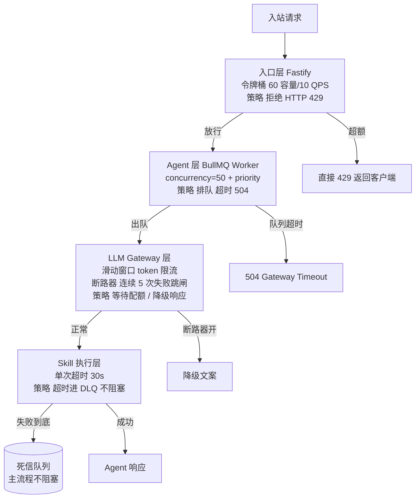
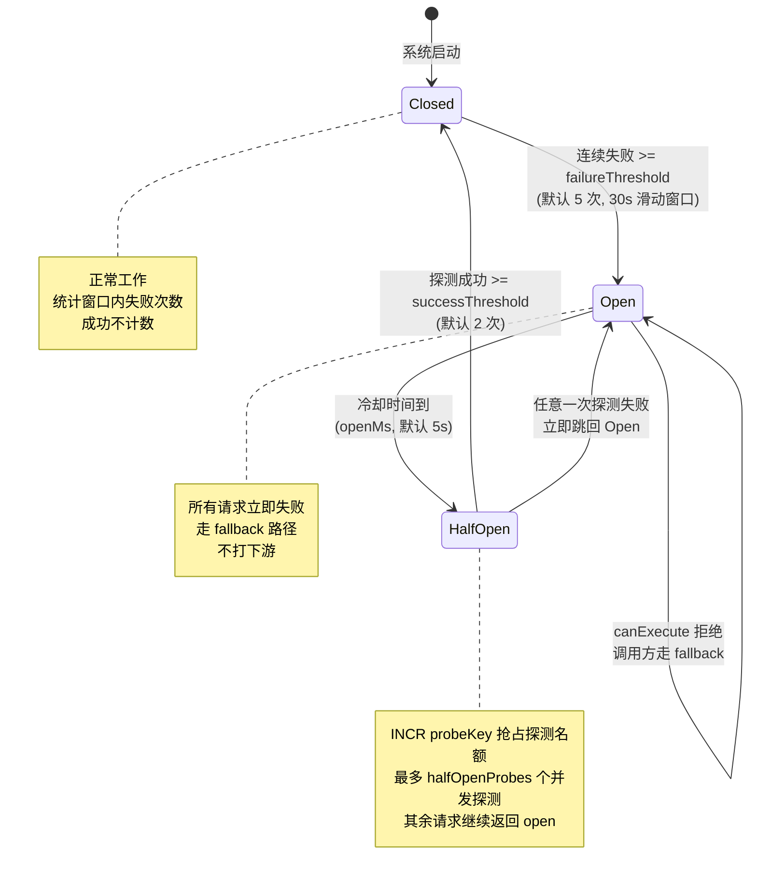

## 从一次双十一的雪崩说起

双十一晚上 8 点，AgentFlow 的监控大盘开始报警。租户 A（电商）的客服 Agent 接口延迟从平时的 200ms 一路飙到 30 秒，Grafana 的 p99 曲线直接顶到图框上沿。值班同学第一反应是看每一层组件，结果是个怪现象：Fastify 没挂、Worker 进程数没掉、Redis CPU 正常、Postgres 慢查询监控干净，连 Anthropic 的 status page 也是绿的——但请求就是出不来。

接着翻日志才发现根因。8:00 前后是开抢瞬间，AgentFlow 全平台 LLM 调用量瞬时翻了 30 倍，Anthropic 在那个时段触发了账户级限流，所有 messages.create 调用开始返回 429。问题是 Agent 引擎里 LLM 调用包了一层默认的指数退避重试，每个失败请求会在 1、2、4、8 秒后各重试一次。当 429 持续 30 秒时，BullMQ 队列里堆积了大约 5 万个 in-flight 任务，每个任务在 retry 循环里来回打 Anthropic，新进来的请求只能继续排队。Worker 没有挂，但每个 Worker 的并发槽都被卡在 retry 里——表面上系统还活着，实际上已经丧失服务能力。

复盘里写的根因是一句话：**没有背压。** 下游告诉你"我处理不过来了"（HTTP 429），系统的正确反应不是更狠地重试，而是降级、排队、拒绝。前 9 章为 AgentFlow 搭起了多租户、安全、可扩展的骨架，第 3 到第 9 章里多次出现"详见第 10 章"的占位（Circuit Breaker、背压、DLQ）。这一章把这些债一起还掉。

本章解决四个具体问题：

- 当流量超过承载能力时，如何让系统**拒绝**而不是**排队到死**
- 当下游故障时，如何**快速失败**而不是把故障传染回上游
- 当任务彻底失败时，怎么保留现场又不影响主流程
- 上线前怎么用 k6 找到瓶颈，避免双十一现场才暴露

配套代码放在 `examples/`，全部用 TypeScript 严格模式实现。Circuit Breaker、令牌桶、限流计数器等所有分布式状态都存在 Redis，不在内存——这是单机版和生产版唯一的差距，本章会反复强调。

## 10.1 背压的三种主流算法

背压（backpressure）的定义只有一句：**当下游处理速度跟不上时，让上游慢下来或拒绝请求。** 听起来简单，但实现上有完全不同的取舍。先把三种主流算法摆在一起，看它们各自适合什么场景，再决定 AgentFlow 哪里用哪一种。

### 令牌桶（Token Bucket）

桶有最大容量 `capacity`，以恒定速率 `refillRate` 往桶里补 token，每次请求消耗若干 token。桶空了就拒绝，桶满了多出来的 token 丢掉。

`examples/src/token-bucket.ts` 里的内存实现：

```typescript
export class TokenBucket {
  private tokens: number;
  private lastRefill: number;

  constructor(
    private readonly capacity: number,    // 桶容量
    private readonly refillRate: number,  // 每秒补充 token 数
  ) {
    this.tokens = capacity;
    this.lastRefill = Date.now();
  }

  tryConsume(count: number = 1): boolean {
    this.refill();
    if (this.tokens >= count) {
      this.tokens -= count;
      return true;
    }
    return false;
  }

  private refill(): void {
    const now = Date.now();
    const elapsedSec = (now - this.lastRefill) / 1000;
    this.tokens = Math.min(this.capacity, this.tokens + elapsedSec * this.refillRate);
    this.lastRefill = now;
  }
}
```

特征是**允许短时突发**：桶里攒满 60 个 token，瞬间冲 60 个请求都能过，但长期平均速率被 `refillRate` 限死。这种"平时严、偶尔松"的语义跟真实用户行为很像——客服场景里用户敲一句话停顿几秒再敲下一句，纯匀速限流反而会误杀正常会话。

AgentFlow 的入口层用令牌桶做单租户限流：`capacity=60, refillRate=10/s` 意味着平时上限 10 QPS，允许偶尔冲到 60。同样的代码在 `examples/src/token-bucket.ts` 还提供了 Redis 版本 `RedisTokenBucket`，把 `refill + consume` 用 Lua 脚本封成原子操作。多 Pod 部署必须用 Redis 版——三个 Pod 各跑一个内存桶意味着实际上限是配置值的三倍，且无法准确预知。

> **生产注意**：内存版令牌桶**不能**用在多 Pod 环境。即便临时上线，也要在代码里加 `if (process.env.NODE_ENV === 'production') throw new Error('use RedisTokenBucket')`，防止有人复制粘贴到生产。

### 漏桶（Leaky Bucket）

请求进 FIFO 队列，一个独立的定时器以恒定速率从队列里取出请求处理，队列满了直接拒绝。和令牌桶相反，漏桶**不允许突发**——无论入流量多猛，出口速率都是恒定的。

```typescript
export class LeakyBucket {
  private queue: QueuedTask<unknown>[] = [];
  constructor(
    private readonly capacity: number,
    leakRatePerSec: number,
  ) { /* ... */ }

  submit<T>(task: () => Promise<T>): Promise<T> {
    return new Promise<T>((resolve, reject) => {
      if (this.queue.length >= this.capacity) {
        reject(new Error('BUCKET_FULL'));
        return;
      }
      this.queue.push({ task, resolve, reject });
      this.ensureLeaking();
    });
  }
  // ...
}
```

完整实现见 `examples/src/leaky-bucket.ts`。

漏桶的场景往往是"对方明确要求恒定速率"。AgentFlow 调用某 ERP 系统时，对方 SLA 写得很清楚："每秒最多 5 次请求，超出会触发风控封 IP 1 小时"。这种场合不能用令牌桶，因为对方一旦看到 1 秒 60 个请求的突发，根本不在乎你长期平均多少。

### 滑动窗口（Sliding Window）

第 8 章的租户配额限流用过这个算法：Redis sorted set 用 timestamp 作 score 存所有请求记录，每次请求时先 `ZREMRANGEBYSCORE` 删掉窗口外的，再 `ZCARD` 查窗口内总数，超过限额就拒绝。

精度最高，能精确控制"过去 60 秒内不超过 100 次请求"。代价是每次请求都要操作 Redis sorted set，QPS 高时会成为热点 key。第 8 章已经展开过，这里不重复贴代码。

### 三种算法的对比

| 算法 | 是否允许突发 | 实现复杂度 | 精度 | 典型用途 |
|------|-------------|-----------|------|---------|
| 令牌桶 | 允许 | 中 | 中 | 用户级 API 限流（容忍突发） |
| 漏桶 | 不允许 | 简单 | 高 | 对外部 API 恒速调用 |
| 滑动窗口 | 不允许 | 复杂 | 极高 | 配额（日/月 token、月调用次数） |

AgentFlow 三种都在用：入口层令牌桶、对接外部系统漏桶、配额滑动窗口。挑算法时只问两个问题——**业务允许突发吗？我能承担多少精度损失？**

### 一个常见的误区：限流不是排队

很多团队第一次实现限流时会把它写成"超限请求暂存到内部队列，等容量空出来再处理"。这本质是把限流偷偷变成了排队，问题是队列没有上限——开篇双十一的 5 万任务堆积就是这么来的。**限流的语义必须是拒绝**：超额请求直接返回 429，让客户端决定是否重试。是否重试是客户端的策略，不是服务端的责任。

服务端如果想给客户端一点缓冲（比如配额刚刚耗尽，再过 1 秒就恢复），正确的做法是在 429 响应里带 `Retry-After: 1` 头，把决定权交给客户端，而不是替客户端把请求藏在某个队列里偷偷等待。

## 10.2 AgentFlow 的四层背压架构

光有算法不够，要把算法落到具体的层次上。AgentFlow 的四层背压架构如下（图 10-1，四层背压架构）：



四层各司其职，**策略不同**是关键：入口层直接拒绝、Agent 层排队、LLM 层等待或降级、Skill 层失败进 DLQ。开篇那次双十一事故的本质是**所有层都在排队**——入口层不限流、Worker 不超时、LLM 调用死命重试、Skill 失败回到 Agent step 又重新触发 LLM 调用。任何一层正确实施背压，都不会雪崩。

### 入口层：直接拒绝

入口层挡在最外面，目标是**快速失败**。一个用户请求被拒绝（429）的成本是几毫秒，被排队 30 秒后超时的成本是占着一个 Worker 槽 30 秒。前者用户大概率会重试，后者用户会去微博骂。

```typescript
app.post('/chat', async (req, reply) => {
  const allowed = await entryLimiter.tryConsume(body.tenantId);
  if (!allowed) {
    return reply.code(429).send({ error: 'rate_limited' });
  }
  // ...入队
});
```

完整入口路径见 `examples/src/index.ts`。注意 `entryLimiter` 是 `RedisTokenBucket`，状态在 Redis——多 Pod 时三个 Pod 共享同一个桶。

### Agent 层：排队 + 优先级

入口层放过的请求进 BullMQ。BullMQ 的优先级机制让租户 A 的实时对话能插队到租户 C 的批量任务前面：

```typescript
const priority = body.tenantId === 'tenant-a' ? PRIORITY.REALTIME : PRIORITY.BATCH;
await agentQueue.add('process', body, { priority, attempts: 3 });
```

排队但有上限——`waitUntilFinished` 设了 15 秒超时，超出返回 504。这意味着队列再深也不会无限拖延用户。

### LLM Gateway 层：等待或降级

LLM 调用是最容易出问题的层。Anthropic 限流、网络抖动、模型加载延迟都会让一个本该 1 秒的调用变成 30 秒。第 4 章实现了 LLM Gateway 的 token 配额（滑动窗口），本章再补一道断路器：连续失败超过阈值时跳闸，所有调用立即走降级路径。

```typescript
const reply = await llmBreaker.execute(
  () => callLLM(message),
  // 降级：返回固定文案，告诉用户稍后重试
  async () => '系统繁忙，请稍后重试',
);
```

降级文案不是"摆烂"——比让用户等 30 秒看不见回复好得多。生产中可以更精细：根据租户和场景准备不同的降级文案，金融租户的降级文案要走法务审过。

### Skill 执行层：超时进 DLQ

Skill 调用外部系统时最大的坑是**没有超时**。某次 AgentFlow 调用一个内部 CRM 系统查客户信息，对方 DB 锁了，连接池配置又把 timeout 设成了默认 0（永不超时），结果一个 Skill 调用挂了 8 分钟才被运维手动 kill，期间整个 Agent step 卡死。

强制超时：

```typescript
async function callSkill<T>(fn: () => Promise<T>, timeoutMs: number): Promise<T> {
  return new Promise<T>((resolve, reject) => {
    const timer = setTimeout(() => reject(new Error(`skill timeout after ${timeoutMs}ms`)), timeoutMs);
    fn().then((v) => { clearTimeout(timer); resolve(v); },
             (e) => { clearTimeout(timer); reject(e); });
  });
}
```

超时后的失败由 BullMQ 重试机制兜底，重试到上限进 DLQ（10.5 节）。主链路不等 Skill 完成，立即返回部分结果或降级文案。

### 四层之间怎么传递背压信号

每一层独立做限流不够，相邻两层之间的信号传递同样关键。AgentFlow 用三种信号实现层间联动：

- **HTTP 429**：入口层挡回客户端时显式带 `Retry-After`，告诉调用方多久后再来
- **BullMQ job 优先级反馈**：Worker 检测到当前 LLM 配额接近耗尽时，把后续入队的低优先级任务自动延迟入队
- **断路器状态**：LLM Gateway 断路器一旦 Open，入口层立刻把当前租户的令牌桶 `refillRate` 临时调低，提前减少入流

第三条特别重要——单纯靠每层各自的阈值反应太慢，故障可能传染到上游再被挡住。把断路器状态作为"前置反馈信号"，能让系统在故障扩散前一步就开始降级。

实现上，AgentFlow 在 LLM Gateway 断路器跳闸时往 Redis 发布一个 `breaker:open` 消息，入口层订阅后修改对应租户的令牌桶配置：

```typescript
redis.subscribe('breaker:events');
redis.on('message', async (_channel, raw) => {
  const evt = JSON.parse(raw) as { service: string; state: string };
  if (evt.service === 'anthropic-api' && evt.state === 'open') {
    // 全局降速：所有租户入口限流减半
    await applyEmergencyThrottle(0.5);
  } else if (evt.state === 'closed') {
    await restoreNormalThrottle();
  }
});
```

这样系统在下游恢复前不会一直把入流打到原来的水平，给下游一个真正的喘息空间。

## 10.3 BullMQ 在 AgentFlow 中的深度使用

BullMQ 是 AgentFlow 整个后端的核心调度组件，前面几章用得很表层（只是 `queue.add` 和 `new Worker`）。这一节系统讲它的几个关键特性。

### 优先级队列

```typescript
import { Queue } from 'bullmq';

const queue = new Queue('agent-tasks', { connection });

// 高优先级任务（数字越小越优先）
await queue.add('process', data, { priority: 1 });

// 低优先级任务
await queue.add('process', data, { priority: 10 });
```

**priority 数字越小优先级越高。** 这条非常容易搞错，看代码里写 `priority: 100` 和 `priority: 1` 时下意识会以为 100 优先，结果就是反的。`examples/src/bullmq-setup.ts` 用了一组业务常量：

```typescript
export const PRIORITY = {
  REALTIME: 1,
  STANDARD: 5,
  BATCH: 10,
} as const;
```

代码里用 `PRIORITY.REALTIME` 比裸数字安全得多。

### 延迟任务

```typescript
// 5 秒后执行
await queue.add('process', data, { delay: 5000 });
```

延迟任务的真正价值是配合限流使用——当一个租户当前请求被 LLM 配额挡住时，与其直接拒绝，不如延迟 3 秒入队：

```typescript
if (await isLLMQuotaExceeded(tenantId)) {
  // 把请求推到 3 秒后，期望那时配额已恢复
  await queue.add('process', data, { delay: 3000, priority: PRIORITY.BATCH });
} else {
  await queue.add('process', data, { priority: PRIORITY.REALTIME });
}
```

延迟期间不占 Worker 槽位，BullMQ 内部用一个 sorted set 按 `executeAt` 排序，到点了才进入主队列。

### Parent-Child 任务（任务依赖）

Agent 调用多个 Skill 并发执行、全部完成后再走汇总响应，正是 Parent-Child 模型的典型场景：

```typescript
import { FlowProducer } from 'bullmq';

const flow = new FlowProducer({ connection });

await flow.add({
  name: 'aggregate',
  queueName: 'agent-tasks',
  data: { sessionId: 'flow-1' },
  children: [
    { name: 'skill', queueName: 'skill-tasks', data: { skillName: 'queryOrder' } },
    { name: 'skill', queueName: 'skill-tasks', data: { skillName: 'queryLogistics' } },
  ],
});
```

`aggregate` 任务会等两个 `skill` 子任务都完成（或失败）后才被调度执行。在 processor 里通过 `await job.getChildrenValues()` 拿到所有子任务的返回值。这避免了在 Agent 代码里手动写 `Promise.all` + 错误处理 + 状态保存——所有这些 BullMQ 都帮你做了。

### Worker 并发与限流

```typescript
const worker = new Worker('agent-tasks', processor, {
  connection,
  concurrency: 50,
  limiter: {
    max: 100,
    duration: 1000, // 每秒最多 100 个任务
  },
});
```

`concurrency` 控制单 Worker 进程内同时处理几个任务，`limiter` 控制速率。

> **生产注意**：`concurrency` 是**单 Worker 进程内的并发数**，不是全局并发。多 Pod 部署时，全局并发 = Pod 数 × concurrency。压测时容易在单机调到 50 觉得性能不错，上生产开 20 个 Pod 直接打挂下游。`limiter` 默认也是单 Worker 范围，跨进程协调要用 `limiter.groupKey` 或额外的 Redis 限流。

### connection 配置的两个坑

```typescript
const connection = {
  host: '127.0.0.1',
  port: 6379,
  maxRetriesPerRequest: null, // ★必须设
};
```

`maxRetriesPerRequest` 默认值是 20，BullMQ 用的 blocking 命令（`BRPOPLPUSH` 等）执行时间很长，达到 20 次重试就报错。BullMQ 5.x 启动时会校验这个配置，没设直接抛错。

第二个坑是 BullMQ 内部会创建多个 Redis 连接（队列、worker、events 各一个），调试时看到 Redis `CLIENT LIST` 显示 20+ 个连接很正常，不要以为有连接泄漏。

### 重试策略：指数退避与抖动

`attempts` 设了上限只是第一步，**重试间隔**同样关键。直觉做法是固定间隔（每秒重试一次），但这有两个问题：

1. 下游瞬时故障可能在 200ms 就恢复，固定 1 秒间隔白白浪费时间
2. 下游持续故障时大量任务每秒"齐刷刷"一起重试，等于自己 DDoS 自己

BullMQ 内置了指数退避：

```typescript
await queue.add('process', data, {
  attempts: 5,
  backoff: {
    type: 'exponential',
    delay: 1000,  // 第 1 次重试等 1s，第 2 次 2s，第 3 次 4s...
  },
});
```

更稳的做法是加抖动（jitter），用 BullMQ 的自定义退避策略：

```typescript
const worker = new Worker('agent-tasks', processor, {
  connection,
  settings: {
    backoffStrategy: (attemptsMade) => {
      const base = Math.min(30_000, 1000 * 2 ** attemptsMade);
      // 加 ±25% 随机抖动，错开重试时刻
      return base * (0.75 + Math.random() * 0.5);
    },
  },
});
```

加抖动后，1 万个任务的第二次重试不会集中在同一毫秒打下游，而是均匀分散在某个时间窗口里，下游压力曲线变得平滑得多。任务量越大，加不加抖动的差距越明显。

## 10.4 Circuit Breaker：必须用 Redis 存状态

第 3 章到第 9 章一共出现过 7 次 "Circuit Breaker 详见第 10 章"，这里把账还掉。

### 三种状态与转换

下图（图 10-2，Circuit Breaker 三状态转换）是 Redis 版本的完整状态机：



- **Closed**：正常工作，统计失败次数
- **Open**：跳闸，所有请求立即失败或走降级，不打下游
- **Half-Open**：放少量请求过去探路，成功足够多次回 Closed，任何一次失败回 Open

Half-Open 是设计中最容易省略也最容易踩坑的状态。没有它的实现要么"冷却时间一到全部放行"（瞬间又把下游打死），要么"必须人工干预重置"（运维痛苦）。Half-Open 用少量探测请求验证下游真的恢复了再放流量进来，省掉这两种麻烦。多 Pod 部署时，状态机的所有转换都在 Redis Lua 脚本里完成，所有 Pod 看到一致的状态——这就是 10.4 节强调"必须 Redis 存状态"的根本原因。

### 为什么必须用 Redis

新人最常见的实现是把 `failures`、`state`、`openedAt` 放在内存：

```typescript
// 反面教材
class InMemoryCircuitBreaker {
  private failures = 0;
  private state: 'closed' | 'open' = 'closed';
  // ...
}
```

单机演示 OK，生产部署 N 个 Pod 时就完全失效——每个 Pod 各自看到的 `failures` 不一样，等于装了 N 个不联动的断路器。极端情况下：下游已经挂了 90 秒，Pod A 的断路器跳了，Pod B 的断路器因为请求被 LB 分发得少还没跳。负载均衡把流量转给 Pod B，Pod B 继续往下游打——根本没起到保护作用。

状态必须放 Redis。`examples/src/circuit-breaker.ts` 实现了一个完整的 Redis 版本，关键逻辑全部封装在 Lua 脚本里保证原子性。看下"获取执行许可"的核心 Lua：

```lua
-- ACQUIRE_SCRIPT 节选
local state = redis.call('HGET', stateKey, 'state') or 'closed'

if state == 'closed' then
  return {1, 'closed'}  -- 直接放行
end

if state == 'open' then
  local openedAt = tonumber(redis.call('HGET', stateKey, 'openedAt') or '0')
  if now - openedAt >= openMs then
    -- 冷却到期，转入 half-open
    redis.call('HMSET', stateKey, 'state', 'half-open', 'halfSuccess', 0)
    redis.call('DEL', probeKey)
    state = 'half-open'
  else
    return {0, 'open'}
  end
end

-- half-open：抢占探测名额（限制并发探测数量）
local probes = tonumber(redis.call('INCR', probeKey))
if probes == 1 then redis.call('PEXPIRE', probeKey, openMs) end
if probes > halfOpenProbes then return {0, 'half-open'} end
return {1, 'half-open'}
```

注意两个细节：

1. **状态转换在 Lua 内完成**，从 Open 跳到 Half-Open 不需要应用层定时器，每次 `canExecute` 调用时检查一次时间戳即可。这样多 Pod 看到一致的状态机推进。

2. **探测名额用 `INCR + PEXPIRE` 抢占**，多 Pod 同时进入 Half-Open 时只有前 N 个请求拿到名额，其余继续返回 `open`。这是保护下游的关键——一旦 Open 全放，又是雪崩。

### TypeScript 封装

应用层用法很简单：

```typescript
const breaker = new RedisCircuitBreaker(redis, 'anthropic-api', {
  failureThreshold: 5,      // 失败 5 次跳闸
  successThreshold: 2,      // Half-Open 阶段成功 2 次回 Closed
  openMs: 5000,             // Open 状态持续 5 秒
  halfOpenProbes: 2,        // Half-Open 阶段最多 2 个探测请求
  windowMs: 30_000,         // 失败窗口 30 秒
});

// 包裹 LLM 调用
const reply = await breaker.execute(
  () => anthropicClient.messages.create({ /* ... */ }),
  // fallback：断路器打开时返回降级响应
  async () => '系统繁忙，请稍后重试',
);
```

`execute` 自动调 `canExecute → fn → recordSuccess/recordFailure`。fallback 只在断路器打开（被拒绝执行）时触发，**不是**业务异常时触发——这是有意的设计，业务异常本来就该让上层感知，不该被默默吃掉。

### 参数怎么调

四个参数的经验值：

| 参数 | 建议起点 | 调整方向 |
|------|---------|---------|
| `failureThreshold` | 5-10 | 下游越脆弱越小 |
| `successThreshold` | 2-3 | 太大恢复慢，太小容易抖动 |
| `openMs` | 5s-30s | 看下游恢复典型时间 |
| `halfOpenProbes` | 1-3 | 取决于 Pod 数和下游容量 |
| `windowMs` | 30s-60s | 太长会把陈年旧错算进来 |

实际调参建议跑一次故障注入压测（10.6 节）观察断路器行为再定。

### 断路器与重试的协作

断路器和 BullMQ 重试机制要协调好，否则会出现"重试触发断路器、断路器又把任务踢回重试"的循环。原则是**重试在断路器内层**：

```
attempts=3 重试
   └── 每次重试 → 走断路器 → 失败计入断路器统计
```

不是反过来：

```
attempts=3 重试
   └── 直接打 LLM API（无断路器）
       └── 全部失败后人工排查（无自动跳闸）
```

第二种结构等于没装断路器。`examples/src/index.ts` 里 `worker` 的 processor 就是把 `llmBreaker.execute()` 放在最内层，BullMQ 重试看到的"失败"是断路器允许执行后下游真的挂了，断路器跳闸后续重试直接拿到 fallback。

### 别忘了客户端断路器

讨论断路器时大家默认是服务端实现，但**客户端断路器**同样有用。AgentFlow 调用 Anthropic 时，Anthropic 服务端不会因为某个客户调用太多就给你跳闸（除非账户级限流），但你的客户端代码完全可以本地跳闸。Anthropic 的官方 SDK 没有内置断路器，需要自己包一层：

```typescript
class AnthropicClient {
  constructor(private breaker: RedisCircuitBreaker, private sdk: Anthropic) {}

  async createMessage(params: MessageCreateParams) {
    return this.breaker.execute(() => this.sdk.messages.create(params));
  }
}
```

每个外部依赖都有自己的断路器实例，名字按 `cb:anthropic-api`、`cb:openai-api`、`cb:internal-erp` 等区分。一个下游挂了不影响另一个下游的统计。

> **生产注意**：断路器开了 `>5 分钟还没自愈`，几乎一定是下游真挂了，需要告警值班介入。在 `recordFailure` 路径里加监控指标 `circuit_breaker_state{service=...}`，Prometheus 配 alertrule：`state == 'open' for 5m` 直接 page。

## 10.5 死信队列：失败任务的兜底现场

BullMQ 任务的 `attempts` 选项设置最大重试次数，超出后任务进入 `failed` 状态，留在 Redis 的 failed 集合里。问题是这个集合**会一直涨**，几天就到几十万条，Redis 内存撑不住；但如果定期清理，最关键的失败现场就丢了。

### DLQ 的两个目标

死信队列要同时满足：

1. **保留现场**：任务数据、错误信息、堆栈、重试次数、失败时间全部归档
2. **不影响主流程**：DLQ 处理不能阻塞主队列，落库、告警、统计都要异步

`examples/src/dlq.ts` 的实现：

```typescript
export function attachDeadLetterHandler(
  worker: Worker<any, any>,
  dlqQueue: Queue,
  store: DeadLetterStore,
): void {
  worker.on('failed', async (job, error) => {
    if (!job) return;

    const maxAttempts = job.opts.attempts ?? 1;
    if (job.attemptsMade < maxAttempts) {
      // 还能继续重试，不进 DLQ
      return;
    }

    const record: DeadLetterRecord = {
      id: job.id ?? `unknown-${Date.now()}`,
      originalQueue: worker.name,
      jobName: job.name,
      data: job.data,
      error: error.message,
      stack: error.stack,
      attemptsMade: job.attemptsMade,
      failedAt: Date.now(),
      tenantId: (job.data as { tenantId?: string })?.tenantId,
    };

    // 双写：DLQ 队列（重放用）+ Postgres（审计用）
    await dlqQueue.add('dead-letter', record, {
      attempts: 1,
      removeOnComplete: false,
      removeOnFail: false,
    });
    await store.save(record);
  });
}
```

关键判断是 `job.attemptsMade < maxAttempts` 时直接 return，**让 BullMQ 继续自动重试**，只在彻底没希望时才搬运。这样不会因为第一次失败就误判，也不会重复落库。

### 为什么双写

DLQ 队列（Redis）和 Postgres 各有不可替代的作用：

- **DLQ 队列**：用同一套 BullMQ 消费机制做"重放"——管理后台触发 `dlqQueue.add('replay', ...)` 把任务搬回原队列。
- **Postgres**：长期归档、跨周统计、按租户检索失败模式。Redis 不适合做这些。

落库的表结构（Drizzle schema 简化版）：

```typescript
export const deadLetterJobs = pgTable('dead_letter_jobs', {
  id: uuid('id').primaryKey().defaultRandom(),
  bullJobId: text('bull_job_id').notNull(),
  originalQueue: text('original_queue').notNull(),
  jobName: text('job_name').notNull(),
  tenantId: uuid('tenant_id'),
  data: jsonb('data').notNull(),
  error: text('error').notNull(),
  stack: text('stack'),
  attemptsMade: integer('attempts_made').notNull(),
  failedAt: timestamp('failed_at').notNull(),
  // 重放相关
  status: text('status').notNull().default('pending'), // pending|replayed|discarded
  replayedAt: timestamp('replayed_at'),
  replayedBy: text('replayed_by'),
});
```

`status` 字段配合管理后台做工作流：DLQ 任务默认 `pending`，运维查看后判断要么 `replayed`（修复参数后重新入队），要么 `discarded`（明确丢弃，比如用户已经手动重发过）。

### DLQ 增长率告警

DLQ 不为零是正常的——总会有些任务因为外部系统暂时故障失败到底。但**增长率**是关键指标：

- 每分钟新增 DLQ 任务数（按租户分组）
- 每个租户的 DLQ 占比（DLQ / 总任务数）

突发增长几乎一定意味着出了大问题：某次部署后某个 Skill 的入参 schema 变了，调用全部失败；某个外部依赖永久下线了；某个 Anthropic 模型被 deprecated。Prometheus rule 配合 Grafana 大盘做出来后，问题暴露速度从"客户投诉"提前到"分钟级自动告警"。

> **生产注意**：DLQ 队列本身的内存占用也要监控，配 `removeOnComplete: 100, removeOnFail: { age: 30 * 24 * 3600 }`（保留 30 天）防止无限增长。Postgres 那边可以更长，比如保留 90 天。

## 10.6 用 k6 做压测：单机找瓶颈，部署有依据

上线前没压过的系统，第一次峰值流量来时几乎一定出问题。压测的目标不是"证明系统能撑住"，而是**找到瓶颈在哪一层**——这样部署时知道该堆 Pod、该升 Redis 还是该砍并发。

### 为什么是 k6

k6 是用 JavaScript 写场景脚本、Go 写引擎的开源压测工具，相比 JMeter 有几个工程上的优势：单二进制无依赖、脚本可以走 git 版本管理、内置 Prometheus exporter、CI 集成顺手。AgentFlow 团队评估过 Locust（Python）、Gatling（Scala）、Vegeta（Go），最后选 k6 主要是 JavaScript 脚本工程师能直接读写。

### 一个基础脚本

完整脚本在 `examples/k6/load-test.js`，节选最常用的 baseline 场景：

```javascript
import http from 'k6/http';
import { check, sleep } from 'k6';

export const options = {
  stages: [
    { duration: '30s', target: 100 },   // 30s 内爬到 100 VU
    { duration: '1m', target: 500 },    // 持续 1 分钟到 500 VU
    { duration: '30s', target: 0 },     // 30s 降回 0
  ],
  thresholds: {
    http_req_duration: ['p(95)<500'],   // p95 必须 < 500ms
    http_req_failed: ['rate<0.01'],     // 错误率必须 < 1%
  },
};

export default function () {
  const payload = JSON.stringify({
    tenantId: 'tenant-a',
    sessionId: `s-${__VU}-${__ITER}`,   // __VU 是虚拟用户号，__ITER 是迭代号
    message: '查询订单 #12345 状态',
  });

  const res = http.post('http://localhost:3000/chat', payload, {
    headers: { 'Content-Type': 'application/json' },
  });

  check(res, {
    'status is 200': (r) => r.status === 200,
    'response time < 1s': (r) => r.timings.duration < 1000,
  });

  sleep(Math.random() * 0.5 + 0.1);
}
```

几个关键点：

- `stages` 的 `target` 是**虚拟用户数（VU）**，不是 QPS。一个 VU 在 `sleep(0.5)` 时大致每秒发 2 个请求，500 VU 大约 1000 QPS。要精确控制 QPS 用 `constant-arrival-rate` 执行器。
- `thresholds` 失败时 k6 退出码非 0，可以直接接 CI 卡 PR。
- `__VU` 和 `__ITER` 内置变量构造唯一 sessionId，避免缓存命中影响结果。
- `sleep` 必须有随机抖动，否则 500 个 VU 会刚好每整秒一起发请求，造出脉冲。

### 三类常见瓶颈

跑出来的 p95 数据怎么解读：

| p95 范围 | 大概率瓶颈 | 排查方向 |
|---------|-----------|---------|
| < 200ms | 应用代码、序列化、网络 | profile CPU、看 Fastify hooks 耗时 |
| 200ms - 2s | LLM API 本身延迟 | 看 LLM Gateway 的 `llm_request_duration` |
| > 2s | Redis 慢命令、Postgres 慢查询、连接池耗尽 | `SLOWLOG GET`、`pg_stat_activity` |
| 大量超时 | 队列堆积、Worker 不够、断路器频繁开闭 | 看 BullMQ 队列长度、断路器状态指标 |

实战经验：第一次压测大概率会发现 Redis 是瓶颈，因为限流、断路器、BullMQ、会话状态、缓存全压在它身上。这时不是马上升 Redis 实例，而是用 `SLOWLOG` 看慢命令分布——大概率会发现某个 Lua 脚本或某个 `KEYS *` 把延迟拉爆了，改掉就好。

### 故障注入场景

光跑 baseline 不够，要主动注入故障验证降级路径：

```javascript
const SCENARIO = __ENV.SCENARIO || 'baseline';

const scenarios = {
  'fault-inject': {
    stages: [
      { duration: '30s', target: 200 },
      { duration: '2m', target: 200 },
      { duration: '20s', target: 0 },
    ],
    thresholds: {
      http_req_duration: ['p(95)<2000'],
      fallback_responses: ['rate>0.1'],  // 必须有足够的降级响应
    },
  },
};

// 30% 请求带特殊头，让后端模拟 LLM 429
if (SCENARIO === 'fault-inject' && Math.random() < 0.3) {
  headers['X-Simulate-Failure'] = 'llm-429';
}
```

后端在 LLM Gateway 加一个旁路：检测到 `X-Simulate-Failure: llm-429` 头时直接抛 429 错误，不真打 Anthropic。这样压测能验证：

- 断路器在 30% 失败率下是否会跳闸（应该会）
- 跳闸后降级文案是否返回（`fallback_responses` 指标）
- 跳闸恢复后是否正常（5 秒 cooldown 之后看请求成功率回升）

类似的还可以注入 Redis 故障（用 toxiproxy 给 Redis 加 latency / drop）、Postgres 慢查询（直接 `pg_sleep(2)`）。

### spike 场景：模拟双十一

baseline 是平稳压力，真正可怕的是瞬间脉冲——双十一 8 点整、社交媒体爆火、营销活动开抢都是这个模式。`examples/k6/load-test.js` 里的 spike 场景模拟瞬间从 50 VU 飙到 2000 VU：

```javascript
spike: {
  stages: [
    { duration: '10s', target: 50 },
    { duration: '5s', target: 2000 },  // 5 秒内拉到 2000
    { duration: '30s', target: 2000 },
    { duration: '10s', target: 0 },
  ],
  thresholds: {
    http_req_failed: ['rate<0.5'],
    rate_limited_429: ['rate>0.3'],  // 限流必须真的挡住请求
  },
},
```

注意 `rate_limited_429` 的阈值是 `>0.3`——意思是**期望至少 30% 的请求被 429 挡掉**。Spike 场景成功的标准不是 100% 都成功，而是**限流真的起作用**、系统不雪崩、被 429 挡住的请求重试后能成功。如果 spike 场景下 429 比例是 0，说明限流配置太宽，开篇那个 5 万任务堆积的事故就是这么来的。

### 把压测接进 CI

`thresholds` 失败 k6 退出码非 0，最直接的 CI 集成是每次发布前跑一次 baseline，未通过不让 merge：

```yaml
# .github/workflows/loadtest.yml 节选
- name: Run k6 baseline
  run: k6 run --quiet examples/k6/load-test.js
  env:
    BASE_URL: http://staging.agentflow.local
```

CI 跑的压测目标不是"压到挂"——staging 资源有限，跑挂没意义。目标是**对比指标趋势**：本次发布的 p95 是不是比上次高了 50ms？错误率是不是从 0.1% 涨到了 1%？发现问题就拦截，不等上线再回滚。

### 压测前的几个准备动作

直接跑 k6 大概率会拿到一组没用的数据。开始前先确认：

1. **关掉 staging 的所有外部依赖 Mock**。如果 Anthropic 调用走 Mock，压测出来的 p95 是 Mock 的延迟，不是真实延迟。要么用真实 API 配合较低 QPS，要么用 toxiproxy 注入真实的延迟分布。
2. **预热**。Node.js 进程刚启动 30 秒内 V8 还没充分优化热点代码，Postgres 连接池也在慢慢扩容。第一段 stage 用 30 秒爬到 100 VU 就是预热，这段时间的数据不算数。
3. **指标采集器要先就绪**。Prometheus、Langfuse、应用日志都要确认在压测期间数据完整。第一次跑完发现某个关键指标没采到，整段压测要重跑。
4. **客户端机器不能成为瓶颈**。在压测机器上同时跑 `htop`，CPU 100%、网络打满的话，瓶颈在压测端不在被测系统，数据无效。需要分布式压测时 k6 支持 `k6 run --out cloud` 或自建 k6 operator on K8s。

### 一次真实压测的发现

AgentFlow 上线前的一次压测，baseline 跑出来 p95 是 220ms 一切看着 OK。spike 场景一加马上看到三个问题：

第一，BullMQ 的 worker 在脉冲下短暂出现 `stalled jobs`——意思是任务被 fetched 但 30 秒内没有 ack（Worker 进程过于繁忙没来得及发心跳）。修复方法是把 `stalledInterval` 调短到 10 秒、`maxStalledCount` 调到 5。

第二，Postgres 连接池在 800 VU 时打满（默认 20 个连接），大量请求在 `pg-pool` 排队。调到 50 后 p95 立刻降回 200ms 区间。

第三，断路器在 spike 第 8 秒跳闸，但是 fallback 文案的 `i18n` 加载也是同步从 Postgres 读的——Postgres 自己已经被打挂，fallback 路径也跟着挂。这是典型的"降级路径不能依赖出问题的组件"原则被违反。修复是把 fallback 文案内嵌到代码里，或者预加载到内存。

这三个问题在 baseline 都没暴露，只有 spike 才能逼出来。**没跑过 spike 不算压过测。**

## 对三个租户意味着什么

高并发这一章的四层背压架构，三个租户用同一套机制，触发频率和参数差异巨大。

**租户 A（电商）**：双十一是这章测试的主场景，10.6 节的 spike 压测剧本直接对应租户 A 的真实流量曲线。入口令牌桶上限按租户 A 的峰值估算配置，是其他租户的几十倍，但发生 LLM 断路时 fallback 文案要专门为电商客服场景写一份（"客服繁忙，您可以先查看订单状态"）而不是通用回复。

**租户 B（SaaS 软件）**：背压机制存在的意义不是抗峰值，是限制单租户对其他人的影响——租户 B 突然跑一个批量分析任务时，入口限流和 BullMQ 队列优先级把它隔离在自己的配额内，不让它把所有 LLM 连接都占了。

**租户 C（金融机构）**：QPS 普遍很低，但每次请求的重要级别都高。断路器跳闸时，租户 C 的请求不能直接走 fallback 文案——合规审批必须要么真实执行，要么明确失败让人介入，绝不能假装回复。这里需要按租户配置 fallback 策略，10.4 节的断路器开放时机制对租户 C 的实现是"直接返回 503，不调用 fallback"。

## 本章小结

背压不是可选项，是高并发系统的必备组件。AgentFlow 用四层背压（入口令牌桶 + Agent 排队 + LLM 断路器 + Skill 超时）把开篇那种雪崩挡在外面，分布式状态全部放 Redis 保证多 Pod 一致，失败任务进 DLQ 保留现场。压测不是为了证明系统能跑，而是为了在用户之前发现瓶颈。

## 参考资料

- BullMQ 官方文档：<https://docs.bullmq.io>
- Martin Fowler，《Circuit Breaker》：<https://martinfowler.com/bliki/CircuitBreaker.html>
- Netflix Hystrix 设计文档（已 archive 但仍是最经典的断路器设计参考）：<https://github.com/Netflix/Hystrix/wiki>
- k6 官方文档：<https://grafana.com/docs/k6/>
- Stripe Engineering，《Scaling your API with rate limiters》：<https://stripe.com/blog/rate-limiters>
