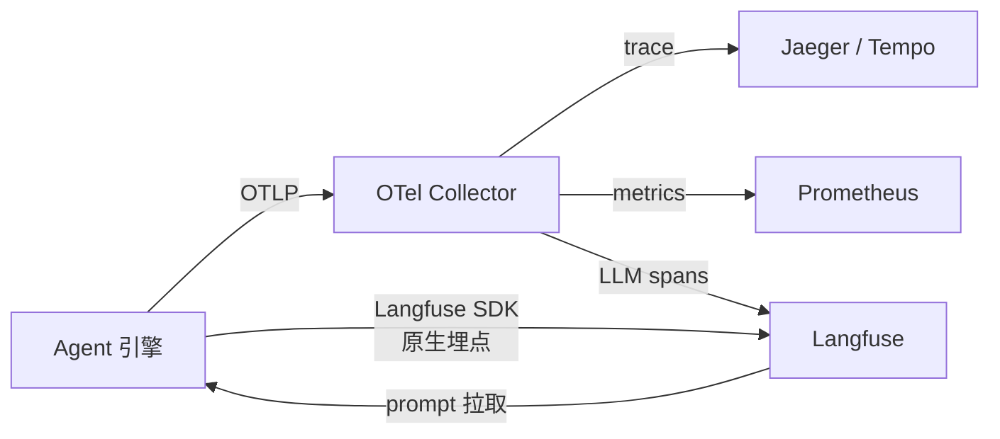
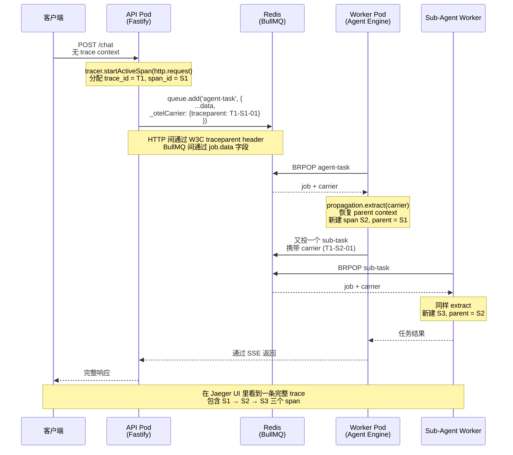

## 两个具体问题

第一个问题是延迟。租户 B 的 PM 周一早上提工单：「上周五下午开始，AgentFlow 慢得离谱，用户投诉一堆。」打开 Grafana，p95 延迟确实从 1.2s 涨到 4.8s，但卡点在哪里？Agent 一次对话至少要经过：API 网关 → Agent 引擎 → 多次 LLM 调用 → 多次 RAG 检索 → 多次 Skill 执行。Grafana 只能告诉你「总耗时长」，但具体是哪一步？是某次 LLM 调用突然变慢？是 pgvector 查询命中了冷数据？还是 Skill 调用的下游 ERP 抖动？没有分布式追踪，根本说不清——只能去 Worker 日志里捞 ts 时间戳逐条对照，半个小时定位一次故障。

第二个问题是钱。月底财务跑过来要按租户分摊 LLM 成本，但 Anthropic 的账单只给一个总数。AgentFlow 里租户 A、B、C 共用同一套 Agent 引擎、同一个 API key，OpenAI/Anthropic 那边看到的只是聚合调用，他们不知道哪一笔属于哪个租户。要分摊成本，必须在调用 LLM 的瞬间打上租户标签、记录 input_tokens 和 output_tokens、按各家定价表算出美金或人民币，然后聚合出每租户每天的成本曲线。这件事 OTel 默认不做、Datadog 不做、Anthropic 自家 dashboard 也不做。

这两个问题各自需要一套基础设施。延迟、错误率、依赖链路这种基础设施层面的事，用 OpenTelemetry（OTel）解决。LLM 调用质量、token 成本、prompt 版本、Agent 评估这种 LLM 应用特有的事，用 Langfuse 解决。两者数据通过 OTLP 协议串联，本章把它们一起搭起来。

## 11.1 双层观测：OTel + Langfuse

把基础设施可观测和 LLM 可观测拆成两套系统，不是因为想多花钱，而是这两件事的数据模型差得太远。

**OTel（OpenTelemetry）** 是 CNCF 孵化的开源可观测标准，对应商业产品是 Datadog、New Relic、Dynatrace 这一类 APM。它的数据模型是 trace（一次请求）→ span（请求里的某个操作），核心解决的是「服务 A 调用服务 B 慢了，慢在网络还是慢在 B 自己」这类问题。OTel 的 auto-instrumentations 知道 HTTP 是什么、Postgres 是什么、Redis 是什么，但它**不知道 LLM 是什么**——更准确地说，它不知道 prompt token、cache hit、temperature、Agent step 这些概念。给 OTel 发一个 span 叫 `llm-call`，OTel 会老老实实记录耗时，但「这个 span 花了多少钱」「输入 prompt 是什么」「输出 token 怎么计费」它一概不管。

**Langfuse** 是专门给 LLM 应用做的可观测产品（自托管开源 + 云版本），数据模型是 trace → generation/span/event。它原生理解 LLM——输入 prompt、输出 completion、token usage、模型版本、prompt template、评估打分都是一等公民。Langfuse 缺的恰好是 OTel 擅长的那部分：它不监控 Postgres 慢查询、不画 Redis 内存曲线、不追踪 BullMQ 队列堆积。

两套数据互补，不能合二为一。但好消息是：从 v3 开始 Langfuse 接受 OTLP 协议输入，意味着你可以让 OTel SDK 把同一份 trace 数据同时发到 Jaeger（给 SRE 看延迟分布）和 Langfuse（给算法工程师看 prompt 质量）。本章后续的代码都按这个思路组织。

下面这张图说明 AgentFlow 的观测数据流向：



OTel Collector 是中间路由层，业务代码只发给 Collector，Collector 决定数据往哪儿分流。生产中通常会跑一个 Collector DaemonSet，每个 Pod 把数据发到本地 Collector，再由 Collector 批量、压缩、签名后发到中心。

## 11.2 OTel 基础

这一节假设读者没接触过 OTel，先把概念讲清楚。

**Trace**：一次完整的端到端请求处理。用户在小程序里点「查我的订单」，从 API 网关收到 HTTP 请求开始，到把响应送回去结束，整个过程是一个 trace。Trace 有一个全局唯一的 `trace_id`。

**Span**：trace 内的一个操作单元。「调用 Anthropic API」是一个 span，「查 pgvector 拿相关文档」是另一个 span。Span 之间有父子关系——`agent.step` 是父 span，它下面的 `agent.planner`、`agent.executor`、`agent.reflector` 是子 span。Span 有 `span_id`，引用父 span 的 `parent_span_id`。

**Context Propagation**：trace_id 在服务间传递的机制。HTTP 服务间走 `traceparent` header（W3C Trace Context 标准），消息队列里走自定义 metadata。没有 propagation，跨服务的 span 就串不起来，每个服务看到的都是局部 trace。

**Resource / Attribute**：附在 trace 和 span 上的标签。Resource 是 process 级（service.name、service.version、deployment.environment），Attribute 是 span 级（tenant.id、user.id、gen_ai.request.model）。查询 trace 的时候按这些 attribute 过滤——「过去 1 小时租户 A 的 p95 延迟」就是按 `tenant.id=A` 过滤再算分位数。

### 最小可行接入

Node.js 接入 OTel 的最少代码：

```typescript
// otel-init.ts —— 必须在业务代码之前 import
import { NodeSDK } from '@opentelemetry/sdk-node';
import { getNodeAutoInstrumentations } from '@opentelemetry/auto-instrumentations-node';
import { OTLPTraceExporter } from '@opentelemetry/exporter-trace-otlp-http';
import { Resource } from '@opentelemetry/resources';
import { ATTR_SERVICE_NAME, ATTR_SERVICE_VERSION } from '@opentelemetry/semantic-conventions';

const sdk = new NodeSDK({
  resource: new Resource({
    [ATTR_SERVICE_NAME]: 'agentflow-api',
    [ATTR_SERVICE_VERSION]: process.env.SERVICE_VERSION ?? 'dev',
    'deployment.environment': process.env.NODE_ENV ?? 'development',
  }),
  traceExporter: new OTLPTraceExporter({
    url: process.env.OTEL_EXPORTER_OTLP_ENDPOINT ?? 'http://localhost:4318/v1/traces',
  }),
  instrumentations: [getNodeAutoInstrumentations()],
});

sdk.start();
```

> **生产注意**：上面用的是 `@opentelemetry/resources@1.x` 的 `new Resource()` 构造器。如果升级到 2.x，对应 API 改成 `resourceFromAttributes({...})`——两套互不兼容，升级时整套 OTel 包要一起升。

两个细节要注意。第一，`otel-init.ts` 必须在所有业务模块加载**之前**执行——OTel 通过 monkey-patch 给各种库打补丁，业务代码已经 `require` 完了再启动 OTel 就来不及了。第二，`getNodeAutoInstrumentations()` 会自动注入一大堆 instrumentation 包：HTTP、HTTPS、DNS、fs、net、Postgres、Redis、Fastify、Express、AWS SDK 等等。大多数你不会用到，启动开销也不大。

入口脚本里要这么写：

```typescript
// src/index.ts
import './otel-init';   // 必须放第一行
import { startServer } from './server';

startServer();
```

> **生产注意**：OTel 默认是 BatchSpanProcessor，攒够一批再发到 Collector。如果进程崩溃，最后那批 span 会丢。重要 span（比如审计相关的）要么主动 `sdk.shutdown()`，要么改成 SimpleSpanProcessor（同步发，性能差但保险）。

### 看到第一条 trace

启动 Jaeger（OTel Collector 的默认下游之一），把 OTel exporter 指向 Jaeger 的 4318 端口，跑一次业务请求，在 Jaeger UI 里就能看到 trace。本章 `examples/` 里附带 `docker-compose.yml` 把 Jaeger + Langfuse 一起拉起来。

## 11.3 手动埋点：Agent 关键路径

auto-instrumentations 能给你 HTTP/Postgres/Redis 这些标准库的 span，但它不知道「agent step」「planner」「executor」是什么概念。Agent 的关键路径必须手动埋点，否则 trace 看上去只有「HTTP 请求 1.2s」一条线，里面到底干了什么完全是黑盒。

```typescript
import { trace, SpanStatusCode, SpanKind } from '@opentelemetry/api';

const tracer = trace.getTracer('agent-engine', '1.0.0');

export async function runAgentStep(input: AgentInput): Promise<AgentOutput> {
  // 一次 Agent step 是 trace 里的根 span（如果是 HTTP 触发的，则是子 span）
  return tracer.startActiveSpan(
    'agent.step',
    { kind: SpanKind.INTERNAL },
    async (span) => {
      // 业务标签全部用低基数维度
      span.setAttribute('tenant.id', input.tenantId);
      span.setAttribute('session.id', input.sessionId);
      span.setAttribute('agent.step.type', input.stepType);
      span.setAttribute('agent.step.iteration', input.iteration);

      try {
        // Planner：决定下一步做什么
        const plan = await tracer.startActiveSpan('agent.planner', async (s) => {
          // GenAI semantic conventions —— OTel 的半官方标准，下一节详述
          s.setAttribute('gen_ai.system', 'anthropic');
          s.setAttribute('gen_ai.request.model', 'claude-sonnet-4-5');
          s.setAttribute('gen_ai.request.temperature', 0.2);

          const result = await llmGateway.complete({
            model: 'claude-sonnet-4-5',
            messages: input.messages,
            tenantId: input.tenantId,
          });

          s.setAttribute('gen_ai.usage.input_tokens', result.usage.inputTokens);
          s.setAttribute('gen_ai.usage.output_tokens', result.usage.outputTokens);
          s.setAttribute('gen_ai.usage.cache_read_input_tokens', result.usage.cacheReadTokens ?? 0);
          s.setAttribute('gen_ai.response.id', result.id);
          s.end();
          return result;
        });

        // Executor：并行调用多个 Skill
        const skillResults = await tracer.startActiveSpan('agent.executor', async (s) => {
          s.setAttribute('agent.executor.skill_count', plan.toolCalls.length);
          const results = await Promise.all(
            plan.toolCalls.map((call) =>
              tracer.startActiveSpan(`skill.${call.name}`, async (cs) => {
                cs.setAttribute('skill.name', call.name);
                cs.setAttribute('skill.input.size', JSON.stringify(call.args).length);
                try {
                  const r = await skillRegistry.invoke(call.name, call.args);
                  cs.setAttribute('skill.output.size', JSON.stringify(r).length);
                  return r;
                } finally {
                  cs.end();
                }
              }),
            ),
          );
          s.end();
          return results;
        });

        // Reflector：决定是否继续下一步
        // ……（略）

        span.setStatus({ code: SpanStatusCode.OK });
        return { plan, skillResults };
      } catch (err) {
        span.recordException(err as Error);
        span.setStatus({ code: SpanStatusCode.ERROR, message: (err as Error).message });
        throw err;
      } finally {
        span.end();
      }
    },
  );
}
```

几个关键设计：

**用 `startActiveSpan` 而不是 `startSpan`**：前者会把新创建的 span 设为「当前 active context」，子 span（包括自动埋点的 HTTP、DB 调用）会自动挂到这个 span 下面。如果用 `startSpan`，子 span 会丢父子关系。

**异常路径要主动 `recordException + setStatus`**：OTel 默认不会把 throw 出去的异常自动记到 span 上。错过这一步，trace 里只能看到「这个 span 耗时 30s 然后突然结束」，看不到错误堆栈。

**`span.end()` 必须执行**：忘记调用 `end()`，span 会一直挂在内存里，最终被 batch processor 因超时丢掉。`startActiveSpan` 的 callback 形式**不会自动 end**——它只负责把 span 设为 active context，end 必须自己调。最稳的写法是 `try/finally` 包住，无论正常返回还是抛异常都能 end。

### GenAI semantic conventions

OTel 社区在维护一组针对 LLM 应用的 semantic conventions（半官方标准，状态是 Experimental，会偶尔变），关键约定：

| 属性名 | 含义 | 示例 |
|--------|------|------|
| `gen_ai.system` | LLM 提供方 | `anthropic`、`openai`、`bedrock` |
| `gen_ai.request.model` | 请求模型 | `claude-sonnet-4-5` |
| `gen_ai.response.model` | 实际响应模型（可能不同） | `claude-sonnet-4-5` |
| `gen_ai.request.temperature` | 温度参数 | `0.2` |
| `gen_ai.usage.input_tokens` | 输入 token 数 | `1234` |
| `gen_ai.usage.output_tokens` | 输出 token 数 | `567` |
| `gen_ai.usage.cache_read_input_tokens` | 命中 prompt cache 的输入 token | `980` |
| `gen_ai.response.finish_reasons` | 结束原因数组 | `["stop"]` |

按这套约定打 attribute，Jaeger、Tempo、Grafana 等下游工具都能自动识别和聚合。Langfuse 接收 OTLP 数据时也按这些字段映射到自己的 generation 模型。

> **生产注意**：不要把完整 prompt 和 completion 内容塞进 span attribute——prompt 动辄上万 token，attribute 有大小上限（默认 12KB），超出会被截断或拒绝。完整内容用 Langfuse 的 generation 存储（专门为此优化的存储），span 里只放 token 数等结构化指标。

## 11.4 跨 Agent 边界的 trace 传播

AgentFlow 的请求路径不是单进程内一条直线。一次用户请求可能触发以下跨进程动作：

1. API（Fastify）收到 HTTP 请求，往 BullMQ 投一个 `agent-task`
2. Worker 进程消费任务，启动 Agent 引擎
3. Agent 在 Reflector 阶段决定调用 Sub-Agent，给 Sub-Agent Worker 队列再投一个任务
4. Sub-Agent Worker 完成后，把结果回写主任务

要让这四步在 Jaeger 里串成一个 trace，必须把 trace context 在每次跨进程时显式传播。下图（图 11-2，跨进程 trace 传播）展示了 trace_id 在两类边界上的传递方式：



HTTP 边界靠 OTel auto-instrumentation 自动处理（W3C `traceparent` header），不用写代码。BullMQ 边界必须显式 `propagation.inject` / `propagation.extract`，把 carrier 塞进 `job.data` 跟随任务一起持久化到 Redis。少了这步，trace 在 BullMQ 边界处断成两段，Jaeger 里就是两条互相独立的 trace。

### HTTP 服务间：自动

W3C Trace Context 标准定义了 `traceparent` 和 `tracestate` 两个 HTTP header。OTel 的 HTTP instrumentation 默认会注入和提取这两个 header，所以纯 HTTP 链路上不需要写任何代码。验证方法：在被调用服务的入口打印 `req.headers.traceparent`，应该能看到形如 `00-0af7651916cd43dd8448eb211c80319c-b7ad6b7169203331-01` 的字符串。

### BullMQ 任务间：手动

BullMQ 的 job 数据是 JSON，OTel 官方 instrumentation 列表里没有 BullMQ。社区有第三方包（如 `@appsignal/opentelemetry-instrumentation-bullmq`、`@jenniferplusplus/opentelemetry-instrumentation-bullmq`），但它们的维护节奏跟不上 BullMQ 主线版本，且行为不够透明。推荐自己显式 inject/extract——代码量很小，可控性高。

```typescript
import { trace, propagation, context, SpanKind } from '@opentelemetry/api';
import { Queue, Worker } from 'bullmq';

const tracer = trace.getTracer('agent-task');

// ============ 生产端：投任务时注入 context ============
export async function enqueueAgentTask(queue: Queue, data: TaskPayload): Promise<void> {
  // 用一个普通对象当 carrier，propagation 会把当前 active context 序列化进去
  const carrier: Record<string, string> = {};
  propagation.inject(context.active(), carrier);

  await queue.add('agent-task', {
    ...data,
    _otelCarrier: carrier, // 跟随 job data 一起持久化到 Redis
  });
}

// ============ 消费端：处理任务前提取 context ============
export function createAgentWorker(queueName: string) {
  return new Worker(
    queueName,
    async (job) => {
      const carrier = (job.data._otelCarrier ?? {}) as Record<string, string>;
      // 把 carrier 里的 traceparent 提取回 OTel context
      const parentCtx = propagation.extract(context.active(), carrier);

      // 用 SpanKind.CONSUMER 表示这是消息队列的消费者侧
      return context.with(parentCtx, async () => {
        return tracer.startActiveSpan(
          'agent-task.process',
          { kind: SpanKind.CONSUMER },
          async (span) => {
            span.setAttribute('job.id', job.id ?? 'unknown');
            span.setAttribute('queue.name', queueName);
            try {
              const result = await processAgentTask(job.data);
              return result;
            } catch (err) {
              span.recordException(err as Error);
              throw err;
            } finally {
              span.end();
            }
          },
        );
      });
    },
    { connection: { host: 'localhost', port: 6379 } },
  );
}
```

`context.with(parentCtx, fn)` 是关键。它把 parentCtx 设为「在 fn 执行期间的 active context」，fn 里创建的任何 span（包括 auto-instrumentations 创建的）都会挂到这个 context 的根 span 下。

> **生产注意**：Redis 单 value 上限是 512MB，但实际生产建议单 job 不超过 1MB——大 job 会拖累 BLPOP、阻塞主线程、放大网络带宽。carrier 序列化后通常只有 100-200 字节，可以忽略。但如果有人复制粘贴时把整个 trace 对象塞进 carrier，就会跑偏——所以代码里始终用 `propagation.inject` 而不是手动 `JSON.stringify(span)`。

## 11.5 Langfuse 接入

第 2 章在 Docker Compose 里已经把 Langfuse 拉起来了，本节讲怎么往里写数据。

### 方式 1：原生 SDK

原生 SDK 的好处是精细控制——可以单独命名每个 generation、单独打分、关联 prompt 版本。坏处是要在业务代码里多写一层埋点：

```typescript
import { Langfuse } from 'langfuse';

const langfuse = new Langfuse({
  publicKey: process.env.LANGFUSE_PUBLIC_KEY!,
  secretKey: process.env.LANGFUSE_SECRET_KEY!,
  baseUrl: process.env.LANGFUSE_BASE_URL ?? 'http://localhost:3000',
  // 默认 batch flush，关进程前要 await shutdownAsync 否则丢数据
  flushAt: 15,
  flushInterval: 10_000,
});

export async function chatWithLangfuse(input: ChatInput): Promise<ChatOutput> {
  // 创建一个 trace —— 对应一次完整对话
  const lfTrace = langfuse.trace({
    name: 'customer-service-chat',
    userId: input.userId,
    sessionId: input.sessionId,
    metadata: {
      tenantId: input.tenantId,
      requestId: input.requestId,
    },
    tags: ['production', input.tenantId],
  });

  // 在 trace 下创建一个 generation —— 对应一次 LLM 调用
  const generation = lfTrace.generation({
    name: 'main-llm-call',
    model: 'claude-sonnet-4-5',
    modelParameters: { temperature: 0.2, maxTokens: 2048 },
    input: input.messages,
  });

  try {
    const response = await llmGateway.complete({
      messages: input.messages,
      model: 'claude-sonnet-4-5',
    });

    // 结束 generation —— 关键：要带 usage，Langfuse 据此算成本
    generation.end({
      output: response.content,
      usage: {
        input: response.usage.inputTokens,
        output: response.usage.outputTokens,
        total: response.usage.totalTokens,
        unit: 'TOKENS',
      },
    });

    lfTrace.update({ output: response.content });
    return { content: response.content };
  } catch (err) {
    generation.end({ level: 'ERROR', statusMessage: (err as Error).message });
    throw err;
  }
}
```

注意 `langfuse.shutdownAsync()` 必须在进程退出前调用，否则 batch 队列里的 trace 会丢。Fastify 里通常这么写：

```typescript
fastify.addHook('onClose', async () => {
  await langfuse.shutdownAsync();
});
```

### 方式 2：通过 OTLP

Langfuse v3 起接受 OTLP HTTP 输入，端点是 `<langfuse-base>/api/public/otel/v1/traces`。配置 OTel 多 exporter，把同一份 trace 同时发到 Jaeger 和 Langfuse：

```typescript
// otel-init.ts
import { BatchSpanProcessor } from '@opentelemetry/sdk-trace-base';
import { OTLPTraceExporter } from '@opentelemetry/exporter-trace-otlp-http';

const jaegerExporter = new OTLPTraceExporter({
  url: 'http://localhost:4318/v1/traces',
});
const langfuseExporter = new OTLPTraceExporter({
  url: 'http://localhost:3000/api/public/otel/v1/traces',
  headers: {
    Authorization: `Basic ${Buffer.from(
      `${process.env.LANGFUSE_PUBLIC_KEY}:${process.env.LANGFUSE_SECRET_KEY}`,
    ).toString('base64')}`,
  },
});

const sdk = new NodeSDK({
  // ...
  spanProcessors: [
    new BatchSpanProcessor(jaegerExporter),
    new BatchSpanProcessor(langfuseExporter),
  ],
});
```

按 GenAI semantic conventions 打 attribute（`gen_ai.system`、`gen_ai.usage.*`）后，Langfuse 会自动识别为 generation 并算出成本。

两种方式可以混用：基础 LLM 调用走 OTLP（统一基础设施），需要打分、版本化的关键场景走原生 SDK。AgentFlow 的策略是入口对话用 OTLP，离线评估和 prompt 实验用原生 SDK。

### 多租户配置

按租户分摊成本有两种做法：

1. **同一个 Langfuse project，按 metadata.tenantId 过滤**：实施简单，所有租户数据混在一起，查询时用 filter。适合内部用——SRE 和算法工程师看全局趋势方便。
2. **每租户一个 Langfuse project**：数据物理隔离，可以单独发 API key 给客户租户后台。适合外部用——给租户提供「本租户成本/质量 dashboard」时不会泄漏其他租户数据。

AgentFlow 用方案 1 做内部观测，对外暴露的「租户控制台」用单独的 API 从 Langfuse 拿数据再渲染。

## 11.6 Prompt 版本管理与 A/B 测试

System prompt 改一行能让 Agent 准确率下降 10%。这事在传统软件工程里不存在——代码改 1 行有 git diff、有 code review、有单测、有灰度。Prompt 现在大多数团队的做法是塞在 ts 文件里当字符串常量，跟随代码一起部署。这有两个问题：

1. **变更不可独立发布**：改 prompt 必须发版，发版必须走 CI/CD，CI/CD 平均要 10 分钟。出了线上事故想回滚 prompt，等不起。
2. **A/B 测试做不了**：想验证「prompt v2 比 v1 准确率高」，需要 50% 流量走 v1、50% 走 v2，对比指标。代码里 if/else 切流可以做，但版本管理、灰度比例、回滚都要自己写。

### Langfuse Prompt Management

Langfuse 内置 prompt 仓库，支持：

- 多版本存储，每个版本带标签（`production`、`staging`、`experiment-A`）
- 通过 SDK 按 label 拉取（带本地 cache）
- 在 UI 里改 prompt、即时生效、随时回滚
- 关联到使用它的 generation，可以看「prompt v3 的平均评分高于 v2」

```typescript
import { Langfuse } from 'langfuse';

const langfuse = new Langfuse({ /* ... */ });

export async function runAgentWithVersionedPrompt(input: AgentInput) {
  // 拉取 production label 的最新版本，带 60 秒缓存
  const prompt = await langfuse.getPrompt(
    'customer-service-system',
    undefined,
    { cacheTtlSeconds: 60, label: 'production' },
  );

  // 编译模板变量（langfuse 支持 mustache 风格的 {{var}}）
  const compiled = prompt.compile({
    tenantName: input.tenantName,
    productName: input.productName,
    currentDate: new Date().toISOString(),
  });

  // 这次对话先开一个 trace，再挂 generation
  const lfTrace = langfuse.trace({
    name: 'customer-service-chat',
    sessionId: input.sessionId,
  });

  const generation = lfTrace.generation({
    name: 'agent-main',
    model: 'claude-sonnet-4-5',
    prompt, // 关联 prompt 版本 —— 关键
    input: [{ role: 'system', content: compiled }, ...input.messages],
  });

  const result = await llmGateway.complete({
    system: compiled,
    messages: input.messages,
  });

  generation.end({
    output: result.content,
    usage: { input: result.usage.inputTokens, output: result.usage.outputTokens, unit: 'TOKENS' },
  });
}
```

关键是 `generation` 创建时传入 `prompt` 对象。这一步把 generation 和 prompt 版本关联起来，在 Langfuse UI 里就能按 prompt 版本聚合质量指标。

### A/B 测试与灰度

Langfuse 的 prompt label 是字符串，多个版本可以共享 label，也可以独占 label。一种实用做法是：

- `production` label：稳定版，承载 95% 流量
- `experiment` label：实验版，承载 5% 流量

在业务代码里按 session 或 user 哈希分流：

```typescript
function pickPromptLabel(sessionId: string): 'production' | 'experiment' {
  const hash = createHash('sha1').update(sessionId).digest()[0];
  return hash < 13 ? 'experiment' : 'production'; // 5% 走 experiment
}
```

监控两个版本的核心指标（准确率、用户满意度、成本），实验版优于生产版 → 把 production label 切到实验版本号上 → 全量。

### Prompt CI/CD

Prompt 上线流程参照灰度发布的逻辑：

1. **变更**：在 Langfuse UI 里创建新版本，打 `staging` label
2. **评估**：跑离线评估（11.7 节），对比关键指标
3. **小流量**：staging 通过 → 打 `experiment` label，5% 流量
4. **监控**：观察 24-48 小时，看错误率、满意度、成本
5. **全量**：指标无回归 → 把 `production` label 切过来
6. **回滚**：发现问题 → UI 一键把 `production` label 退回上一版本，无需发版

> **生产注意**：Langfuse 的 prompt cache 是进程内 LRU。回滚 prompt 后，所有跑着的 Pod 要等 `cacheTtlSeconds` 过期才会拉新版本。紧急回滚场景下，把 TTL 设短点（30 秒），或者部署 SIGUSR1 信号让 Pod 主动清缓存。

## 11.7 Agent 评估（Evals）

改了 prompt 之后怎么判断「变好了」还是「变差了」？凭直觉看几个 case 不够——样本太小，且对错偏见严重。需要一套可重复执行、可量化对比的评估机制。这就是 evaluation（evals）。

### 三种评估类型

**Pointwise 单点评估**：单个输入 → 单个输出 → 单个分数。比如「用户问『查我的订单』，Agent 回复『订单号 XYZ123，已发货』，相关性打 5 分」。每条样本独立评分，最后算平均。

**Pairwise 对比评估**：单个输入 → 两个候选输出 → 选哪个更好。比如「同一个用户问题，prompt v1 答 A、prompt v2 答 B，哪个更好？」适合 A/B 对比，结果是 Win/Loss/Tie 比例。

**端到端评估**：完整多轮对话 → 最终业务结果是否达成。比如「用户想退款，5 轮对话后是否成功提交退款工单？」端到端是最贴合业务的，但最难标注——需要业务专家审。

### LLM as Judge

人工标注又慢又贵。AgentFlow 用 LLM as Judge 做大规模评估：用一个 LLM（通常比业务模型更强或同等的模型）按打分 rubric 给样本评分。

```typescript
import { z } from 'zod';

const RelevanceScoreSchema = z.object({
  score: z.number().min(1).max(5),
  reasoning: z.string(),
});

export async function evaluateRelevance(
  userMessage: string,
  agentResponse: string,
): Promise<z.infer<typeof RelevanceScoreSchema>> {
  const judgePrompt = `你是评估专家。给定用户问题和 Agent 回复，评估回复的相关性。

评分规则：
- 5 = 完全相关，直接命中用户意图
- 4 = 相关，覆盖主要意图
- 3 = 部分相关，遗漏关键信息
- 2 = 弱相关，答非所问但有部分关联
- 1 = 完全不相关

用户问题：${userMessage}
Agent 回复：${agentResponse}

只输出严格的 JSON：{"score": number, "reasoning": "string"}`;

  const result = await llmGateway.complete({
    model: 'claude-sonnet-4-5',
    messages: [{ role: 'user', content: judgePrompt }],
    temperature: 0, // 评估场景 temperature 必须 = 0
  });

  return RelevanceScoreSchema.parse(JSON.parse(result.content));
}
```

几个细节：

**temperature 必须 = 0**：评估要可重复，同样的输入应该给同样的分数。temperature > 0 会引入随机性，无法对比。

**评分维度要明确**：rubric 要写死边界条件，否则不同次评估会漂移。「5 分」是什么、「3 分」是什么，写清楚。

**输出强约束**：用 JSON Schema（或 Zod）校验输出格式。LLM 偶尔会给「Sure, here's the JSON: {...}」前缀，要 parse 失败时重试或 fallback。

**Judge 模型选择**：用比业务模型更强的或同档次的。用更弱的 Judge 会系统性低估好答案、高估差答案。生产中 Judge 模型本身也是成本，按对比关系挑（业务用 Sonnet，Judge 也用 Sonnet 是个稳妥起点）。

### Pairwise 评估

```typescript
const PairwiseSchema = z.object({
  winner: z.enum(['A', 'B', 'tie']),
  reasoning: z.string(),
});

export async function pairwiseCompare(
  userMessage: string,
  responseA: string,
  responseB: string,
) {
  // 位置偏见：LLM 倾向于选第一个，要随机交换位置后再判
  const swap = Math.random() < 0.5;
  const [first, second] = swap ? [responseB, responseA] : [responseA, responseB];

  const result = await llmGateway.complete({
    model: 'claude-sonnet-4-5',
    temperature: 0,
    messages: [
      {
        role: 'user',
        content: `给定用户问题和两个 Agent 回复，判断哪个更好。

用户问题：${userMessage}

回复 1：${first}
回复 2：${second}

只输出 JSON：{"winner": "1" | "2" | "tie", "reasoning": "..."}`,
      },
    ],
  });

  const raw = JSON.parse(result.content);
  // 翻译回原始 A/B
  let winner: 'A' | 'B' | 'tie';
  if (raw.winner === 'tie') winner = 'tie';
  else if (raw.winner === '1') winner = swap ? 'B' : 'A';
  else winner = swap ? 'A' : 'B';

  return { winner, reasoning: raw.reasoning };
}
```

位置偏见（position bias）是 Judge LLM 的已知问题——给同一对答案，把 A/B 顺序换一下，结果可能反过来。生产里用「双向评估取平均」或「随机交换 + 单次评估」减小偏差，后者成本低，本书默认用后者。

### 评估数据集

数据来源三种：

1. **从生产 trace 抽样**：Langfuse 里按时间窗口导出真实对话，是分布最贴合线上的数据。但有偏——只覆盖已经出现过的场景。
2. **人工标注**：业务专家挑 200-500 条典型案例，写期望答案。慢、贵、但是金标。AgentFlow 把这部分叫「regression set」，每次发版必跑。
3. **合成数据**：边缘 case（用户骂人、prompt 注入、跨语言）线上少，用 LLM 生成 + 人工挑选。

三类数据各占一部分，总量 500-1000 条是个起步规模。

### 回归测试

发版前在 CI 里跑评估，关键指标退步超过阈值阻断发布。简化版：

```typescript
const baseline = await loadBaselineMetrics(); // 上一次发版的评估结果
const current = await runEvalsOnDataset('regression-set');

if (current.relevance < baseline.relevance - 0.05) {
  throw new Error(`Relevance 退步 ${baseline.relevance - current.relevance}，阻断发布`);
}
if (current.cost > baseline.cost * 1.2) {
  throw new Error(`成本上涨超过 20%，阻断发布`);
}
```

CI 里跑 500 条评估，每条 1-2 次 LLM 调用，整体成本几美金、耗时 5-10 分钟。比上线后才发现退步便宜得多。

## 11.8 关键指标与告警

可观测最后落到一组要看的数字和要响的警报上。把 AgentFlow 的核心指标分三类。

### 性能指标

- **p50 / p95 / p99 响应时间**：按 endpoint 和 tenant.id 双重分组。p95 比 p50 重要——p50 是「中位用户感受」，p95 才是「快炸了的用户感受」。
- **TTFT（Time To First Token）**：流式响应专用。用户在前端看到第一个字的等待时间。LLM 在生成阶段慢不要紧，等 5 秒才出第一个字就是事故。
- **Agent step 平均耗时**：单步的耗时，按 step.type（planner、executor、reflector）分组。某一类突然变慢能立刻定位。
- **单次对话 LLM 调用次数**：Agent 跑飞的标志。正常对话 3-5 次 LLM 调用，跑飞会跑到 50+。

### 业务指标

- **每租户每日 token 消耗**：成本追踪基础。input/output/cache_read 分开记录，因为价格不同。
- **Skill 调用成功率**：每个 Skill 单独看。某个 Skill 成功率从 99% 跌到 90% 通常是下游服务出问题。
- **Cache 命中率**：prompt cache（Anthropic 的 cache_read_input_tokens / total_input_tokens）和语义 cache（你自己实现的）分开看。
- **用户满意度**：消息后面的点赞/点踩按钮，简单但有效。
- **意图识别准确率**：把意图分类当成独立任务，离线评估。

### 告警规则

告警的本质是「值班同学要不要从床上爬起来」。规则要严，否则狼来了。AgentFlow 用的几条：

- **p95 响应时间 > 5s 持续 5 分钟**：用户体验已经出问题。
- **错误率 > 2% 持续 3 分钟**：明确的服务降级。
- **单租户每小时 token 消耗 > 日均值 × 3**：可能是被刷接口、可能是 prompt 失控、可能是用户在搞攻击。
- **单次请求 input_tokens > 100K**：很可能 RAG 召回出问题，把全库塞进 context。
- **Agent step iteration > 20**：Reflector 没有正常停止条件，Agent 跑飞了。
- **Langfuse / Jaeger 自身宕机**：观测系统挂了比业务挂了更可怕——业务挂了你看得见，观测挂了你瞎了。

告警通道分级：P0 直接电话，P1 IM + 短信，P2 IM。日均不超过 3 条 P1，否则告警疲劳，谁都不看。

> **生产注意**：告警一定要有 runbook 链接——告警内容里附排查文档 URL。半夜两点被叫醒的人没空翻 wiki，runbook 第一步要说「先看这个 dashboard」。

## 对三个租户意味着什么

可观测三件事——成本、质量、合规——三个租户各拿一件作为主诉求。

**租户 A（电商）**：按租户分摊 LLM 成本是 SaaS 计费的关键指标，11.5 节 Langfuse 的 trace 里每个 span 都打上 `tenant.id` 和 `model.name`，月底直接按租户聚合 token usage 出账单。租户 A 流量大、利润薄，这套核算精度直接决定能不能赚到钱。

**租户 B（SaaS 软件）**：核心问题不是"agent 跑得快不快"，是"agent 答得对不对"。11.7 节的 Evals（LLM-as-judge + 离线评估集）是租户 B 的产品 KPI 之一——每次产品文档更新后，自动跑评估集回归测试，确保新 chunk 没把回答质量拖坏。

**租户 C（金融机构）**：所有 trace 都要留 7 年（监管要求），不能依赖 Langfuse 自己的默认 90 天保留期。OTel Collector 在导出 Langfuse 之外，还要把 trace 镜像一份到合规专用的冷存储（带对象锁），保留期单独配置。审计抽查时按 trace_id 能拉出完整对话链。

## 本章小结

可观测性分两层：OTel 解决基础设施和服务间链路，Langfuse 解决 LLM 调用质量和成本。两者通过 OTLP 协议串联，但保留各自数据模型。手动埋点的关键路径是 Agent 引擎的 `agent.step / planner / executor / reflector`，必须用 GenAI semantic conventions 打标签，token 和模型名都按约定字段塞 attribute。跨进程 trace（HTTP、BullMQ）必须显式传 context，否则 trace 在边界处断成两截。Prompt 用 Langfuse 版本化管理，发版前在 CI 里跑评估集做回归测试。告警规则要严，宁可少不可滥，每条告警必须配 runbook。

## 参考资料

- OpenTelemetry 官方文档：https://opentelemetry.io/docs/
- OTel GenAI semantic conventions：https://opentelemetry.io/docs/specs/semconv/gen-ai/
- Langfuse 文档：https://langfuse.com/docs
- W3C Trace Context 规范：https://www.w3.org/TR/trace-context/
- BullMQ 与 OTel 集成讨论：https://github.com/taskforcesh/bullmq/discussions
- LLM as Judge 论文（MT-Bench）：https://arxiv.org/abs/2306.05685
